# Xbox Multiplayer Analysis Tool

## Current Build Status
[](https://github.com/microsoft/xbox-multiplayer-analysis-tool/actions/workflows/dotnet-desktop.yml)

## OpenSSF Best Practices
[](https://www.bestpractices.dev/projects/9612)

## Description

Xbox Multiplayer Analysis Tool is a network traffic capturing tool to aid in the debugging of Xbox & PlayFab services issues and other network
traffic from both a PC and Xbox development console. It incorporates features to proxy web and low-level
network requests and responses in real-time, decrypt and view SSL traffic, modify traffic on the fly, and
analyze Xbox services and network traffic for problems.

The web proxy supports HTTP/1.1 and HTTP/2 over TLS using ALPN negotiation, with automatic HTTP/1.1 fallback.
WebSocket traffic passing through the proxy is also captured and can be inspected alongside regular web requests.

## Basic Environment Requirements & Dependencies

|  |Web Proxy | Low Level Network Capture| Notes |
|--|--|--|--|
|Xbox Developer Kit| :heavy_check_mark: | :heavy_check_mark: |Requires an Xbox One or Xbox Series developer kit running recovery 2106 or higher.|
|Windows PC| :heavy_check_mark: | :heavy_check_mark: |Requires a Windows machine running Windows 10 (17763 or higher) or Windows 11|
|Generic Device | :heavy_check_mark: | :x: | Web proxy requires a device capable of utilizing a .cer certificate in combination with settings for the devices proxy IP and port. |

## Table of Contents

- **[Local Agent Access](#local-agent-access)**
- **[Web Proxying with a Device](#web-proxying-with-a-device)**
- **[Viewing WebSocket Messages](#viewing-websocket-messages)**
- **[Scripting & Modification of Web Proxy Traffic](#scripting--modification-of-web-proxy-traffic)**
- **[Saving, Loading, Importing & Exporting Captures](#saving-loading-importing--exporting-captures)**
- **[Live Trace Analysis](#live-trace-analysis)**
- **[Network Capture](#network-capture)**
- **[Network Capture Analysis](#network-capture-analysis)**
- **[Appearance](#appearance)**
- **[Known Issues](#known-issues)**
- **[Support](#support)**
- **[Trademarks](#trademarks)**


## SQL workspace

Choose **Analysis > New SQL Query** to open a document in **SQL Queries**; the **Captures** workspace retains its device tabs, analysis views and splitter state. SQL always targets the explicitly selected active/current-loaded database, not the capture grid's device or visual filters. Stop all captures before running or refreshing schema; editing remains available during capture.

The local AvalonEdit editor provides highlighting, line numbers, schema search, table/column insertion, generated SELECTs, examples, basic alias-aware completion, and session-only history. **F5 / Ctrl+Enter** runs the selection when present, otherwise the document; **Ctrl+Space** opens completion. Open/save `.sql` files explicitly—opened files are never executed automatically, and history is not written to application settings. Unsaved documents use Save/Discard/Cancel on close. AvalonEdit 6.3.1.120 is MIT-licensed; its notice is included with the application.

Queries use the same read-only DAL snapshots as agents: exactly one result-producing read-only statement, no database writes/ATTACH/PRAGMA/extension escape hatch. Defaults are 60 seconds and a 512 MiB result store, with explicit document options. Capture can resume after snapshot preparation without changing that run. Cancellation drains private work; errors/cancellation/limits retain the preceding successful result under its original SQL/source identity.

Results use a virtualized ordinal grid with **1,000-row pages**, exact totals, duplicate/empty labels, typed NULL/INTEGER/REAL/TEXT/BLOB previews, and a bounded cell inspector. Paging is not a hidden SQL LIMIT. Selected row identities survive page changes; export **all rows** or **selected rows** as exact CSV/JSON from the completed immutable result, never by rerunning SQL. CSV quoting does not neutralize spreadsheet formulas, and unsanitized output may contain credentials/payloads. Human export uses its own file picker and overwrite/privacy consent.

Temporary snapshots/results contain unencrypted capture data and add disk overhead beyond the result-store quota; successful replacement/document close/application shutdown releases only owned stores after work drains. The editor does not infer a source record for arbitrary joins or aggregates. SQLite errors are shown as supplied by the existing query contract; an exact editor error location is unavailable when the provider supplies no offset.

## Local Agent Access

The agent-access interface exposes device creation/removal and configuration inspection, capture/source metadata, bounded search, built-in analysis, read-only SQL, CSV/JSON result downloads, approved native capture loading and SAZ import, script editing/validation/approved activation, explicit Web Proxy/Network Trace start-stop, recovery, and operation status through the Model Context Protocol (MCP). It uses the official MCP SDK inside the running desktop app and a packaged `AgentBridge\XMAT.AgentBridge.exe` stdio companion. The companion forwards messages over a local, current-user named pipe; it does not open capture databases or automate the UI.

1. Open **Actions > Agent Access** and enable local access. It is off by default. XMAT and the agent/companion must run as the same Windows user at the same elevation level; XMAT does not silently elevate the companion.
2. Copy the generated configuration into your MCP client's configuration. The copied JSON uses the Copilot CLI-compatible `mcpServers` shape; adapt it for clients with a different configuration format. It targets this specific running XMAT instance and must be regenerated after XMAT restarts. Do not commit machine-specific configuration.
3. Connect the client and call `xmat_get_session`. In XMAT, select the session and the relevant capture/source, choose the permissions to grant, then select **Replace grants**. Replacement grants apply only to the selections shown; previously granted scopes not included in that replacement are revoked. A declared client name is not a verified identity. Agents cannot grant permissions or approve their own requests.
4. Use `xmat_list_captures` for IDs and current revisions. `xmat_set_capture_running` requires an explicit capture ID, expected revision, desired running state, and an idempotency key. Retrying the same request/key returns the original operation rather than starting it twice. Sensitive effects wait for an exact-request desktop approval; poll `xmat_get_operation` and then `xmat_get_result`. Acceptance is not completion.

Responses are bounded to 100 rows / 64 KiB by default, with opaque, session-bound continuation cursors where applicable. Metadata access does not permit arbitrary SQL or raw payloads. Metadata can still identify devices and services, and an external agent may send returned information to its model provider.

### Adding and managing devices

Use `xmat_describe_devices` with application summary permission for supported device choices. Grant **adding devices** separately, then submit `xmat_add_device`, for example:

```json
{
  "kind": "XboxConsole",
  "captureType": "WebProxy",
  "address": "console.example",
  "idempotencyKey": "add-console-1"
}
```

Other choices are `LocalPC`, `DefaultXboxConsole`, `GenericProxyDevice`, and `WindowsHandheldOrRemoteDevice`; only the explicit `XboxConsole` choice accepts an address. Manual devices support Web Proxy only. Xbox creation retains the desktop's GDK prerequisite. A default-console request is approved for its exact resolved address and fails if that selection changes before execution.

Every add request needs desktop approval. Existing device identity/deduplication rules, controller initialization, port reservations, DAL registration and settings serialization are shared with the desktop. Adding **does not start capture, configure/reboot a device, enable scripts, or grant access to the new capture**. Get the `captureId` and revision from the completed operation result; grant capture/script/raw permissions separately. Created contexts remain after disconnect.

`xmat_get_device` returns parameters, current and pending port reservations, and operation availability. `inspectProxy: true` reads supported device proxy status with a bounded wait, without writes. Unknown/unreachable state is not treated as disabled; private configuration/error text is excluded. Status is a point-in-time observation, not proof that an external device cannot change later.

Grant the selected capture's separate **device proxy configuration and removal** permission for `xmat_set_pending_proxy_port` or `xmat_remove_device`. Both require its exact revision, a stable idempotency key, and desktop approval. Port drafts reserve the new port while retaining the current reservation; omitted/null `port` or the current port discards the draft. Save failure rolls back the draft/reservations. Drafts remain on disconnect and **never apply the port, start capture, or configure a device**; application is a separate desktop or approved agent action.

Agent removal requires a stopped writable context without unresolved recovery or transitions. An owned, unknown or unreachable proxy endpoint blocks removal; resolve it separately. Removal shares the existing close/drain and registration workflow. Web Proxy close clears that context's HTTP/WebSocket data; Network Trace packet rows and loaded files are retained. Manual-device configuration cannot be verified and remains the operator's responsibility. Add/removal results distinguish the committed change from a successful settings save: `PersistenceFailed` includes a protected receipt with `changed`/`removed` and `persisted: false`, rather than pretending that nothing happened.

### Configuring device proxying and applying ports

`xmat_get_proxy_options` lists the capture's assigned local source addresses and revision. It requires application summary permission. `addressOffset` continues a bounded address list; check its fingerprint if the machine's addresses change. This discovery does not grant configuration consent.

`xmat_set_device_proxy` takes `captureId`, `expectedRevision`, explicit `enabled`, and an `idempotencyKey`. Enabling selects a `sourceAddress` from the options (Local PC defaults to `127.0.0.1`); disabling omits it. Both require **DeviceConfiguration and CaptureControl** for that exact capture, plus desktop approval. Already-enabled C# requires separate ScriptExecute permission and exact source approval.

Enabling starts/reuses the existing listener and configures supported PC/Xbox devices. Xbox configuration uses the existing certificate/address copy/removal and restart workflow; the approval names the resolved console, observed endpoint, desired address/ports and reboot effects. Foreign endpoints are not silently overwritten by enabling. An explicitly approved Xbox Disable can remove an unknown/foreign current setting; it is not limited to a setting created by this tab.

Use `xmat_apply_proxy_port` with the capture/revision, an assigned `sourceAddress`, and an idempotency key to apply an existing stopped capture's reserved draft. It shares the desktop bind, disable/readback, asynchronous saved commit, enable/readback, and rollback workflow without clearing history or requeueing another port. Current/pending reservations are retained on a failed save; after a committed port change, an uncertain enable retains the new listener/reservation for recovery.

Poll the operation/result rather than treating acceptance or an SDK return as completion. Results report `configurationWriteRequested`, `configurationConfirmed`, `portCommitted`, `persisted`, the unfinished phase, and actual listener/port state. Supported-device disable retires the listener only after readback confirms it no longer uses the endpoint. Readback waits are bounded; SDK writes drain cooperatively and cannot be assumed undone by cancellation. Uncertain/rebooting console state remains RecoveryRequired instead of triggering an automatic extra write or silent stop on disconnect.

Console resolution, selected assigned source address, capture revision and observed configuration are rechecked after approval. These are point-in-time checks, not atomic control over external actors changing a device. Manual devices are not programmatically configured or verified: the operator must confirm external endpoint updates before approving port application, and results explicitly report manual setup with `configurationConfirmed: false`. No UAC or arbitrary filesystem/shell access is added.

### Searching and running built-in analysis

Grant application summary permission for source/analyzer discovery (`xmat_list_sources`, `xmat_list_analyzers`), then separately grant **search and analysis summaries** for the selected source. This source grant does not permit raw SQL, export, headers/bodies, URI paths/query strings, or free-form rule messages.

Call `xmat_search_captures`, for example:

```json
{
  "sourceId": "<source ID from xmat_list_sources>",
  "kind": "WebProxy",
  "idempotencyKey": "throttled-requests-1",
  "filter": {
    "statusCode": 429,
    "minimumDurationMilliseconds": 100
  }
}
```

Filters can select an exact device, inclusive `afterUtc` / exclusive `beforeUtc`, HTTP host/method/status/minimum duration, or packet protocol/source/destination. `kind` is `WebProxy` or `NetworkTrace`; incompatible filter combinations are rejected. Stop captures before creating the snapshot. The selected desktop tab and hidden grid filters do not redirect agent operations.

Poll `xmat_get_operation`, then use `xmat_get_result` for the frozen `resultId`. `xmat_get_data_page` pages the `Records`, `Metrics`, or `Findings` section, each with its own continuation cursor. Search returns controlled record metadata and statistics, including nearest-rank HTTP p50/p95 durations. Missing or malformed values are counted or left unknown, not invented.

Use the same arguments with `xmat_run_analysis` to run the existing Xbox Live rules or packet-statistics analyzer. Findings include stable rule IDs, severity/counts, and run-scoped console/endpoint IDs; Xbox Live results cover every console, not only the first WPF report. `xmat_get_finding_evidence` pages supporting record references tied to that result's source/snapshot. Synthetic telemetry references its originating captured row when available. Legacy packet threshold metrics report unavailable per-packet evidence explicitly. Full raw evidence/report documents are not exposed through these tools; a later SQL run creates a different snapshot.

Analysis uses the shared operation lease and analyzer core, does not create WPF reports or write report files, and preserves the desktop's filtered packet-analysis behavior. Cancellation/deadlines are cooperative: a running non-interruptible rule drains before releasing the analysis lease. Packet statistics use supported IPv4 decoding; unsupported headers are unknown. Matching payload pairs are a heuristic, not proof of retransmission or loss, and HTTP request duration is not network RTT.

The desktop data limits also apply to search/analysis input spools and serialized output, with a separate combined retained/running-result count (four by default). These are not a strict process-heap limit. Use `xmat_release_data_result` when finished; source-summary revocation/disconnect discards those results without changing captured data or desktop reports. Captured metadata is untrusted evidence and may still identify devices, services, or users.

### Querying capture data

Grant summary access for `xmat_list_sources` and `xmat_describe_schema`. Sources are the active database and the single currently loaded capture database, identified independently of the selected tab. Schema discovery lists actual tables, fields, SQLite declarations, and example queries. Stop captures before discovering schema or creating a query snapshot; XMAT never silently stops another capture.

Arbitrary SQL needs **raw data and read-only SQL** permission for the exact source, even for an aggregate. For example, after discovering the source ID:

```json
{
  "sourceId": "<source ID from xmat_list_sources>",
  "sql": "SELECT RequestHost, RequestStatus, COUNT(*) AS Calls FROM WebProxyConnections GROUP BY RequestHost, RequestStatus ORDER BY Calls DESC",
  "idempotencyKey": "endpoint-status-counts-1"
}
```

Submit those arguments to `xmat_run_query`, poll `xmat_get_operation`, then use `xmat_get_result` for the completed `resultId` or protected query error details. `xmat_get_query_page` reads that immutable result using `nextCursor`; pages never rerun SQL. Types, duplicate/empty column labels, NULL, and ordinals are preserved. Large text/BLOB cells have marked previews and byte lengths; use `xmat_get_query_value` with the row/column ordinals and byte offset for exact base64 byte chunks. Reassemble UTF-8 bytes before decoding. Existing body/payload fields that store base64 text remain base64 text.

Only one read-only result-producing statement is accepted. Writes, batches, transactions, `ATTACH`, `PRAGMA`, and extension loading are rejected. Queries use stopped-capture snapshots through the existing application/data-layer interfaces, not another database connection in the MCP tools.

Defaults are a 60-second snapshot/execution deadline, a 512 MiB result-store limit, and four retained/running query results per connection. The desktop can change these limits; individual query arguments can only lower them. Snapshots and SQLite scratch space require additional disk space. `xmat_release_query_result` frees a result without removing capture data. Source replacement does not change completed results, but new queries require the new source's own grant.

### Exporting query results

Enable the source's separate **CSV/JSON result downloads** permission. Call `xmat_export_query_result` with `resultId`, `format` (`Csv` or `Json`), and a stable `idempotencyKey`. The exact result/format requires desktop approval, including the unsanitized-data and spreadsheet-formula warning. Poll the operation and obtain `artifactId` from `xmat_get_result`; acceptance or approval alone is not completion.

Download using `xmat_get_query_export_chunk`, advancing `byteOffset` by the decoded chunk length until `hasMore` is false. Chunks are base64 bytes and exports are UTF-8. Export includes **all stored rows**, not just the visible page, without rerunning SQL. CSV quotes text/headers and uses invariant numbers and base64 BLOBs. JSON has ordered `columns`, row-value arrays, `rowCount`, and `complete`; BLOBs and nonfinite REALs use explicit `$type` objects, so duplicate labels and SQLite value types are not lost.

XMAT creates only private temporary artifacts; these tools do not accept a server-side destination path or grant arbitrary filesystem access. Each artifact has the same approved byte/deadline limits as a query, with a separate retained-artifact count (four by default). Output expansion can exceed the export budget even when the query result store fits. Use `xmat_release_query_export` to free downloads. Current raw/export grants and connection ownership are checked on every read. Revocation/disconnect cleans temporary results/artifacts; regranting access does not resurrect them. Hard process termination can leave temporary files; these files are not encrypted by XMAT.

These exports are **not sanitized**. They can contain credentials, tokens, bodies, and personal data. CSV quoting does not neutralize formulas interpreted by spreadsheet software. Raw-data permission and local transport do not prevent an external agent from saving or forwarding returned bytes.

### Saving query results in an approved folder

In **Agent Access**, choose an ordinary local export folder, select **Allow new exports in this folder**, and replace the session grants. This folder grant is separate from the query source's raw/export permissions. The agent cannot choose or grant a folder itself. Call `xmat_list_export_folders` for the granted `folderId`; `offset`/`nextOffset` page the list.

Submit `xmat_save_query_result` with the completed owned `resultId`, `folderId`, one `fileName` ending in the matching `.csv`/`.json`, `format` (`Csv`/`Json`), and a stable `idempotencyKey`. Desktop approval shows the exact folder, filename, format, frozen row count and privacy/formula warnings. The complete stored result is pinned and serialized through the same exporter, without rerunning SQL or depending on the selected tab/page.

Only **new files** are supported here. Existing destinations, subdirectory/relative paths, alternate streams, reserved device names, junction/reparse paths, UNC/mapped/network roots and mismatched extensions are rejected. Roots must be ordinary local NTFS/ReFS directories. XMAT pins their directory identities during publication and uses an atomic create-if-absent rename of its owned temporary handle, so a file created after approval is never overwritten. Loaded source paths are protected.

The existing timeout/output quotas apply. Grants and cancellation are checked immediately before publication; unpublished temporary data is removed using its owned handle. Completed results distinguish `published` from an accepted request. A completed user file **remains after revoke/disconnect**; cancellation cannot undo a publication that already committed. The same policy supports the capture/script exports below, not generic filesystem access. Capture imports, report exports, overwrite and network-folder support are still pending. Same-privilege code on the machine is not sandboxed by this interface.

### Saving captures and SAZ exports

Grant the source's separate **capture archive exports**, its raw-data permission, and the selected export folder's FileWrite permission. Call `xmat_save_capture` with `sourceId`, `format` (`CaptureDatabase`, `FiddlerSaz`, or `SanitizedFiddlerSaz`), `folderId`, a new matching `.xmatcap`/`.saz` filename, and a stable idempotency key.

Native save includes **the entire exact active or currently loaded capture database**, including device registrations and capture tables. Loaded-native save uses the existing read-only DAL connection's backup capability, not a file copy or a new connection opened by the agent. Its original capture file is not modified, and active-source grants do not authorize a loaded-source backup. SAZ reads that same explicit source; omit `deviceName` for all Web Proxy rows or provide an exact device name to filter it. No selected device, desktop tab or grid filter is inherited. Native database saves reject device filters.

`FiddlerSaz` is raw and may include credentials, headers and bodies. `SanitizedFiddlerSaz` uses the existing sanitizer and returns `sanitization` counts for sessions, redacted values, omitted headers/bodies and work-budget omissions. It is **not anonymization or a guarantee that all private data was removed**: host names, timings and allowed content may still identify users/services. Raw-source/export/folder permission and exact desktop approval are required even for sanitized SAZ. The receipt names its source/device scope and `sanitized` status explicitly.

All captures must be stopped. The shared stopped-data lease binds the source while the DAL backup or existing SAZ serializer creates a private complete archive. Native backup is not forcibly cancellable: cancellation waits for that phase to drain, then prevents publication. Later capture changes do not alter the staged archive. Output limits/deadlines apply; staging can require additional temporary disk space and is not encrypted.

The approved-folder handle policy then publishes the complete archive as a new file, without overwriting a destination or changing selected tabs/sources. Source replacement, revocation and invalid destinations fail safely. Published files remain on disconnect, and replay returns the original operation rather than creating a second export. Desktop Save/raw Export also use these shared staging services, retaining their file-picker overwrite behavior; their commands now require stopped capture data for a consistent archive.

### Operational boundaries

The typed surface covers capture/device control, native/SAZ/ETL workflows, SQL, structured and raw investigation, reports, scripts, host policy, preferences, diagnostics, and explicit desktop/lifecycle requests. Query/capture/script/diagnostic/report outputs use approved ordinary local roots and new-file/new-directory publication. This is the final fail-closed agent path policy: no arbitrary files, agent overwrite, nested arbitrary destinations, UNC/mapped roots or reparse traversal. Human SQL exports retain their separate file-picker overwrite/privacy consent. No SQL writes or generic property/reflection/shell endpoint is exposed.

Platform prerequisites remain real: capture hardware/GDK/elevation must already be available; public-certificate export requires initialized desktop proxy state; an elevated restart request does not trigger UAC or promise a successful restart. Normal close still honors unsaved SQL, capture recovery, exports and running work.

Web Proxy actions can change connectivity and Windows proxy configuration. Starting a listener does not automatically configure or reboot an Xbox/manual device. Starting a capture with already-enabled C# scripts requires a separate capture-scoped script-execution grant and approval of the current source; scripts execute trusted code in-process and are not sandboxed.

Disconnect/revoke cancels and drains agent work and attempts cleanup only for still-agent-owned resources. Human-owned/adopted work is not stopped. Xbox/manual listeners that might still be needed remain visible as **RecoveryRequired** rather than being silently disabled; resolve the device's configuration or explicitly take over/stop it in the desktop app. Cancellation cannot undo an already committed transition.

### Preparing and enabling scripts

Scripts target an explicit writable Web Proxy capture. Grant **Read script source and compile diagnostics** to discover `SslConnectionRequest`, `WebRequest`, and `WebResponse` through `xmat_list_scripts`, and inspect the existing `Params` globals/types through `xmat_describe_scripting`. Capture metadata and raw database permissions do not imply script-source access. Source and diagnostics may contain credentials or private text and may be forwarded by an external agent.

`xmat_read_script` returns bounded base64 UTF-8 chunks for a script ID and exact revision. Reassemble bytes before decoding; changed revisions are rejected rather than mixing source chunks. No server filename is exposed or accepted.

With the separate **Edit scripts** grant, submit `xmat_update_script` with capture/script IDs, `expectedRevision`, `expectedSourceHash`, complete replacement `source`, and a stable `idempotencyKey`. The desktop shows the exact diff and hashes for approval. Editing immediately invalidates/disables the old executable, including during capture, but **never enables the new text**. Drafts are preserved on disconnect.

Call `xmat_validate_script` for that exact revision/hash to compile without installing, enabling, or executing code. Poll the operation and use `xmat_get_result` for `validationId`, currentness/hash/revision, and diagnostic count. `xmat_get_script_diagnostics` pages warnings/errors with one-based locations; long messages are explicitly marked previews. Validation does not replace an already-enabled human script. Editing while validation runs makes that result stale.

Activating requires the separate **trusted C# activation and scripted capture** grant. Submit `xmat_set_script_enabled` with the exact IDs/revision/hash, explicit `enabled`, and an idempotency key. XMAT requires another desktop approval showing the exact source. Failed compilation leaves the script disabled and returns a protected diagnostic receipt, not a successful activation. Use the returned revision for subsequent actions; an edit-away-and-back cannot reuse an old approval even if its hash matches.

Compile-only validation and agent activation do not resolve `#load`/`#r` directives, preventing source-read permission from becoming arbitrary compiler file access. This restriction **is not a C# sandbox**: approved enabled code executes in-process for every proxied host of that controller and can access files, the network, and application internals. It can ignore cancellation; an in-flight callback may need to finish even after future execution is disabled. Normal trusted desktop activation retains its existing compiler settings.

Only newly committed agent activations become owned resources. Already-enabled human scripts are not adopted. Revoke/disconnect disables future execution only when the exact activation epoch is still owned; human edits, disable/re-enable, and explicit **Take Over** are preserved. Starting capture remains a separate action. Another agent cannot overwrite/control an owned script merely by borrowing its ID.

Compilation uses the desktop data-operation timeout/output ceiling, with a separate retained-validation limit (four by default). Incoming MCP messages still have the host's 1 MiB ceiling. `xmat_release_script_validation` frees diagnostic caches without editing source or disabling code. Source/diagnostics are protected on every read; ordinary runtime/audit status excludes their text. File saving and approved input loading are described below.

### Saving script source

Grant the capture's **Read script source** and separate **exact script-source file exports** permissions, plus FileWrite for a desktop-approved folder. Submit `xmat_save_script` with `captureId`, `scriptId`, `expectedRevision`, `expectedSourceHash`, `folderId`, a new `.txt` `fileName`, and a stable `idempotencyKey`. Desktop approval names the exact revision/hash and destination and warns that source may contain credentials or private text.

Saving writes the complete approved source as UTF-8 without a BOM, using the same serializer as the desktop editor. It **does not edit, compile, enable or execute code**, require ScriptEdit/ScriptExecute, or change the editor's remembered filename. Capture/script identity, revision/hash, current grants and destination are rechecked before publication; edit-away-and-back and replaced script objects invalidate the pending approval. Each file obeys the approved output/deadline limits, with a separate running script-file limit matching the session's result count.

Poll `xmat_get_operation` and `xmat_get_result` for publication, bytes, revision and hash. Revocation/cancellation or a detected source change before commit discards only the unpublished temporary output. Published files remain on disconnect; retries return the original job even if a later human draft changed. Export permissions do not grant loading, arbitrary filenames/paths or overwrite access.

### Loading scripts from approved files

In **Agent Access**, choose a script input `.txt` file, select **Allow this exact input file**, and replace the session grants. Choosing a file alone does not grant it. This is a separate exact-input `FileRead` permission, not access to its directory. Only ordinary local, non-reparse NTFS/ReFS files are supported; UNC/mapped/device paths and arbitrary agent-provided paths are rejected. The catalog binds the selected file and parent identities, byte length and SHA-256. A different identity or content hash requires a new selection/grant.

`xmat_list_input_files` lists only granted input metadata using `offset`/`nextOffset`, without raw content or absolute paths. Submit `xmat_load_script` with `inputId`, `captureId`, `scriptId`, `expectedRevision`, `expectedSourceHash`, and a stable `idempotencyKey`. The target needs separate ScriptRead and ScriptEdit permissions. Desktop approval shows the input's original-byte hash, the BOM-decoded source hash and the exact source diff. Input text is untrusted data, never approval authority.

XMAT pins the ordinary source handle against writes/replacement while hashing and decoding, then rechecks the input and target after approval. Loading uses the same BOM-aware decoder and compare-and-set edit core as desktop Load/Revert. Changed source invalidates/disables the old executable; an identical no-op preserves existing state. Loading **never compiles, enables or executes code**, changes the selected tab, or rebinds the editor's remembered filename. Capture files are not accepted by this script-input workflow.

File verification/reads use the session's data timeout and original/decoded-byte ceilings, sharing running file-operation admission with script exports. Source and diff text can be retained in memory; these byte ceilings are not a hard process-heap limit. Cancellation, revoked grants, changed/replaced input or stale target prevent an edit from committing. A committed draft remains after disconnect, just like an approved source edit; replay returns the prior operation rather than rereading changed input. No generic file-read or file-registration tool is exposed.

### Loading native captures from approved files

Choose a `.xmatcap` input in **Agent Access** and grant both **Allow this exact input file** and **Allow approved capture-file loading**. Registration alone does not grant either permission. `xmat_list_input_files` identifies the granted input's `CaptureDatabase` kind, original byte length and SHA-256; script inputs cannot be used as captures.

Submit `xmat_load_capture` with `inputId`, a stable `idempotencyKey`, and `expectedLoadedSourceId` from `xmat_list_sources`. Omit/null that last value only when no source is loaded. Desktop approval binds the reviewed file hash and current source. Source identity and the read-only view registry are rechecked after approval and immediately before commit. No arbitrary path or SQLite connection is accepted.

Loading shares **File > Load**'s application service: copy verified bytes to private storage, open through the DAL, validate devices/schema and prepare every view off-thread, then publish the source and views together on the dispatcher. A failed, cancelled or stale preparation leaves existing data/views unchanged. Matching read-only device contexts are reused without appending duplicate packets; unmatched older views retain their original datasets. Active writable data/captures are not changed, no capture or script is started, and the agent does not select a tab. Desktop File > Load retains its own explicit selection behavior.

The completed receipt returns the new `sourceId`, added/updated context counts, `published`, and `viewsNotified`. A view-notification failure is reported as a **committed warning**, not an invalid load or automatic rollback. Loading does **not grant summary/raw/export access** to the new source; grant those separately before search or SQL. Loaded captures remain after agent disconnect. Retrying the same key returns the original job even if the original input later changes.

One native load or SAZ import may prepare per application at a time; preparation prevents app close but does not hold the global data lease or block an unrelated capture stop. Agent copy/preparation phases use the session's data deadline and per-input byte ceiling. Provider calls drain cooperatively, not by forced thread termination. Private database copies and decoded view models add disk/memory usage beyond the input ceiling; older copies remain until their last retained view closes and they are no longer the current source. Normal shutdown drains/releases owned copies; interrupted shutdown or filesystem cleanup failure can leave unencrypted temporary data. SAZ import is described below; ETL and multi-file reports remain separate pending workflows.

### Importing SAZ into the active source

Choose a `.saz` in **Agent Access**, grant **Allow this exact input file**, select the **active** source, and separately grant **Allow approved SAZ imports into this active source**. This source-scoped `CaptureImport` grant is independent of RawDataRead, CaptureLoad, device control and output folders. Input selection alone grants nothing.

Submit `xmat_import_saz` with `inputId`, the active `sourceId`, and a stable `idempotencyKey`. Desktop approval names the file/hash, source, and exact replacement scope: **all active WebProxy rows whose DeviceName equals `Fiddler - <input filename>`**. Orphaned matching rows are included. An empty archive replaces that scope with zero rows. The corresponding read-only view is added/reused; unrelated rows and the current loaded native source are unchanged. Writable contexts with that name are rejected rather than overwritten.

All captures must be stopped. Desktop **File > Import** and the agent share input staging, the existing SAZ decoder, prepared filters/models, atomic DAL replacement and dispatcher publication. Invalid archives, quota failures, cancellation before commit and failed transactions preserve the original rows/IDs/views. After the database commits, publication drains even if cancellation arrives; cancelling is not proof of undo. A notification failure is a published warning, not a failed/rolled-back import. The shared operation preserves tab selection; the desktop adapter retains its explicit selection of the imported tab.

Poll the operation/result for source/capture IDs, record count, `addedContext`, `published`, and `viewsNotified`. Imported views are read-only and are not remembered as writable devices. No capture/script starts or new data grants are added. **Existing summary/raw grants for the active source cover the imported records**, including grants held by another connected client; approve imports with that exposure in mind. Search/query/export uses that active source, not the independent loaded-native source. Committed data remains on disconnect; replay never imports a second time.

Agent limits apply separately to physical input bytes, expanded archive bytes (including a 256-byte entry envelope), and encoded stored-row bytes. Expansion/body/line/frame loops and transaction boundaries check cancellation; metadata rejects XML DTDs. These limits are not a hard process-heap/disk ceiling: private compressed staging and decoded models add overhead, and provider/parser phases drain cooperatively. Normal completion removes only the owned input workspace; failed cleanup is logged/retried on shutdown and can leave unencrypted temporary data. No archive entries are extracted to agent-selected paths.

### Offline ETL import and clearing

`xmat_import_etl` uses the same source-scoped CaptureImport/exact-input FileRead grants and approval/job workflow, with a desktop-selected `NetworkTraceEtl` input. It replaces only `NetworkTracePackets` rows named `NetTrace - <input filename>`, prepares every packet before atomic replacement, preserves unrelated data/loaded sources, and adds/reuses a read-only view without selecting it. A complete zero-packet file replaces that scope with zero rows. The shared offline reader does not run netsh, start/stop tracing, request elevation, or configure a device. Native fragment bounds and converted UTC timestamps are validated; callbacks/cancellation drain before publication or cleanup.

`xmat_clear_capture` requires exact CaptureControl, capture revision, idempotency and destructive approval. Stop the writable target first and resolve transitions/recovery; clearing atomically removes its matching rows and resets its HTTP/WebSocket/packet view, without changing scripts/settings/other contexts. This stopped-only rule prevents late capture callbacks from resurrecting deleted rows. The desktop Clear action uses the same service. `xmat_remove_device` also closes imported/loaded read-only views with separate application Navigation permission and exact approval; imported HTTP close follows existing desktop row-removal semantics, while original input files remain untouched.

### Raw evidence, WebSockets and completed reports

Safe search/analysis summaries remain unchanged. `xmat_get_data_details` and `xmat_get_data_detail_value` require the original result's exact-source RawDataRead in addition to its summary access. Details are tied to the original immutable snapshot, matching record/finding and connection; changing/replacing the app source cannot redirect them. Large text/BLOB values use marked previews and bounded exact chunks. Raw revocation invalidates retained details; regrant does not resurrect them. Detail messages and captured text stay out of ordinary operation/audit metadata.

`xmat_list_websocket_captures` reports actual controller/session availability and epochs. WebSocket inspection uses explicit registered capture/source scope and frozen message metadata/payloads, never the selected tab or a loaded-file fallback. These messages may not be persisted in capture files. Metadata is bounded; payloads require separate exact-source raw access.

`xmat_list_completed_reports`, `xmat_open_completed_report` and `xmat_get_report_manifest` use explicit immutable run/source/snapshot provenance, including retained desktop results. Full report details require raw access. `xmat_export_analysis_report` additionally requires AnalysisReportExport for that exact source, approved-folder FileWrite, and sensitive manifest/destination approval. Export consumes the completed report's all-console artifact manifest without rerunning analysis or using the currently selected report/source. Native publication remains pinned, atomic and new-directory-only; published user directories survive disconnect. Grant historical report sources explicitly through Agent Access when they are no longer the current loaded slot.

`xmat_prepare_data_navigation` produces a server-owned provenance-bound target for explicit reveal through `xmat_reveal_desktop_target`. Stale or unrelated live records are not selected by guessing row IDs; frozen completed reports can open in a dedicated report window. Navigation returns availability/action metadata, not a way around raw-data grants.

### Host policy, preferences, diagnostics and desktop requests

Grant application HostPolicy for `xmat_get_host_policy` / `xmat_update_host_policy`. Changes share the actual Block/Bypass normalization, revisions and desktop model, affect every relevant proxy view in this application session, and require exact change approval. They are not capture-file preferences and intentionally persist after agent disconnect; no automatic undo can overwrite a subsequent human edit.

Application Preferences permits `xmat_get_preferences` / `xmat_update_preferences` for typed supported port/proxy/analyzer/language/theme settings. The existing validation/reservations, dispatcher mutation and atomic settings persistence remain authoritative. Updates bind an expected revision and exact approved values, not arbitrary property names. Committed-but-unsaved outcomes are distinct from rollback; language changes can require a normal restart. Desktop preferences and theme toggles use the same operations.

Application Diagnostics permits bounded `xmat_get_diagnostics` and sensitive `xmat_export_diagnostics`. Export also requires an approved folder/new filename and exact approval; logs may contain credentials, captured data or private paths. Public certificate artifacts are DER/PEM **without private keys** and require an initialized desktop root; export never creates/installs trust. The desktop log/certificate commands share these typed serializers/publication rules.

Application Navigation permits `xmat_list_navigation_targets` / `xmat_reveal_desktop_target`; application Lifecycle permits `xmat_get_desktop_lifecycle` / `xmat_request_desktop_lifecycle` with mandatory approval and current guards. Normal close runs existing capture/recovery, dirty SQL and drain checks. Elevated-restart requests deliver trusted operator instructions; the agent does not silently launch UAC, bypass unsaved state or report an unverified restart as completed. After any restart, reconnect using fresh instance configuration.

### Network Trace control and recovery

Create the Local PC or Xbox Network Trace capture through the desktop device UI or approved `xmat_add_device`, then grant capture control for that exact capture. Use `xmat_get_capture_availability` (application summary permission) to inspect its current revision, prerequisites, reset effects, and recovery state before `xmat_set_capture_running`.

Local trace requires an **already elevated** XMAT process and matching-elevation client/companion. Agent calls do not trigger UAC, restart XMAT, or silently elevate `netsh`. The desktop Start action can offer its existing explicit elevation workflow before clearing packets. Regenerate instance configuration after a restart. Local commands use a unique owned ETW session name, not a global/default session; retries query only that name.

Network Trace Start requires desktop approval of clearing this capture's previous packet data. Prerequisite/connection failure does not clear it. Stop is not complete until the trace is stopped, downloaded, atomically published through the DAL, and disconnected. Captured timestamps retain the full UTC date. Downloads use private temporary JSONL staging; incomplete downloads are never published as successful results.

Failed/uncertain operations retain **RecoveryRequired**, a may-be-running indication, and the exact pending phase: Stop, Download, Publish, or Disconnect. Retry Stop to finish only that phase; it does not start again, duplicate a partial download, or erase already committed packets. The desktop keeps Stop/recovery controls available rather than reinitializing the controller and losing its handle. Temporary staging is removed on normal completion/failure; hard process termination may leave unencrypted temporary files.

Disconnect/revoke stops only an unchanged, safely owned Local PC trace and preserves its retrieved data. Xbox traces or uncertain sessions remain visible for human recovery rather than being silently stopped/rebooted. A remote response can be lost after its command commits, and the device portal may not provide enough identity to reconstruct that trace automatically.

After manually stopping or taking responsibility for external state, the desktop **Acknowledge manual recovery** action or approved `xmat_acknowledge_trace_recovery` request can drop the pending handle. This may abandon unretrieved events but retains captured database rows and trace files. Its result explicitly reports `traceStoppedByApp: false`; it is **not** verification that the external trace stopped. Do not approve it merely to hide an unknown active trace.

## Web Proxying with a Device

### Introduction to Web Proxying a Device

The Xbox development kit provides the developer with the capability to proxy their web service traffic
leaving the box to various hosts. Searching for the keyword “Fiddler” within the GDK documentation will
list pages related to this topic. However, all the steps listed within that documentation are no longer
required to proxy traffic if one is using Xbox Multiplayer Analysis Tool.

### Proxying a Device

We will outline in this section basic steps for using Xbox Multiplayer Analysis Tool to proxy your web service traffic coming
from/to your Xbox development kit. When your kit is set to run the Dev Home experience and is not
proxying, it may look like below after successful boot up. This kit is running the June 2021 recovery.


_Screenshot of a kit that has not enabled proxying its web traffic._

From Xbox Multiplayer Analysis Tool, clicking on the “+” tab will inform Xbox Multiplayer Analysis Tool to add a device and capturing method to the
application like so:

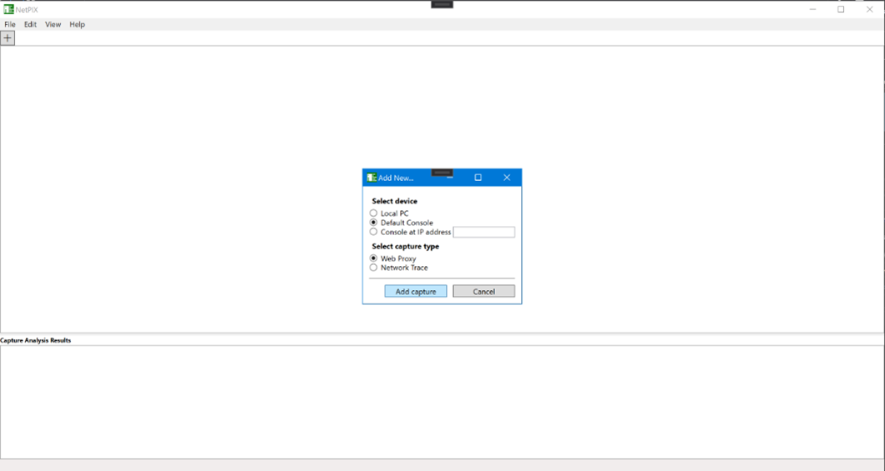
_Screenshot of the default console being added for capturing (proxying) web traffic._


The “Default Console” is a convenience option that allows the user to not have to enter in the IP address
for the designated default console. After clicking on the “Add capture” button from the selector dialog
box, Xbox Multiplayer Analysis Tool will create a new tab for that combination of device and capture method, and display a blank
capture data view.

The port shown below is set to 8080, and that port was chosen according to the available proxy ports that
can be set within the **Preferences** dialog box. You can access the preferences from the **Edit/Preferences**
menu option, and then switch to the “Web Proxy” preferences tab. Xbox Multiplayer Analysis Tool provides some defaults, but
these can be altered and saved like so:

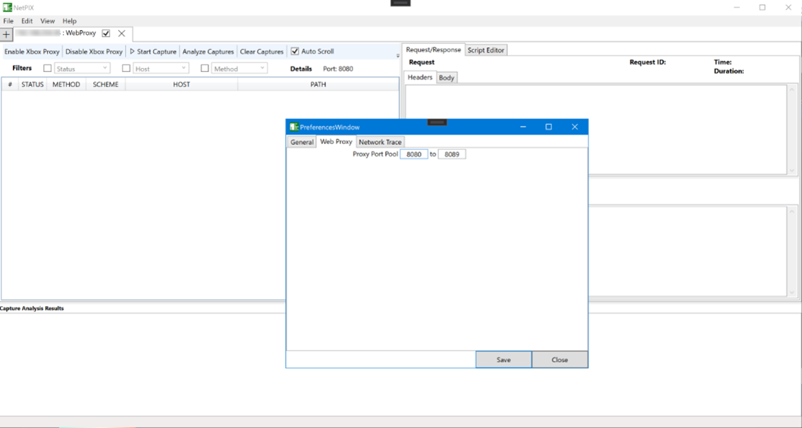
_Screenshot of the ports being used for proxying web traffic._

Note that once a port has been chosen for a particular device that is being captured (proxied), changing
the available proxy ports from the preferences will not alter the designated port for the already added
device proxy session.

XMAT keeps each open capture's port reserved, including while capture is stopped and after
remembered devices are restored. Editing the automatic allocation range does not free ports
belonging to existing tabs. One managed proxy endpoint is supported per device; adding a known
existing device selects its current tab instead of creating a second proxy session. A separate
Network Trace capture and read-only imported captures are still supported.

### Changing a Proxy Port

Select the device's existing tab, stop capture, then choose **Actions > Change Proxy Port**. You can choose any
unassigned port from **1 through 65535**, including ports outside the automatic range in
Preferences. The capture history, filters, and selection are retained.

The bottom status bar shows the selected capture's running/stopped state, assigned port, and
pending-change or device-configuration details. Endpoint confirmation is shown separately from
local capture activity, so stopping capture does not leave a message claiming it is still running.

- **Apply now** starts the replacement listener before changing device settings. For an Xbox,
  it disables/re-enables proxying and waits for the required restarts; the console may reboot
  twice. The popup explains this before you consent. Other devices remain stoppable while the
  console restarts.
- **Later** saves a pending replacement without changing the device or its current assigned
  port. Both ports remain protected, including after restarting XMAT. Starting/enabling the
  capture offers the pending change again; **Discard pending change** keeps the current port.
- **Cancel** closes the popup without accepting a new selection.

The new port is not silently substituted for the device's old endpoint. If binding, saving, or
device configuration fails, XMAT reports the failed step and preserves the assignments needed
for recovery. Once a replacement is saved and the device may already be using it, an uncertain
activation does not automatically tear down its listener or revert to the old port. For an Xbox,
use **Check Proxy Status** before retrying, stopping, or disabling it. Canceling an apply stops
subsequent steps; a console reboot or SDK operation already requested cannot be undone.

For a generic/manual device, XMAT cannot edit its proxy settings remotely. Stop the device/app
from using the old endpoint, confirm that in the popup, then update its settings to the new
endpoint shown by XMAT. Different applications can use independently configured generic
listeners, but enabling two global proxy endpoints does not duplicate the same device traffic.


### Enabling/Starting Proxying

As mentioned previously, enabling a console kit for proxying web service traffic traditionally took many
steps that are outlined within the GDK documentation, as well as other sources. With Xbox Multiplayer Analysis Tool, those steps
have been drastically reduced and automated. All that is required is to hit the “Enable Xbox Proxy” button
on the tool bar for the device tab. Enabling proxying for a kit requires the kit to reboot and will begin
expecting successful proxying upon restart. As a result, enabling a kit for proxying implicitly starts
proxying immediately.

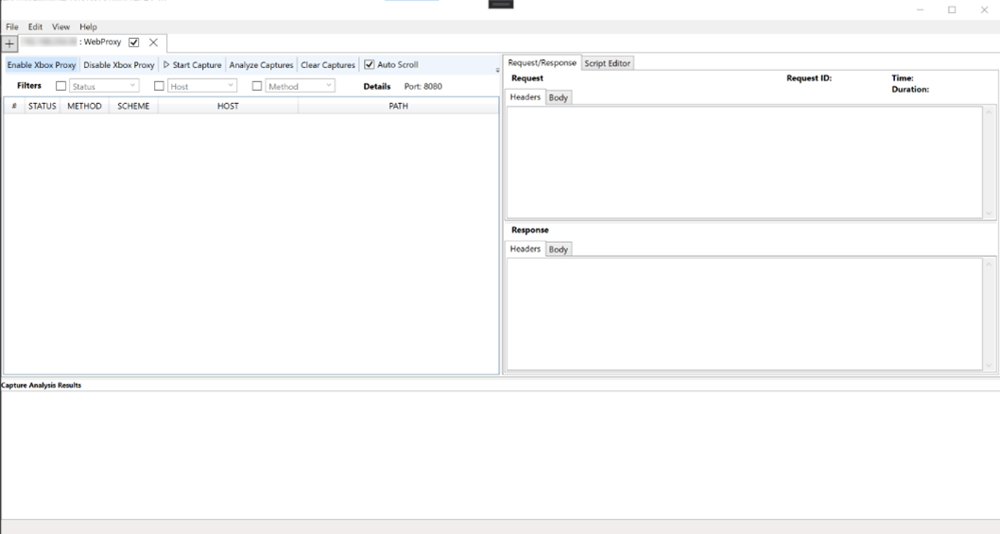
_Screenshot of Xbox Multiplayer Analysis Tool when hitting the Enable Proxy button._

A kit will remain enabled to proxy until told to disable proxying through the “Disable Xbox Proxy” tool bar
option, even after successive console reboots, and restarts of the Xbox Multiplayer Analysis Tool application.

**Stop Capture** stops the local listener; it does not disable or reboot an Xbox.
**Disable Xbox Proxy** remains available while capture is stopped or after a failed start,
so clearing stale console settings does not require first starting another listener.
Status checks show the reported endpoint rather than treating any nonempty proxy host as a
match. Re-enabling a verified matching endpoint does not rewrite its settings or request another
reboot; a different existing endpoint is not overwritten automatically.

**Check Proxy Status** is an Xbox action and is not available for Local PC captures.
Generic/manual devices instead offer **Proxy Setup Details**; that displays connection
instructions rather than querying device state.

The Xbox proxy-address file is written as NUL-terminated UTF-8. The console loader requires
that terminator; an EOF-only or CRLF-only file can leave garbage after the port in the reported
setting. If an older XMAT version configured such a value, explicitly disable and re-enable
Xbox proxying with the current version to rewrite it. Invalid endpoint suffixes are still
reported as unverified rather than silently stripped.

A console that has successfully enabled proxying of web service traffic will provide a notification to the kit
like what is shown below. Even though the Fiddler app is not actually being executed, the words “Fiddler
enabled” in the notification, and on the front of the kit, will indicate success.

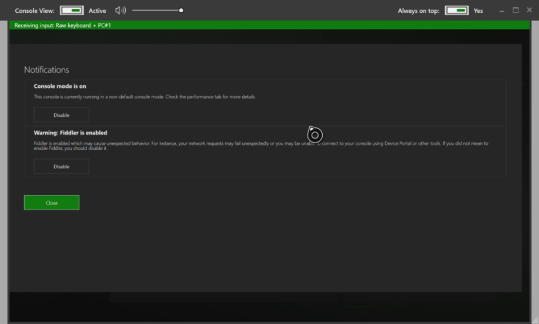
_Screenshot of a kit that now has proxying of web traffic enabled._


Within the Xbox Multiplayer Analysis Tool application’s device tab that was opened earlier, the user should now start to see
proxied connections populate within the connections list view like so:

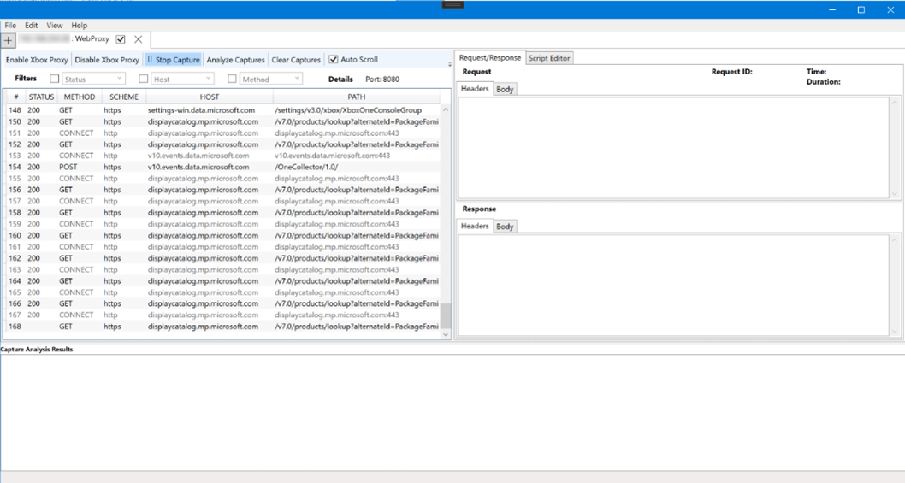
_Screenshot of web traffic activity displayed in the connections list view._

For those that are accustomed to using previous versions of Fiddler that worked “out of the box” --
providing root certificates that are compatible with Xbox development kits, the list of connections on the
left, and a display of a particular connection’s request/response data on the right pane, will be very

familiar.

The “Auto Scroll” option is enabled by default so that the app will keep pace with newer connections as

they come in, and status codes are filled in once a response for a particular request is received. One can
prevent the auto scrolling behavior by unchecking it so that a connection item can be kept in view and
inspected.


### Viewing Request & Response Data

While proxying, we can launch an app installed on the kit – like the ATG NetRumble sample – and see the
traffic created as a result of the app’s activity like below:

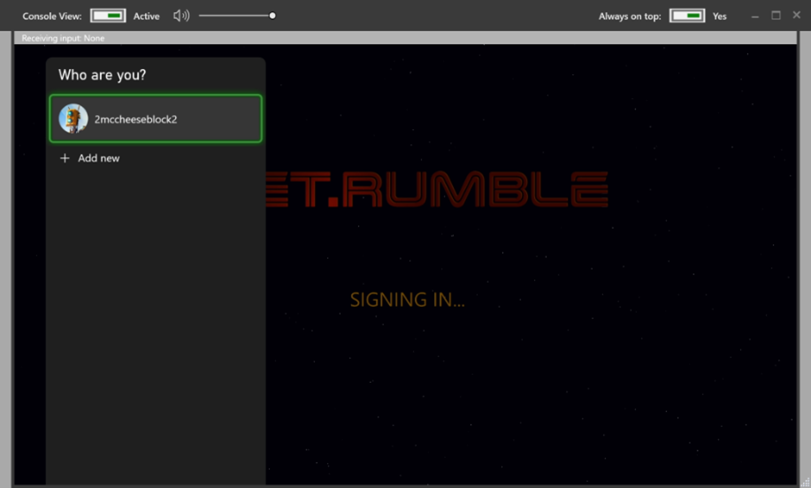
_Screenshot of user Xbox services sign-in for the ATG NetRumble sample._

As a result of the Xbox services user signin process that happens at the start of the app, we can click on the
individual user authentication request and response in Xbox Multiplayer Analysis Tool. The “Headers” and “Body” tabs show
formatted text for the separate request and response. In addition, additional connection details are
provided that include when the request was made, and how long the request took to complete (when the
response was received).

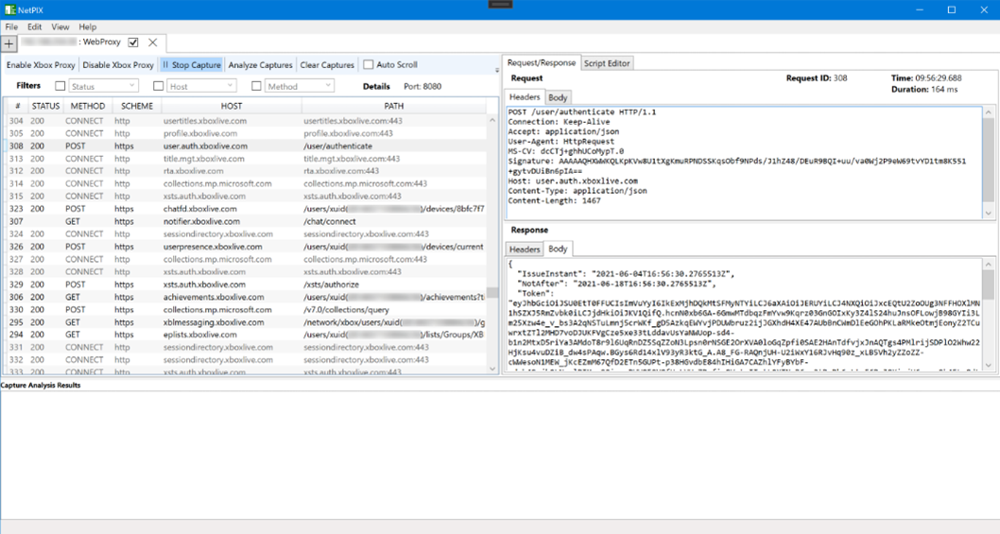
_Screenshot of viewing individual request/response data for a connection._


### Filtering Displayed Requests & Responses

On the tool bar on will notice that the connections list can be filtered according to checked values found
within the data for various fields. For proxied data, one can filter on a set of status codes, hosts, and
methods. The drop lists show all of the possible values found within the data, and only checked values
will display in the connection list. Multiple fields can be filtered at once.

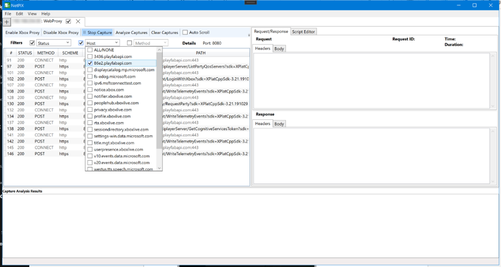
_Screenshot of filtering the connections list by host._

The connections list will filter in real time as connections are being received and proxied, and the filters
will dynamically update. Toggling between “ALL/NONE” allows for including or excluding a small set of
values in the connections list. Status codes that are equal to or above 400 are color coded (to red) as they
indicate an error condition.

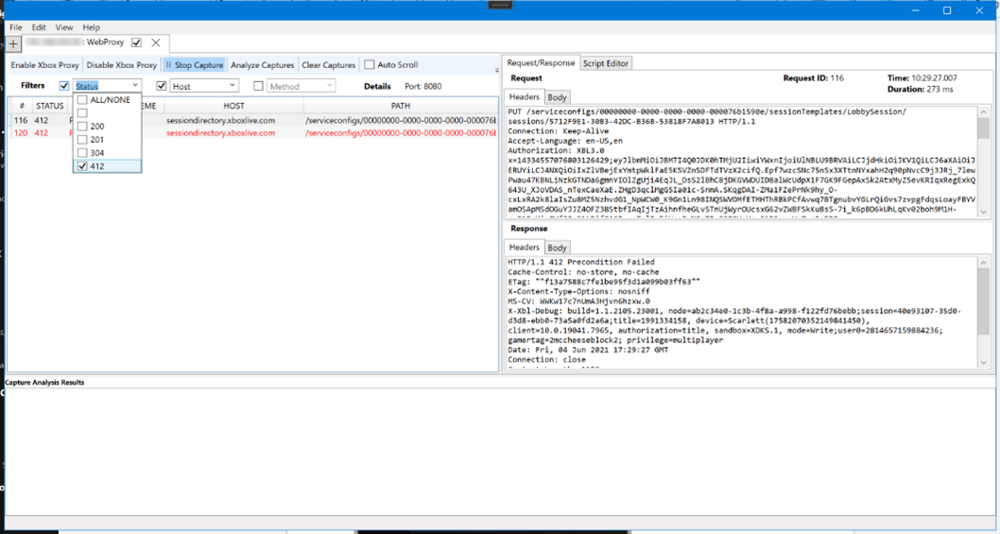
_Screenshot of filtering also by status to further prune connections._


### Capture Timeline

The Waterfall and By Host timeline views retain the complete capture history, including gaps between
capture sessions. Only the visible request bars, host labels, and time-axis ticks are rendered, so
scrolling through an older part of a capture does not require rebuilding the entire timeline.

Incoming capture changes are combined into at most ten timeline refreshes per second. This affects
only presentation; requests are still captured and stored without that limit. Scrolling, resizing,
switching timeline modes, and stopping a capture refresh the visible timeline without waiting for the
live-update cadence. Stopping also displays the final response status and duration, even if no further
requests arrive.

### Blocking or Bypassing Hosts

The **Block List** and **Bypass List** apply to every capture in the current session, including imported
captures and captures created later. They are not saved: closing a capture tab keeps them, and exiting XMAT
clears them. Each capture's Block and Bypass tabs edit these same lists, so any change there, including
**Clear All**, applies to every capture.

- **Right-click a host** in the connections list, on a timeline bar or By Host label, or on an analysis Per
  Endpoint summary row or details header to add or remove that exact host. The menu key acts on the focused
  row, not the selected one. **Remove** appears only when the exact entry exists, so each action undoes the
  other, and the menu notes any wildcard that still matches.
- **Actions > Manage Host Lists...** opens the list editors even when no capture is selected.
- **Blocked** requests are captured but not forwarded. Block applies to new requests immediately and wins when
  a host is in both lists, but a bypassed tunnel that is already open continues until it closes.
- **Bypass** skips HTTPS decryption for new CONNECT tunnels; open connections keep their current mode.
  Bypassed tunnels appear only as CONNECT rows, and scripts and path-based block patterns cannot see inside
  them. Plain HTTP is never bypassed. This is not the Windows proxy bypass list.

Entries follow these rules:

- A host entry covers every port and no subdomains; use `*.example.com` for subdomains.
- DNS names match regardless of case, but a final dot is significant: `example.com.` and `example.com` are
  different entries.
- IP addresses match by address, so `[::1]`, `::1`, and `0:0::1` are one entry. A complete IPv6 address such
  as `2001:db8::1:443` is read as an address, not a host and port.
- Entries can't include a port: `example.com:443`, `example.com:`, and `[::1]:443` are rejected with an
  explanation.
- Entries containing `*` or `/` are glob patterns, such as `example.com/api/*`. A colon inside a pattern is
  matched literally and is not a port filter. Write IPv6 in patterns without brackets, such as `2001:db8::*`
  or `::1/api/*`: an IPv6 pattern with brackets is accepted but never matches, including one that matched
  HTTP/2 traffic in earlier versions.

Analysis endpoints offer host actions only when every request in the endpoint was captured from the same
host. Endpoints synthesized from telemetry (such as `inGameEvents`), endpoints that combine several hosts,
and older data without recorded host provenance explain why no action is available.

### Stopping Proxying

Proxying may be stopped from with Xbox Multiplayer Analysis Tool for a specific device by clicking on the “Stop Capturing”
button on the tool bar. Disabling proxing for a device will cause the kit to reboot and no longer route
web service traffic through the Xbox Multiplayer Analysis Tool proxy, thereby implicit stopping proxying.

Stopping a capture cancels active proxy connections and prevents new requests from being forwarded.
If stopping takes longer than half a second, a progress dialog shows the shutdown phase and pending
capture callbacks or UI updates while the application remains responsive. Captured data is retained
when stopping and restarting the capture.

The **Edit > Preferences > Web Proxy > Prompt to disable Xbox proxy on close** setting applies immediately
to existing capture tabs. When enabled, closing a device tab or exiting the application (including **File > Exit**
and the window's close button) prompts for each reachable console whose proxy is still enabled. Choosing **Yes**
disables the proxy and reboots the console; choosing **No** leaves its proxy settings unchanged. Imported,
read-only captures do not trigger this prompt.

If proxying remains enabled, but Xbox Multiplayer Analysis Tool is not proxying web traffic for that particular device, then the kit
will fail to perform Xbox services status checks, as well as successfully execute other Xbox services related APIs or
REST requests. The kit will eventually show an “unknown” status like this:

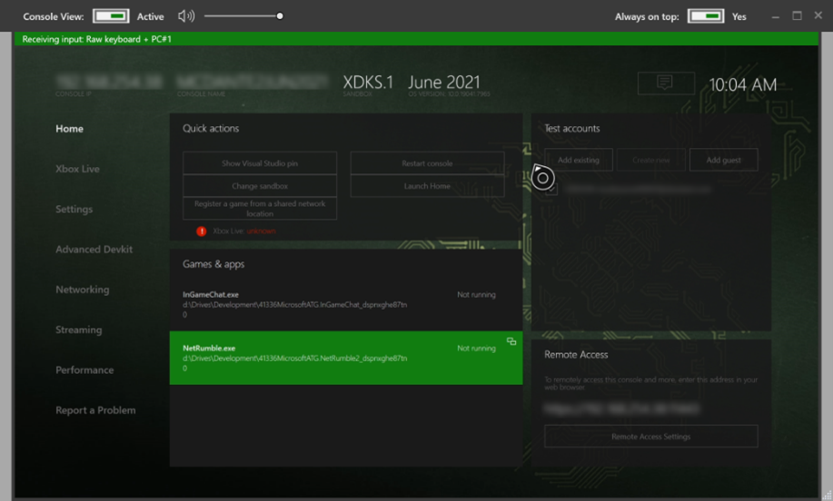
_Screenshot of a kit that has enabled proxying but proxying has been stopped._

If a device tab is left open within Xbox Multiplayer Analysis Tool, and the Xbox Multiplayer Analysis Tool app is terminated. Upon execution of Xbox Multiplayer Analysis Tool the
next time, the opened device tab is remembered and automatically reopened like shown below. The
connections list will be clear until proxying resumes for that device.

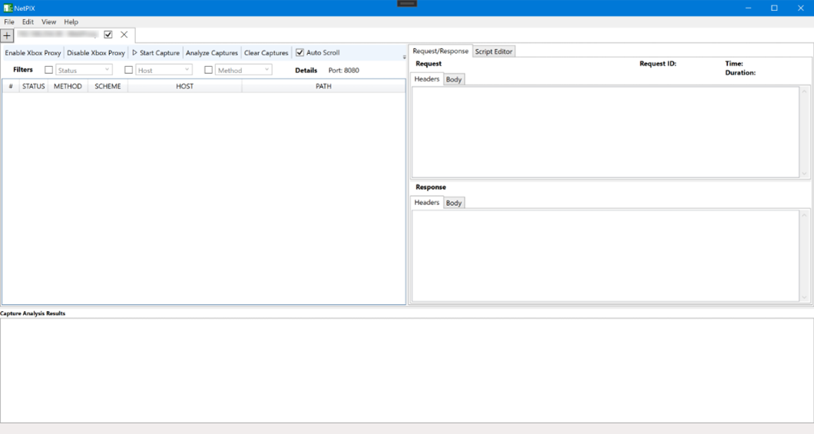
_Screenshot when Xbox Multiplayer Analysis Tool is closed and reopened -- previous capture device is remembered._

### If Xbox Multiplayer Analysis Tool Closes Unexpectedly

Capturing the **Local PC** points the Windows proxy setting at Xbox Multiplayer Analysis Tool. If the tool ended
without changing it back, apps that use the Windows proxy would lose internet access, so the tool records your
settings and tries to put them back:

- Before it changes the Windows proxy, the tool records your current proxy settings and starts a small helper
  process; if the helper cannot start, the Windows proxy is not changed and the capture does not start. If the tool
  then crashes, is ended from Task Manager, or is stopped from a debugger, the helper tries to restore the recorded
  settings, which are usually a direct connection.
- Stopping the capture, exiting normally, or an error that closes the tool also tries to restore them.
- A restore happens only while Windows still has the settings the tool applied. If it cannot complete, the record is
  kept and the tool tries again later, for example when you stop the capture and at its next start.
- If the helper stops unexpectedly during a capture, the tool tries to restore your settings right away and reports
  the outcome, unless a newer capture has started since. Stop, then start capture to resume.
- At the next start, if the Windows proxy points at this PC (for example `127.0.0.1:8880`) but nothing is listening
  there, and either the tool has no record of setting it, which an older version can leave behind, or its settings
  were changed during the capture, the tool asks before turning that proxy off.
- If you change the Windows proxy settings yourself during a capture, the tool leaves your changes alone. Stopping
  the capture turns off only the tool's own proxy; if Windows uses a different proxy by then, the tool leaves it on
  and tells you. A capture started after such a change records your settings at that point, so the tool later tries
  to restore those rather than older ones.

Limits:

- While the tool is paused in a debugger or not responding, the proxy stays on, because the tool has not ended.
- If the PC restarts during a capture, the tool tries to restore the settings the next time you start it.
- If the tool and its helper are ended together, for example by ending the whole process tree, the tool tries to
  restore the settings the next time you start it.
- If the tool cannot verify that the instance that changed the settings has ended, for example one running as
  administrator, it leaves those settings alone and does not capture this PC.
- A proxy change that fails partway can leave settings the tool cannot tell from yours, which you may need to
  correct by hand; a proxy server address that is saved but not in use may not be changed back.
- The tool does not capture the Local PC when it runs inside a process group that could end the helper together
  with it, as some terminals and tools do. Start the tool directly instead.
- Xbox consoles are never reset automatically. If the tool closed unexpectedly while capturing a console, the next
  start offers to disable that console's proxy, which restarts the console; the offer is repeated at later starts
  until you answer it.


## Viewing WebSocket Messages

WebSocket connections made through the proxy are captured automatically -- no extra setup is required.
Messages are displayed in the **WebSockets** tab for the active proxy capture, in the order they were
sent and received.

- The message list can be filtered by **direction** (client to server, or server to client) and by **message type**
  (text, binary, and close).
- Selecting a message shows its payload, which can be viewed as **text**, formatted **JSON**, or **hexadecimal** bytes.

To prevent long-running captures from using too much memory, only the most recent messages are kept (up to
5,000 messages or 32 MB of payload data per capture, whichever is reached first), and individual message
payloads are captured up to 1 MB. WebSocket messages are not currently included when captures are saved to
an .XMATCAP file.


## Scripting & Modification of Web Proxy Traffic

The script editor allows you to write simple C# scripts to modify any or all of the HTTP(S) requests and
responses that are passing through the proxy, on-the-fly. Scripts are written per client (tab) and are not
global across all clients. Clicking on the **Script Editor** tab on the right side of the main application window
will open the script editor view.

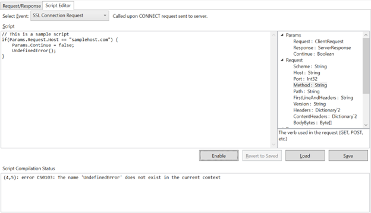
Screenshot of Xbox Multiplayer Analysis Tool Script Editor

There are three different events that are scriptable:
**SSL Connection Request** – This script is called when a proxied client makes an HTTPS CONNECT request
to a server.
**Web Request** – This script is called after an HTTP request has left the client, but before the request is
forwarded to the server.
**Web Response** – This script is called after the HTTP response is received by the server, but before it is
forwarded to the client.

Each event starts with a commented sample script that does nothing until you remove the `//` from the start of
its example lines. An enabled script runs on every host that passes through that capture unless the script checks
`Params.Request.Host`, and a **Web Response** script should also skip `CONNECT` requests, because their responses
open the HTTPS connection. The script editor and the **Script Editor** tab show which scripts are active.

All inspectable and modifiable properties are members of the **Params** object. **Params** contains the web
**Request** and the web **Response** objects, as well as a Boolean named **Continue** which can be set to **_false_**
to cancel the request or response in progress. The right side of the script editor shows these objects and
properties. Click on any item in the list to get a description of the property, and double-clicking on any
item will drop the appropriate text into the script editor at the current cursor position.


For example, you could write a script on the **Web Request** event to redirect all calls to a certain URL to
another URL. Or, you could change a **Web Response** which might have a 200 success status to a 500
status to determine how your client/title code behaves in the case of an error. Note that the
**System.Text.Json** namespace is available to use in the scripting engine for easily parsing and
manipulating JSON content.

To enable a script, complete your code in the text editor, then click the **Enable** button. While the script
compiles, the button shows **Compiling…** and can't be clicked again. The script turns on only after it compiles
without errors. The **Script Compilation Status** window shows the result for the selected event's script. Errors
are listed there, and the script stays off. Warnings do not prevent the script from turning on; they are listed
there with the message "Script compiled successfully with warnings." Double-click an error or warning to go to
its source in the script window. If compiling fails unexpectedly, the script stays off and the window shows
"Could not compile; script remains disabled. See the app log." The app log has the details. Once enabled, all
future requests and responses will pass through the script silently, and any modifications you created will be
applied. Editing a script clears its compilation status: an enabled script turns off, and a script that is
compiling stays off, until you click **Enable** again. **Load** and **Save** are unavailable while a script is
compiling or enabled.

Scripts may use `await`. XMAT waits for that event's script before it forwards the request or response.
Each invocation has a 60-second deadline. If a script reaches the deadline, XMAT writes an error to the app
log and drops that transaction without sending a response. Stopping capture while a script is running also
cancels the wait and drops that transaction, but it is not reported as a deadline error. For a CONNECT
request, the HTTPS tunnel is not opened. The deadline limits one script invocation, not the total time seen
by the client. Some clients retry a dropped request, and every retry runs the script again.

A **Web Response** script also runs for XMAT's CONNECT reply. Delaying that reply delays every HTTPS tunnel,
so Web Response scripts should skip CONNECT unless changing tunnel behavior is intentional. Cancellation
stops XMAT from waiting, but it cannot terminate arbitrary script code. Blocking code may continue running
in the background after its request has been dropped and continue using worker threads. Later changes to
`Params.Request` or `Params.Response` are not forwarded or captured, but other side effects performed by the
script are not undone.

You can also use the **Load** and **Save** buttons to load scripts you have already written and save new scripts
to disk for later usage. The **Revert to Saved** button can also be used to undo any changes since the last
time the script was saved to disk.

There are several known issues and limitations with the scripting functionality:

- The script editor does not have any syntax highlighting or IntelliSense/auto-completion – it is just
    a text box.
- Not all .NET namespaces/objects are available in the scripting environment.


## Saving, Loading, Importing & Exporting Captures

Captures can be saved and shared using the **File** menu:

| Menu option | What it does |
|--|--|
| **Save Captures** | Saves all open web proxy and network trace captures to an Xbox Multiplayer Analysis Tool (.XMATCAP) file. |
| **Load Captures** | Opens a previously saved .XMATCAP file. Loaded captures open in read-only tabs. |
| **Import** | Imports a Fiddler (.SAZ) archive, or a network trace (.ETL) captured with `netsh`, into a read-only tab. Re-importing the same-named .SAZ replaces that tab's data. |
| **Export** | Exports the selected web proxy capture to a Fiddler (.SAZ) archive. |
| **Export Sanitized Capture...** | Exports a sanitized .SAZ copy of the selected web proxy capture, without changing the original capture. Stop all captures first. |

Files can also be dragged and dropped onto the main window -- .XMATCAP files are loaded, and .SAZ and .ETL
files are imported.

If a new .SAZ import fails before commit, XMAT reports the error without registering an incomplete tab.
If re-importing a .SAZ with the same file name fails, the existing tab, its selection, and its previously imported data
remain unchanged. You can retry the import without restarting XMAT. Error details are written to
`application.log` in the application's `Logs` directory.

### Sanitized Export

Use **File > Export Sanitized Capture...** before sharing a web capture. This is a per-export
command, not a preference: ordinary **Export** and native **Save Captures** remain unsanitized.
Loaded and imported web captures are supported. Only the selected capture is exported.

The export redacts recognized credential/cookie headers, sensitive query and form parameters,
URL credentials, sensitive JSON/XML fields (including OAuth device codes and private JWK
members), and common token/private-key patterns in text.
Credential discovery covers headers, URLs, forms and structured fields before either
direction of a session is written, including decoded Basic/userinfo components, token
parameters, and individual cookies from repeated or combined headers. JSON keys and
query/form parameter names are inspected. Learned values in names are masked when long
(at least eight characters) or numeric identifiers (at least four digits), while short and
recognized schema labels are preserved. Renamed JSON keys use collision-safe names.
Xbox profile IDs/display names, recognized structured-body credential echoes across each
request/response pair, and client-IP metadata are also masked. JWT recognition does not
depend on a particular encoded-header
prefix; standalone Xbox credentials and PGP private-key armor are recognized. Header names are
matched without regard to case, and repeated headers are retained.

JSON, XML, URL-encoded forms and plain text are inspected. Gzip, deflate and Brotli bodies
and declared character encodings are supported; exported text is UTF-8 with updated HTTP
framing, including bodyless HEAD/CONNECT/1xx/204/304 responses. Genuine chunk framing is
decoded before scanning, while already-dechunked captures remain supported; ambiguous or
malformed framing is omitted. Sensitive namespace URLs are remapped consistently in XML.
Percent-encoded paths and nested URI/form values are inspected through at most eight
decoding passes, preserving untouched values' original representation. Invalid UTF-8 or
excessively nested URL/form components are redacted without discarding unrelated components
or aborting the archive. URL values are compared literally and with form decoding, preserving
literal `+` and matching credentials that span path segments. Learned values in URL authorities
use a valid replacement host; structural Host and generated Content-Type headers are not
subject to echo replacement. Password-input values in inspected XML are also redacted.

Unsupported content (including binary, HTML/XHTML and multipart bodies), malformed structured
data, JSON/XML nesting exceeding 64 levels, unknown compression/character encodings and
bodies exceeding the 4 MiB inspection limit are omitted rather than copied unchecked.
Scanning also has a finite work budget and a limit of 64 distinct remembered sensitive
values or representations of at most 4,096 characters each per request/response pair.
XML discovery includes both individual values and sensitive containers' combined text.
Learned values are matched at token boundaries and reset before the next pair. Bodies
exceeding format/size limits are omitted. If credential discovery exceeds capacity, or
scanning exhausts its work budget or regex timeout in either pass, partial output is discarded
and the pair's original URLs, headers and bodies are replaced with minimal HTTP framing.
Large authorization values or profile batches can therefore lose diagnostic content;
the limits are not a guarantee of diagnostic completeness.
The completion dialog reports redactions and omissions; SAZ session metadata marks which
request/response bodies were omitted.
Longer exports show a cancellable progress window. Cancel, Escape, or closing that window
requests cancellation and waits for the worker and cleanup to finish before releasing the
operation guard. An existing destination is replaced only after a complete export, not on
cancellation or failure.

**Review the archive before sharing it.** This is best-effort detection, not a guarantee of
anonymity: arbitrary unnamed secrets, custom encodings, and identifiers not recognized by the
rules may remain. Nonsensitive service endpoints, paths/values, timing and request IDs are
retained for diagnosis. The original capture data is not sanitized in place.
HTTP header names, XML element/attribute names, and protocol method/version tokens are not
identifier-scrubbed. Arbitrary percent-encoded text outside URL/form contexts, unrecognized
identifier fields, and JWTs joined directly to ordinary letters can remain. Short learned
values can also redact benign data. These exclusions still require manual review and an
explicit decision about which identifiers a particular sharing scenario must remove.

### Importing Network Traces from Another PC

Network traces captured on a remote PC (for example, a test machine where Xbox Multiplayer Analysis Tool is not installed) can
be imported and viewed just like a local capture. On the remote PC, run the following from an elevated
command prompt, reproduce the issue, then stop the trace:

```
netsh trace start capture=yes
netsh trace stop
```

`netsh` will print the location of the generated .ETL file when the trace stops. Copy that file to your machine
and use **File > Import** (or drag the file onto the window) to open it. Only packet capture data
(Microsoft-Windows-NDIS-PacketCapture) is imported -- other events in the trace are ignored. Traces captured
with `pktmon` are not currently supported.


## Live Trace Analysis

### Introduction to Xbox Live Trace Analysis

The Xbox Live Trace Analyzer tool has traditionally been a standalone command line tool for performing rule-
based analysis against Fiddler web service capture files with extension SAZ. It continues to be supported
and is provided with the Microsoft GDK. One can also build their own tool directly from source as it is
available on a public GitHub repository. Xbox Multiplayer Analysis Tool has the Xbox Live Trace Analyzer’s capabilities built
directly within and are invaluable for detecting problematic Xbox services REST API calling patterns discovered
amongst a title’s web service traffic.

### Execution of analysis

In order to perform the analysis, one must first have web service proxy data -- which can be either a
loaded Xbox Multiplayer Analysis Tool (.XMATCAP) file, an imported Fiddler (.SAZ) file, or from real-time proxied requests & responses.

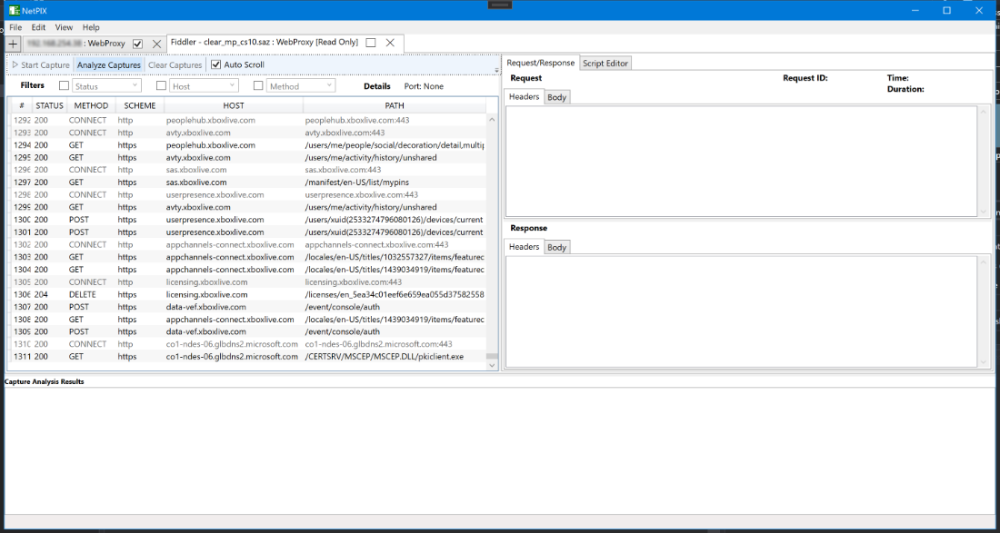
_Screenshot of imported Fiddler (SAZ) capture data about to be analyzed._

Clicking on the “Analyze Captures” tool button will present the list of available analyzers that can be
chosen to execute on the proxied connections currently found within the visible tab.

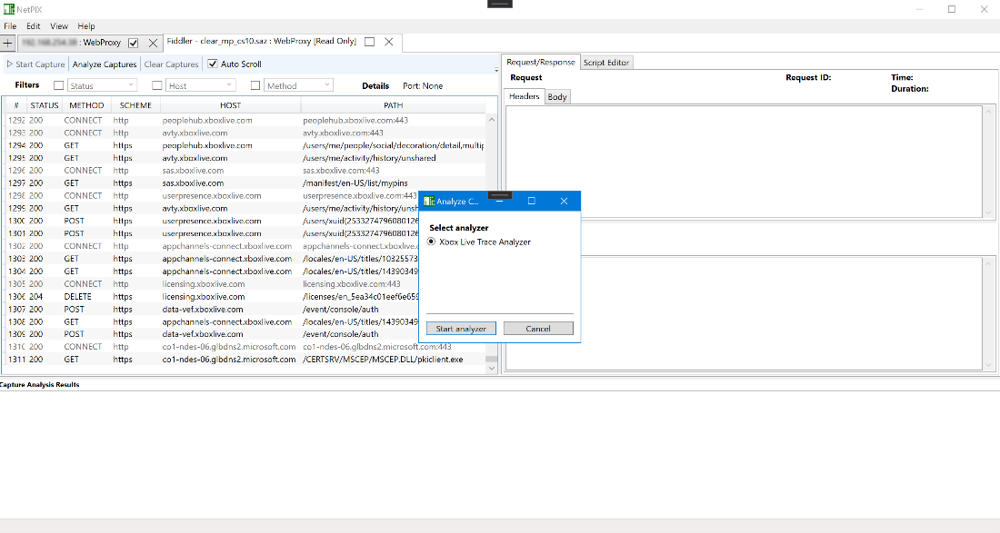
_Screenshot of the analyzer selector which allows Xbox Live Trace analysis._


Once the “Start Analyzer” button is clicked, Xbox Multiplayer Analysis Tool will display and populate a new tab within the “Capture
Analysis Results” portion of the main app window found toward the bottom of the screen:

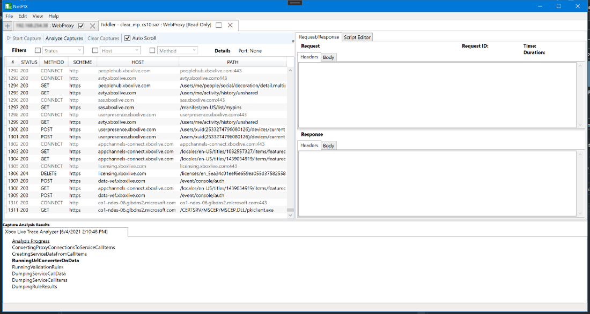
_Screenshot of the Xbox Live Trace analysis in progress._

The analysis will undergo many steps which includes the export of analysis related files placed in the
**/AppRoaming/Microsoft/Xbox Multiplayer Analysis Tool** storage directory. The folder will have a prefix of “xlca_” and contain a
timestamp for the executed analysis. Stop all captures before starting analysis; the disabled Analyze
tooltip explains this requirement. Only one analysis or capture-data operation can run at a time.

Recoverable analysis failures display an error and remove the failed result tab instead of closing XMAT.
The capture remains available for another attempt, and exception details are written to `application.log`.

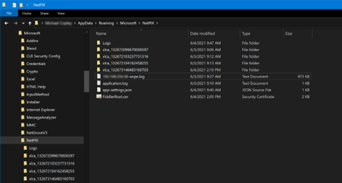
_Screenshot of Xbox Multiplayer Analysis Tool Xbox Live Capture Analysis result output folders._


### The Per Endpoint Report

When analysis has completed, the analysis tab’s progress content is replaced with a series of result report
tabs. The first and main report is the Per Endpoint report. This report contains two main sections: the
summary, and the details. The summary table contains a matrix of service host against analysis rule issue
counts. When there are no issues discovered, the box is green. If there are issues encountered, then the
box is colored a brighter orange.

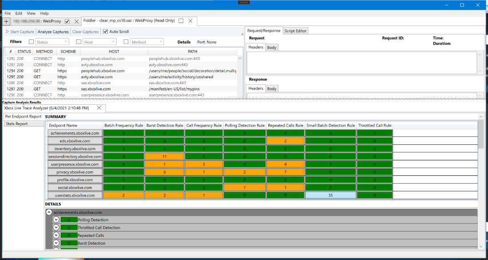
_Screenshot of the Per Endpoint Report with Issue Count Summary data table._

Clicking on a box within the summary table will scroll the report view down to the expander for that host
& rule combination. If the expander for the issues is opened, a table of rule related data is presented
along with the list of individual warnings.

The individual warnings provide explanatory text for why the calls found within its expander invoked the
rule warning. Above the rule data table, a description of what the rule searches for is given:

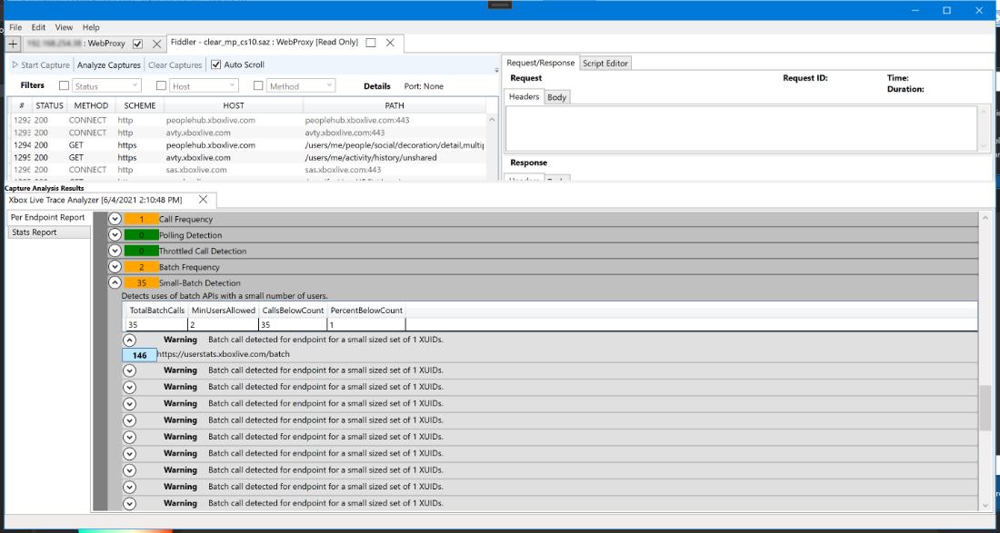
_Screenshot of the analysis rule warning details list._


Every call pertaining to the rule warning is provided on its own line and includes the actual request
number that corresponds to the request within the connections list, along with the URL for the call.
Clicking on the request number button will ensure that the device tab for the analyzed captures is

opened, and will also select the corresponding request like shown:

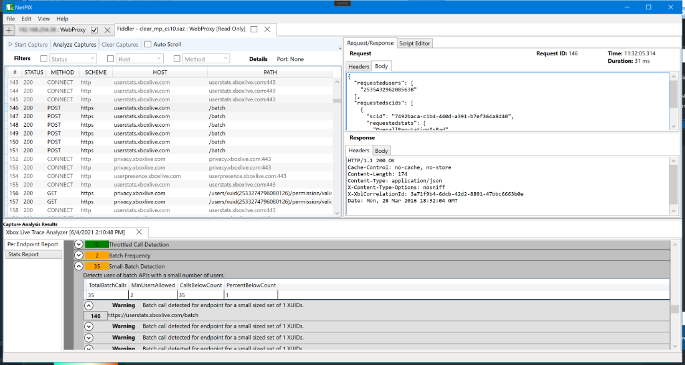
_Screenshot of one of the rule warnings’ request selected in the connections list._

In the example presented above, there exist many Xbox services APIs that can take several users as parameters for
the API call. The warning notes that only one user was provided to the API as can be seen when

inspecting the actual request body JSON seen in the above screenshot.

Reducing the quantity of calls to Xbox services REST APIs is always preferable to prevent throttled call
execution, reduce overall bandwidth consumption, and ease load and latency for calls.


### The Statistics Report

The second report tab after the Per Endpoint report is the statistics report which serves as an auxiliary
report that provides interesting data points from the analysis. The topmost graph of the report is the
“Calls Per Endpoint” bar graph that indicates how many calls were made to specific endpoints:

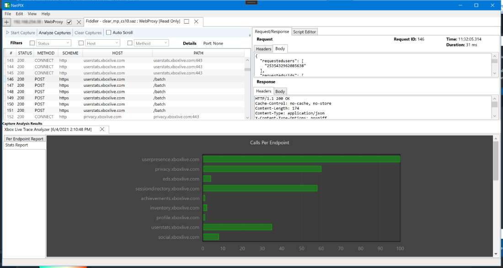
_Screenshot of the Live Trace Analysis statistics report Host call graph._

Beneath the calls bar graph, one will find the timeline graph for the various calls made over the course of
all the analyzed requests & responses. The timeline graph can be zoomed in and out using the mouse
wheel over a particular place within the graph to view more granular timing detail. The color key in the
upper right corner of the graph indicates which hosts were called at specific points in time.

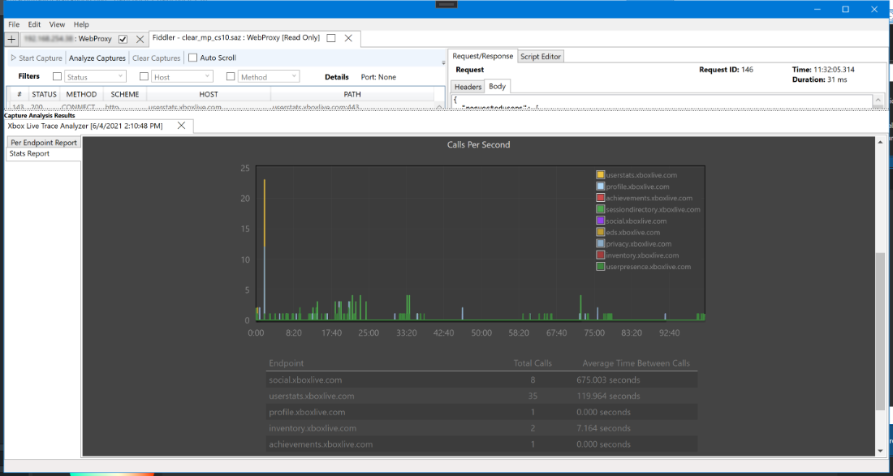
_Screenshot of the statistics report calls timeline and average call times table._

Each bar, timeline series, and table row is one endpoint. When a captured host and endpoints synthesized
from telemetry share a name (for example `inGameEvents`), they stay separate and are labeled with their
source, such as `inGameEvents (captured host)` and `inGameEvents (synthesized telemetry)`. The Stats and Call
report files in the analysis output folder record each endpoint's numeric `Kind` (0 unknown, 1 captured, 2
synthesized telemetry) and `EndpointId` next to its `Uri`.

Analysis report content present in its output folder within the Xbox Multiplayer Analysis Tool data storage folder can be removed
if no longer needed once the Analysis results tab for that analysis run is closed.

### Exporting an Analysis Report

After an Xbox Live Trace analysis finishes, select its result tab and choose
**Analysis > Export Analysis Report...** to copy the complete report folder to a directory you select.
Inside that directory, XMAT creates a child folder named
`XMAT Analysis - <capture> - <yyyy-MM-dd HHmmss>`. If that name already exists, XMAT appends
` (2)`, ` (3)`, and so on without merging or overwriting earlier exports.
The exported folder contains the browser-based Statistics report, JSON report data, rule findings in
`_results.txt`, and the service-call diagnostic text files. The Statistics HTML and JSON reports describe
the first eligible console in the capture; the diagnostic text files can contain data aggregated from all
consoles.

Analysis exports are not sanitized. They can contain request bodies and sign-in tokens, URLs, Xbox user
IDs, console IP addresses, and telemetry. Review an export before sharing it or placing it in a
cloud-synchronized folder. XMAT displays a confirmation describing this sensitive content before writing
the export. For compatibility with Explorer and browsers, XMAT refuses exports when any generated path
would reach 260 characters.
**File > Export Sanitized Capture...** provides opt-in sanitization for .SAZ captures, not analysis
reports; review exported content before sharing.

An export failure leaves the AppData working report unchanged so the export can be retried. If XMAT
cannot remove a temporary staging folder, the error identifies that folder for manual cleanup. Exporting
does not move or automatically delete the working `xlca_*` folder in AppData; those folders may still be
removed manually after their analysis tabs are closed.


## Network Capture

### Introduction to Network Capture

The network capture feature of Xbox Multiplayer Analysis Tool allows for the capture of packet-level network traffic from your
Xbox development kit or local Windows PC. It is similar in feature to taking captures with xbtrace netcap and viewing them in
NetMon. That process is still available and currently provides higher fidelity data. However, Xbox Multiplayer Analysis Tool can
be used to capture, view console network traffic as well as perform some basic analysis and the entire
process takes place inside the Xbox Multiplayer Analysis Tool UI.

Capturing on a local Windows PC uses `netsh trace` and requires Xbox Multiplayer Analysis Tool to be run as an administrator.
Traces captured on other PCs can also be imported -- see
[Importing Network Traces from Another PC](#importing-network-traces-from-another-pc).

### Capturing Network Data

From Xbox Multiplayer Analysis Tool, clicking on the “+” tab will inform Xbox Multiplayer Analysis Tool to add a device and capturing method to the
application. Select your console and choose Network Trace like so:

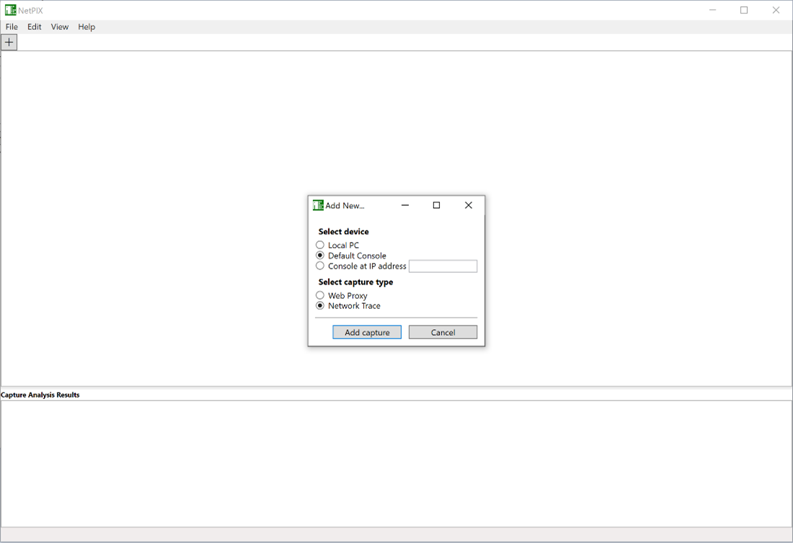

You will now be presented with a **NetworkTrace** tab and the application is ready to begin a capture.

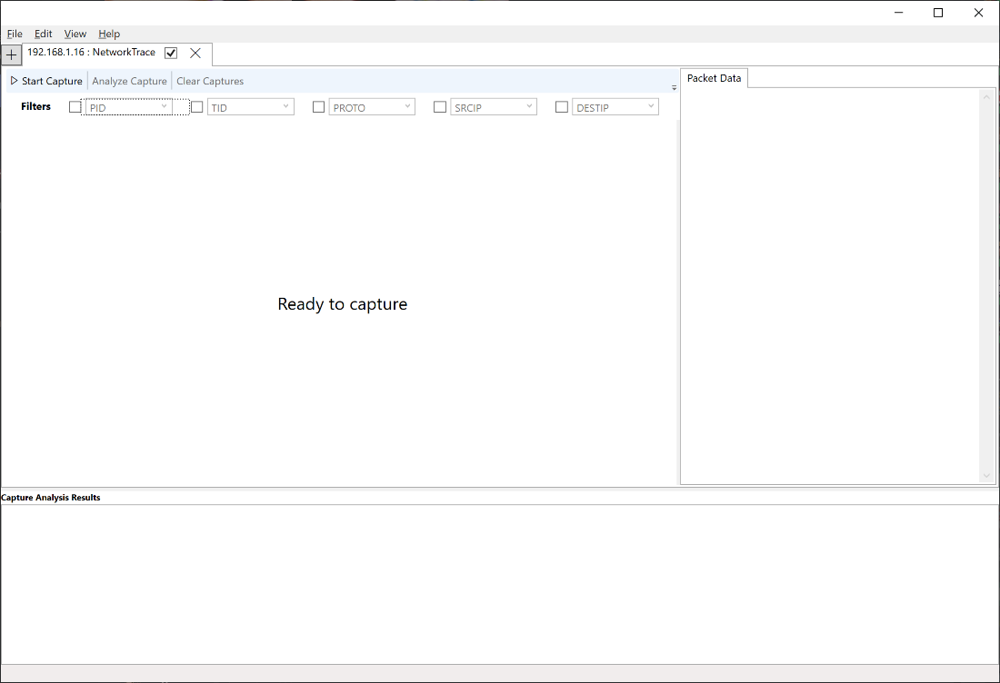

Pressing **Start Capture** will begin the process of connecting to the console and starting the network
capture. Xbox Multiplayer Analysis Tool will display **Trace Running** while the console is capturing until **Stop Capture** is invoked
in Xbox Multiplayer Analysis Tool. Once that occurs, the console will begin to process the capture and Xbox Multiplayer Analysis Tool will then download
the capture. For large captures, this can take some time.

After the capture is downloaded, the data will be presented in the UI where it can be filtered and viewed
individually.

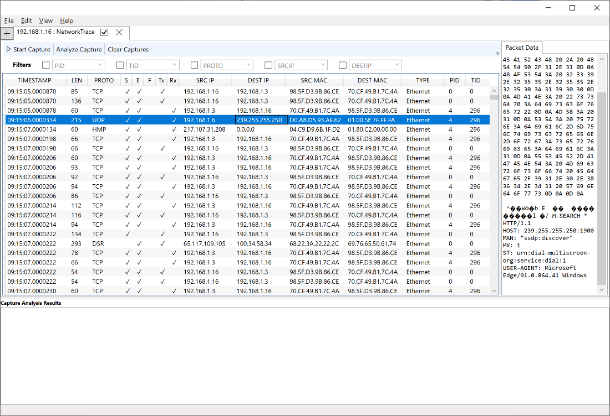

The trace data can be saved for later viewing and analysis by using the **Load** and **Save Captures** items in
the File menu.

Invoking **Clear Captures** will remove the current data set, **Start Capture** will clear the data and start a
new capture, and **Analyze Capture** will open a new **Analysis Results** tab below.


## Network Capture Analysis

### Introduction to Network Capture Analysis

Xbox Multiplayer Analysis Tool has the ability to gather some general statistics and perform a basic analysis. This includes packet
send statistics by source.

### Running Analysis

To start the analysis, first set any filters in order to reduce the data to the relevant packets and then select
Analyze Capture. The results will open in a new tab below as seen here:

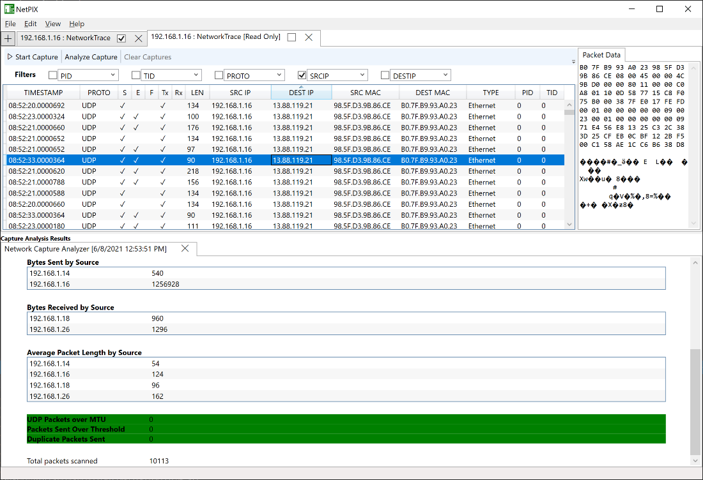

The analysis checks for UDP packets sent in excess of the recommended Xbox MTU (1384), sending more
than (20) packets in a second and sending duplicate packets within a second. If any of these are detected,
the report will show a red background in the list.


## Appearance

Xbox Multiplayer Analysis Tool supports light and dark themes. Toggle **Edit > Dark Mode** to switch between them -- the
choice is remembered the next time the application starts.


## Known Issues

**Xbox proxy endpoint verification depends on the console recovery and installed SDK.**
Use **Change Proxy Port** for a stopped capture rather than changing an active tab's port indirectly
through Preferences. If the console cannot report a complete endpoint, XMAT reports it as
unverified instead of claiming setup succeeded. Explicitly disable proxying, wait for the console
to return, and check its status before re-enabling or retrying a pending change.

**Proxying with the same header spanned across multiple lines fails to proxy correctly.**
_Workaround: None currently. Apps like Outlook may fail to function properly when proxying PC._

**A console reboot or SDK write already requested may not be interruptible.**
Canceling a port apply prevents later steps but waits for an in-flight mutation to settle.
Check proxy status before retrying; a saved new port may remain assigned even if activation
could not be confirmed.

**Potential Future Improvements:**

- Keep alive handling needs further improvement.
- WebSocket messages are not yet saved to or loaded from .XMATCAP files.
- Analysis outputs can be exported to a user-selected folder; working copies remain in AppData. Root certificate(s) are not stored in a user specified location.
- Additional Localization

## Support

If you run into issues using the application, please select the **Help > Collect Debug Logs** menu which will
zip up application logs and place them on your Desktop. Once complete, please send these logs to
xmat_oss@microsoft.com with a description of the problem so that we may review. Additionally, if the
application encounters an unknown error, logs will automatically be placed on your desktop. Please note
that contents of web requests and responses may be included in this log data.

If an error occurs during network capture it is highly recommended that you reboot the console you were
utilizing as the trace may still be running and the capture service will likely continue to fail if not restarted.

## Trademarks
This project may contain trademarks or logos for projects, products, or services. Authorized use of Microsoft trademarks or logos is subject to and must follow [Microsoft’s Trademark & Brand Guidelines](https://www.microsoft.com/en-us/legal/intellectualproperty/trademarks/usage/general). Use of Microsoft trademarks or logos in modified versions of this project must not cause confusion or imply Microsoft sponsorship. Any use of third-party trademarks or logos are subject to those third-party’s policies.
