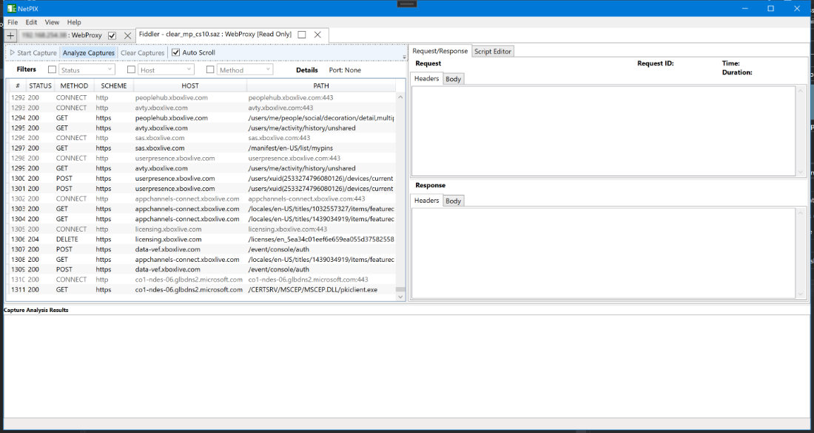
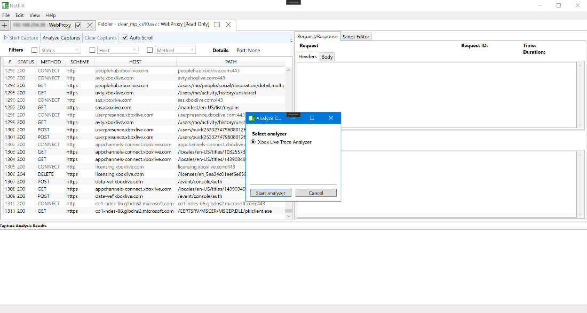
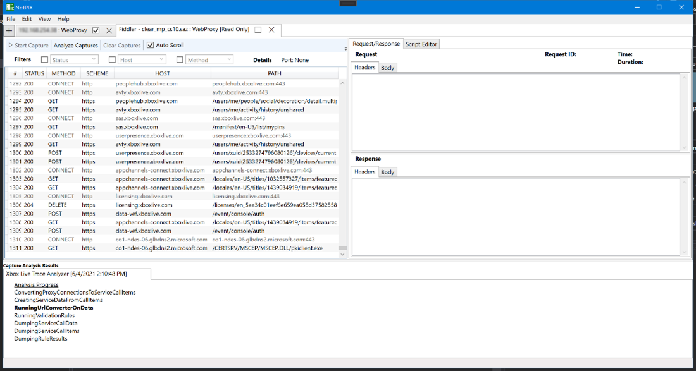
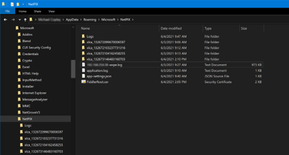
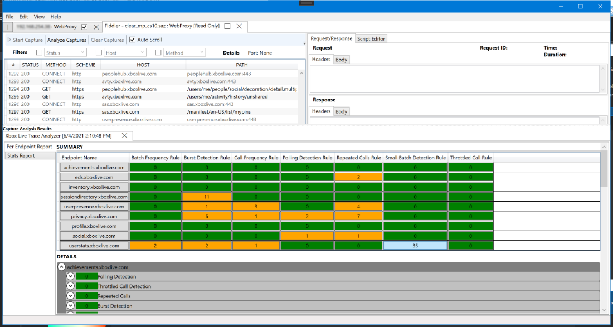
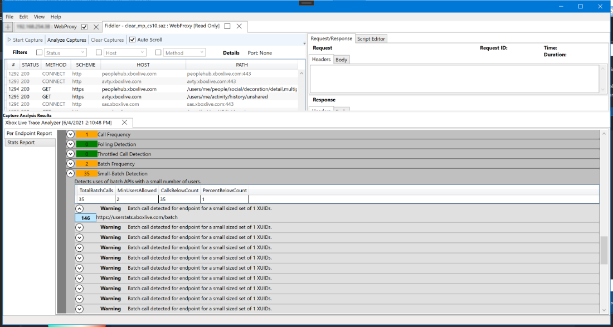
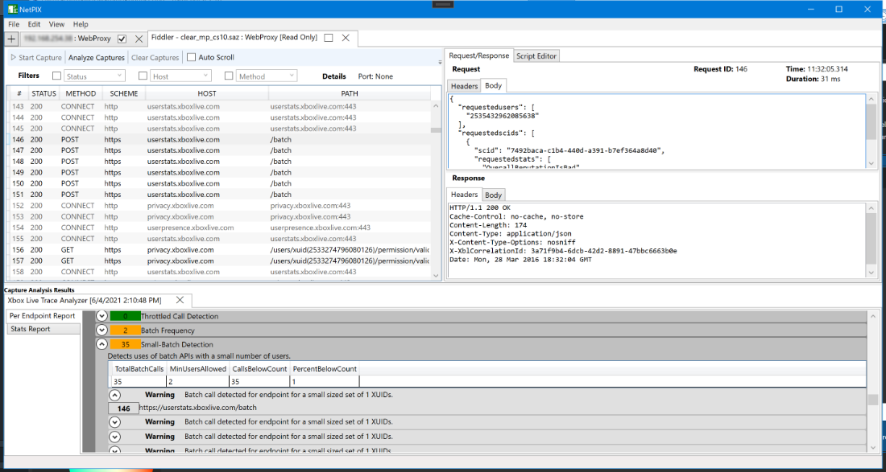
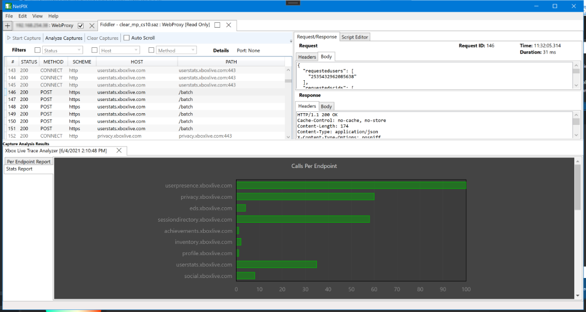
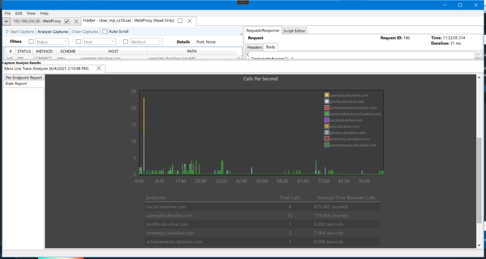

# Live trace analysis

[Back to README](../README.md)

XMAT incorporates Xbox Live Trace Analyzer capabilities to detect problematic Xbox
services REST API calling patterns. The analyzer has also traditionally been
available as a standalone command-line tool in the Microsoft GDK and as public source.

## Prerequisites

Use web proxy data from a live capture, a loaded `.XMATCAP` file, or an imported
Fiddler `.SAZ` archive. See [Capture files](capture-files.md) for loading and importing.

**Stop all captures before starting analysis.** The disabled Analyze tooltip explains
this requirement. Only one analysis or capture-data operation can run at a time.

## Run analysis

1. Select the capture tab containing the requests to analyze.
2. Click **Analyze Captures** and select Xbox Live Trace analysis.
3. Click **Start Analyzer**.

**Expected result:** a tab opens under **Capture Analysis Results**, shows progress,
and then displays report tabs.

Analysis creates a timestamped `xlca_*` working folder in XMAT's roaming application
data directory, under `Microsoft\Xbox Multiplayer Analysis Tool`.

Recoverable failures show an error and remove the failed result tab instead of
closing XMAT. The capture remains available for retry; exception details are written
to `application.log`. See [Troubleshooting](troubleshooting.md#collect-debug-logs).

## Read the Per Endpoint report

The main report contains a summary matrix of service hosts against analysis-rule
issue counts, followed by details. Green indicates no issues; brighter orange
indicates issues were found.

1. Click a summary cell to scroll to the host/rule combination.
2. Expand it to see the rule description, related data, and individual warnings.
3. Click a warning's request-number button to open the corresponding capture tab
   and select that request.

Each related call has its own row, request number, and URL. In the example, an API
that supports multiple users was called with only one user, visible in the request
body JSON. Reducing unnecessary service calls helps avoid throttling and reduces
bandwidth, service load, and latency.

## Read the Statistics report

The **Calls Per Endpoint** bar graph shows call counts for individual endpoints.

The timeline below it shows calls across all analyzed requests/responses. Use the
mouse wheel over a location to zoom into its timing. The upper-right color key
identifies hosts; the report also includes average call times.

Each bar, timeline series, and table row represents one endpoint. A captured host
and synthesized telemetry endpoint sharing a name (such as `inGameEvents`) remain
separate, labeled with their source: for example, `inGameEvents (captured host)` and
`inGameEvents (synthesized telemetry)`.

The Stats and Call report files record each endpoint's numeric `Kind` (0 unknown,
1 captured, 2 synthesized telemetry) and `EndpointId` alongside its `Uri`.

## Export an analysis report

1. After Xbox Live Trace analysis finishes, select its result tab.
2. Choose **Analysis > Export Analysis Report...** and select a directory.
3. Read the sensitive-content confirmation before proceeding.
4. Review the exported content before sharing or placing it in a cloud-synchronized folder.

**Warning:** analysis exports are **not sanitized**. They can contain request bodies,
sign-in tokens, URLs, Xbox user IDs, console IP addresses, and telemetry.
**File > Export Sanitized Capture...** sanitizes `.SAZ` captures, not analysis reports.

XMAT creates a child folder named `XMAT Analysis - <capture> - <yyyy-MM-dd HHmmss>`.
If it exists, XMAT adds ` (2)`, ` (3)`, and so on without merging or overwriting exports.
For Explorer/browser compatibility, exports are refused if any generated path would
reach 260 characters.

The folder contains the browser-based Statistics report, JSON report data, rule
findings in `_results.txt`, and service-call diagnostic text files. Statistics HTML
and JSON describe the first eligible console in the capture; diagnostic text can
aggregate data from all consoles.

An export failure leaves the AppData working report unchanged for retry. If a
temporary staging folder cannot be removed, the error identifies it for manual cleanup.

## Clean up working reports

Export does not move or delete the working `xlca_*` folder. You can manually remove
working report folders once their analysis tabs are closed and the files are no longer needed.

For packet-level statistics instead, see [Network capture](network-capture.md#analyze-a-capture).
