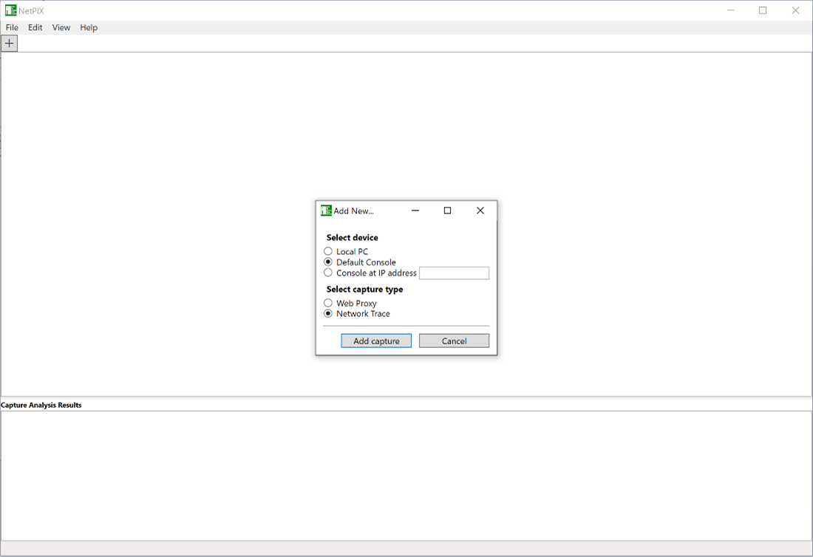
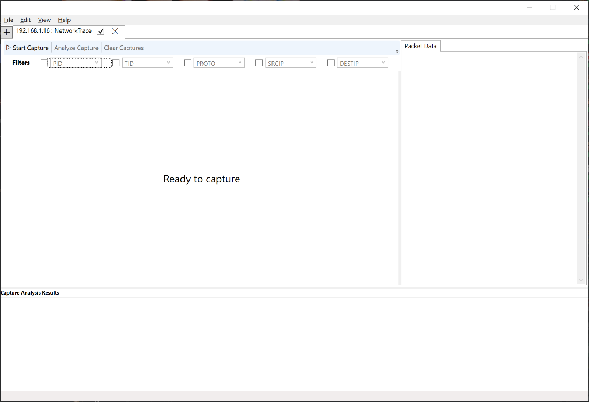
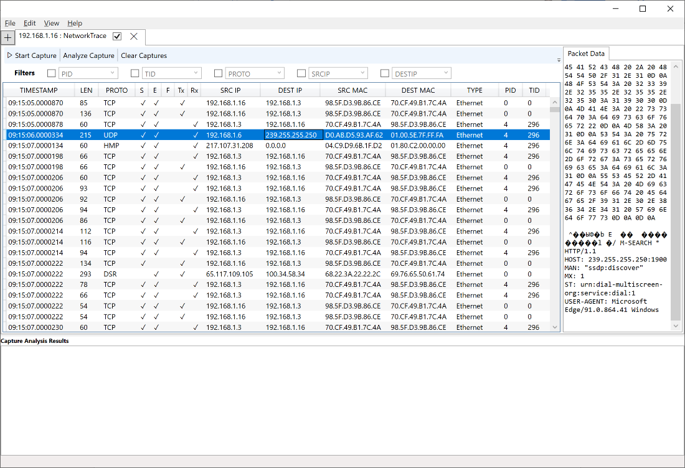
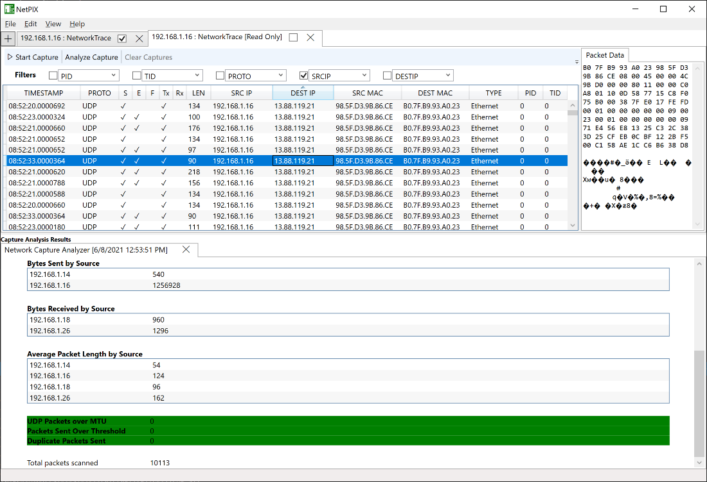

# Network capture

[Back to README](../README.md)

Capture packet-level traffic from an Xbox development kit or local Windows PC,
inspect packets, and run basic analysis inside XMAT.

Console capture is similar to using `xbtrace netcap` and viewing results in NetMon.
That workflow remains available and provides higher-fidelity data.

## Prerequisites

- For consoles, a reachable Xbox development kit meeting the
  [device requirements](../README.md#requirements).
- For local Windows PC capture, **run XMAT as administrator**. It uses `netsh trace`.
- To analyze existing data instead, [load or import a capture](capture-files.md).
  Traces from another PC can be [imported as `.ETL`](capture-files.md#import-network-traces-from-another-pc).

## Capture network data

1. Click the **+** tab and select your console or Local PC.
2. Choose **Network Trace** and add the capture.
3. In the **NetworkTrace** tab, click **Start Capture**.
4. Reproduce the issue while XMAT shows **Trace Running**.
5. Click **Stop Capture** and wait for trace processing. For consoles, XMAT
   downloads the capture after processing; large captures can take time.

**Expected result:** captured packets appear in the UI for filtering and individual
inspection.

Use **File > Save Captures** and **Load Captures** to save and reopen trace data.
**Clear Captures** removes the current data set; **Start Capture** clears it and
starts a new capture.

## Analyze a capture

1. Stop captures and apply filters to reduce the data to relevant packets.
2. Select **Analyze Capture**.
3. Inspect the new **Analysis Results** tab.

The report includes packet-send statistics by source. It flags UDP packets exceeding
the recommended Xbox MTU (1384), sending more than 20 packets in a second, and
duplicate packets within a second. Detected issues have a red background.

## Recover from capture errors

If console network capture fails, reboot the console before retrying. A trace may
still be running and its capture service can continue to fail until restarted.
For logs and other recovery steps, see [Troubleshooting](troubleshooting.md).
