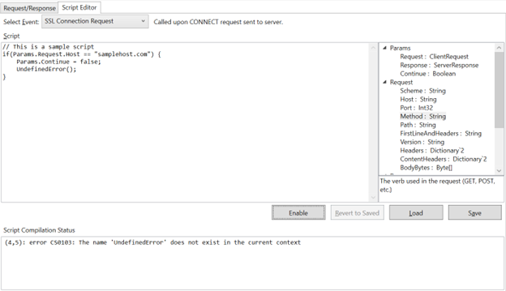

# Scripting

[Back to README](../README.md) | [Web proxy](web-proxy.md)

Use C# scripts to modify HTTP(S) requests and responses on the fly. Scripts belong
to a capture/client tab, not all clients.

## Prerequisites

Set up a [web proxy capture](web-proxy.md), then open its **Script Editor** tab
on the right side of the main window.

## Choose an event

| Event | When it runs |
|---|---|
| **SSL Connection Request** | When a client makes an HTTPS CONNECT request to a server |
| **Web Request** | After the client sends a request, before XMAT forwards it to the server |
| **Web Response** | After the server sends a response, before XMAT forwards it to the client; also for XMAT's CONNECT reply |

Each event starts with a commented sample that does nothing until you remove the
`//` prefixes from its example lines.

**Scope warning:** an enabled script runs for every host passing through that capture
unless it checks `Params.Request.Host`. A Web Response script should skip `CONNECT`
requests unless changing tunnel behavior is intentional; delaying that reply delays
every HTTPS tunnel.

**Streamed responses:** event streams, audio and video (while **Automatically stream
audio, video and event streams** is on), every response with a body (while **Stream all
responses** is on) and bodies larger than the capture limit reach the device as they
arrive (see [Streaming and large responses](web-proxy.md#streaming-and-large-responses)).
A Web Response script sees a copy after such a response ends and can't change or cancel
it. The copy's body is what the capture kept, so it may be truncated. XMAT logs a warning
when the script changes the copy or sets **Continue** to `false`.

## Write and enable a script

1. Select an event and edit its script.
2. Use **Params** to inspect or modify **Request** and **Response**. Set
   **Continue** to `false` to cancel the request or response.
3. Click a property in the right-hand list for its description, or double-click to
   insert its name at the cursor.
4. Click **Enable** and check **Script Compilation Status**.

The button shows **Compiling...** and cannot be clicked again while compilation is
running. A script turns on only after compiling without errors. The editor and
**Script Editor** tab show which scripts are active.

**Expected result:** future requests and responses pass through the enabled script
and receive its modifications.

### Example uses

- Redirect a particular URL in a **Web Request** script.
- Change a **Web Response** status from 200 to 500 to test client error handling.
- Parse and modify JSON using the available **System.Text.Json** namespace.

## Handle compilation results

- Errors leave the script disabled. Double-click an error or warning to navigate to
  its source.
- Warnings do not prevent activation; the status reads "Script compiled successfully
  with warnings."
- An unexpected compilation failure leaves the script disabled and displays
  "Could not compile; script remains disabled. See the app log." Details are in the log.
- Editing clears compilation status and turns off an enabled script. A script edited
  during compilation stays off until you click **Enable** again.
- **Load** and **Save** are unavailable while compiling or enabled.

## Asynchronous scripts and deadlines

Scripts can use `await`. XMAT waits for the event's script before forwarding the
request or response. Each invocation has a **60-second deadline**.

If the deadline expires, XMAT logs an error and drops that transaction without
sending a response. Stopping capture while a script runs also cancels the wait and
drops the transaction, but is not logged as a deadline error. A CONNECT request
does not open its HTTPS tunnel in either case. A streamed response already reached the
device, so neither drops it: its capture is still recorded, and stopping capture gives
its Web Response script up to 10 seconds.

The deadline applies to one invocation, not the total time seen by the client.
Clients may retry dropped requests, and every retry runs the script again.

**Cancellation cannot terminate arbitrary script code.** Blocking code may continue
using worker threads after its request is dropped. Later changes to `Params.Request`
or `Params.Response` are neither forwarded nor captured, but other script side effects
are not undone.

## Save and reuse scripts

Use **Load** and **Save** to work with scripts on disk. **Revert to Saved** undoes
changes since the last save.

## Limitations

The editor is a text box without syntax highlighting, IntelliSense, or completion.
Not all .NET namespaces and objects are available.

For collecting logs when compilation or execution fails, see
[Troubleshooting](troubleshooting.md#collect-debug-logs).
