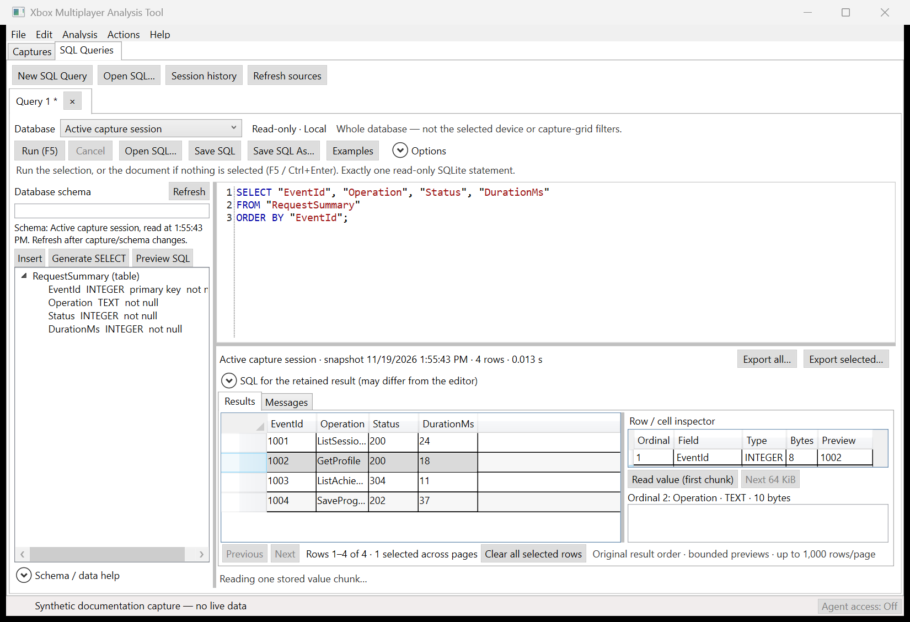

# SQL workspace

[Back to README](../README.md) | [Capture files](capture-files.md) | [Agent Access](agent-access.md)

Use the SQL workspace to inspect an active or loaded capture with read-only SQLite queries. Choose
**Analysis > New SQL Query**. XMAT opens a **SQL Queries** workspace without replacing the **Captures**
workspace, so device tabs, analysis views and the capture-panel splitter remain in place.



## Start a query document

1. Open **Analysis > New SQL Query**, or select the **SQL Queries** workspace tab.
2. Select the data source and click **Refresh sources** if the active or loaded capture changed.
3. Click **Refresh schema** for the selected source when you need its current tables and columns.
4. Enter a query, then select **Run**. **F5 / Ctrl+Enter** runs the selection when text is selected;
   otherwise it runs the document. **Ctrl+Space** opens completion.

The source selector is authoritative:

- The active source is a private snapshot of the current writable capture database. Captures must be
  stopped before that snapshot can be prepared.
- The current loaded source is the `.xmatcap` or imported capture opened by the application. It is
  immutable for query purposes, so it can be queried while an unrelated live capture runs.
- XMAT retains one current loaded source; the SQL workspace does not perform a cross-file join.
- Capture-grid device, host, process and status filters do not silently select or filter the SQL
  source. Use the source and schema controls explicitly.
- An old selected source can remain visible after a capture is replaced or becomes unavailable.
  Refresh sources and choose an available source before running it.

Editing a document remains available while capture is running. Query readiness and snapshot preparation
are separate from editor availability.

## Write and explore SQL

The local AvalonEdit editor provides syntax highlighting, line numbers, schema search,
table/column insertion, generated `SELECT` examples, preview queries, basic alias-aware completion,
and sample query templates. Select a table or column in **Database schema**, then use **Insert**;
double-clicking a table or column can insert it too. **Generate SELECT** and **Preview table** update
the editor with an example query; they do not execute it automatically.

For example, summarize the status returned for each host:

```sql
SELECT RequestHost,
       RequestStatus,
       COUNT(*) AS Calls
FROM WebProxyConnections
GROUP BY RequestHost, RequestStatus
ORDER BY Calls DESC;
```

Illustrative output:

| RequestHost | RequestStatus | Calls |
|---|---:|---:|
| `example.test` | `200` | 42 |
| `login.example.test` | `401` | 3 |

Use **Schema** to discover the tables and fields in your source rather than assuming that an example
source has every table or column. Generated queries and completion are schema-informed helpers, not a
full SQL language server.

## Query safety and limits

The SQL workspace uses the same read-only data-access snapshots as Agent Access. A run accepts exactly
one result-producing read-only statement. It does not allow database writes, `ATTACH`, `PRAGMA`,
transactions, batches or extension loading. SQLite is opened by XMAT's data-access layer; the editor
is not a generic SQLite database browser or a path by which an agent can open arbitrary files.

Default document options allow 60 seconds and a 512 MiB result store. The document validates its
options before running. A quota, timeout, cancellation or query error leaves the preceding successful
result available with its original SQL and source identity; XMAT does not present a failed result as
if it belonged to the latest editor text.

After a snapshot has been prepared, capture can resume without changing that run. **Cancel** stops the
UI operation and drains private work before releasing it. Temporary snapshots and results contain
unencrypted capture data and use additional disk beyond the configured result-store quota.

## Read and inspect results

Results use a virtualized ordinal grid and pages of 1,000 rows. The page boundary is not a hidden
`LIMIT`: the completed immutable result still retains its exact total row count.

- NULL, INTEGER, REAL, TEXT and BLOB previews remain typed.
- Empty and duplicate column labels are retained without losing ordinal access.
- Select a value to use the bounded **Row / cell inspector**. Large values are read in chunks, rather
  than being assembled into an unbounded UI string.
- Row selection is based on the immutable result's row identity, so selections survive page changes.
- Columns preserve the query order rather than offering a separate sort that would imply a new result.

Select a statement result only after the run is complete. The editor, result and export continue to
refer to the same frozen result while you page or inspect it.

## Export a completed result

Use **Export all...** for every row or **Export selected...** for the selected row identities. Choose
CSV or JSON and accept the privacy disclosure before selecting a destination. The export reads the
completed immutable result and never reruns the SQL, reopens the source or substitutes a newer capture.

Exports keep all rows, duplicate/empty labels and typed values. CSV quoting makes fields parse correctly
but does not neutralize spreadsheet formulas. Treat CSV and JSON as unsanitized evidence: both can contain
credentials, identifiers, URLs, headers or payload-derived values. Review and share them according to
your organization's data-handling rules.

## Documents, files and history

- **New query** creates a separate document and preserves other documents' editors and undo stacks.
- **Open SQL...** creates a document from a `.sql` file. Opening a file does not execute it.
- **Save / Save As** writes the editor text, not the result.
- Unsaved documents use **Save / Discard / Cancel** before close.
- Closing a document or the application waits for its owned query work to drain before releasing that
  document's private snapshots and results.
- **History** keeps the latest 100 run entries for this session. Reopening a history item creates a
  document with the remembered SQL and source when that source is still identifiable. History can be
  cleared and is not written to application settings.
- **Ctrl+N** creates a document and **Ctrl+W** closes the current document.

Query source files and history can contain sensitive data even when no output file is exported. The
history is memory-only, but it remains visible to the current desktop user for the lifetime of the
workspace.

## Troubleshooting

| Symptom | What to check |
|---|---|
| Run or snapshot controls are unavailable | Refresh sources, confirm the selected source is still available, and stop the relevant live capture before preparing an active-source snapshot. |
| Schema does not show a table you expect | Refresh sources, then refresh schema for the explicit source. A loaded source and the active source are separate schemas. |
| A query times out or reaches a quota | Reduce the result size, narrow the time/host/source criteria, use aggregation, or adjust the document's validated options. |
| A cancelled or failed run still shows old rows | This is expected: the previous successful result is retained. Check its displayed SQL/source identity before exporting it. |
| The cell inspector shows a preview or omits a value | XMAT bounds display reads. Use the exact result export workflow when you need the complete completed value set allowed by the query result. |
| A SQL error has no precise editor location | The SQLite provider did not supply an offset XMAT can map. Use the error text and the statement near the reported operation. |
| Source refresh fails | The active/loaded capture may have changed or become unavailable. Refresh again after capture load/import/close completes, then select an available source. |

For capture-file opening, saving and import behavior, see [Capture files](capture-files.md). For logs and
general recovery, see [Troubleshooting](troubleshooting.md#collect-debug-logs).

## SQL through Agent Access

[Agent Access](agent-access.md) uses the same provider-free query, immutable-result and export
boundaries for desktop and headless MCP sessions. Under the agent's Redacted sharing policy, XMAT builds
a fresh private projected database before accepting arbitrary SQL. Result pages, exact value chunks and
CSV/JSON exports all use that same projected result.

Human editor results are not automatically projected or redacted by Agent Access policy. Agent-origin
shutdown can request explicit revision-bound SQL **Save / Discard / Cancel** choices; normal human Close
continues to use the desktop dialogs described above.

AvalonEdit 6.3.1.120 is MIT-licensed; its notice is included with the application.
