# Web proxy

[Back to README](../README.md) | [Getting started](getting-started.md)

Capture and inspect web requests, responses, and WebSocket messages from a device.
XMAT automates the console proxy setup traditionally described under "Fiddler" in
the GDK documentation.

## Prerequisites

Check the [device requirements](../README.md#requirements) and start XMAT.
An Xbox kit must be reachable and ready for the reboots required when enabling or
disabling proxying. Generic devices must support a certificate and manual proxy settings.

## Add a device

1. Click the **+** tab and choose a device and the web proxy capture method.
2. Select **Default Console** to use the designated default console without
   entering its IP address, or specify another device.
3. Click **Add capture**. A new device/capture tab opens with an empty connections list.

The kit shown above runs the June 2021 recovery and is set to the Dev Home experience.

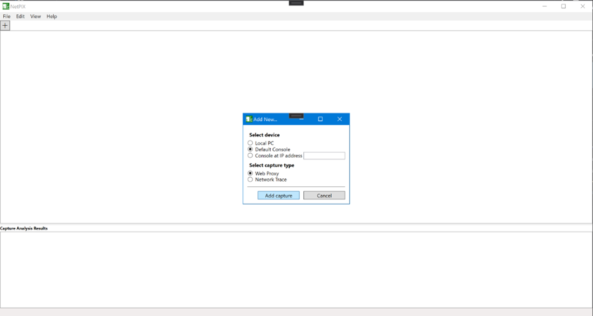

### Automatic proxy ports

Open **Edit > Preferences > Web Proxy** to change the available automatic proxy ports.
The example below uses port 8080.

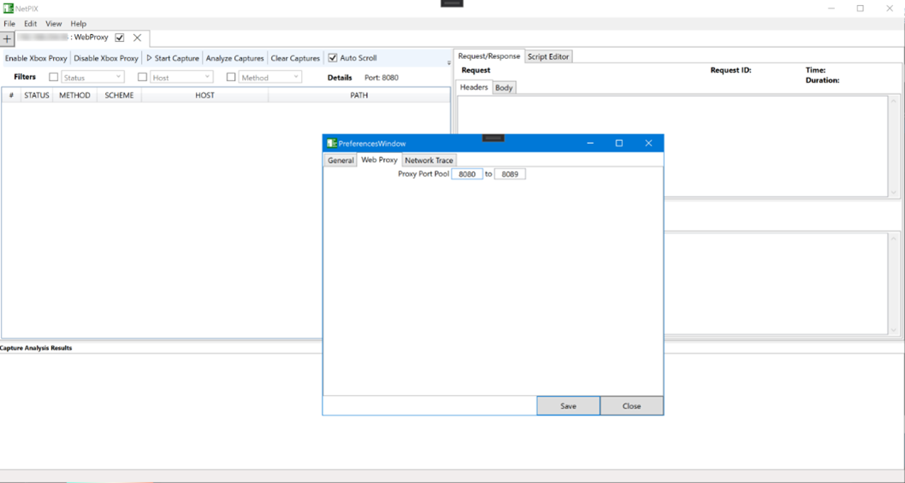

Changing the automatic range does not change an existing device session's assigned
port or free its reservation. Each open capture keeps its port reserved even while
stopped and after remembered devices are restored.

Only one managed proxy endpoint is supported per device. Adding a known device
selects its existing tab rather than creating a second proxy session. A separate
Network Trace capture and read-only imported captures are still supported.

## Enable console proxying

1. Select the console's capture tab.
2. Make sure the kit is ready to reboot, then click **Enable Xbox Proxy**.
3. Wait for the console to restart, then generate web traffic from an app.

**Warning:** enabling proxying reboots the kit and starts the local proxy immediately.
Proxy settings persist across console reboots and XMAT restarts until you explicitly
disable them.

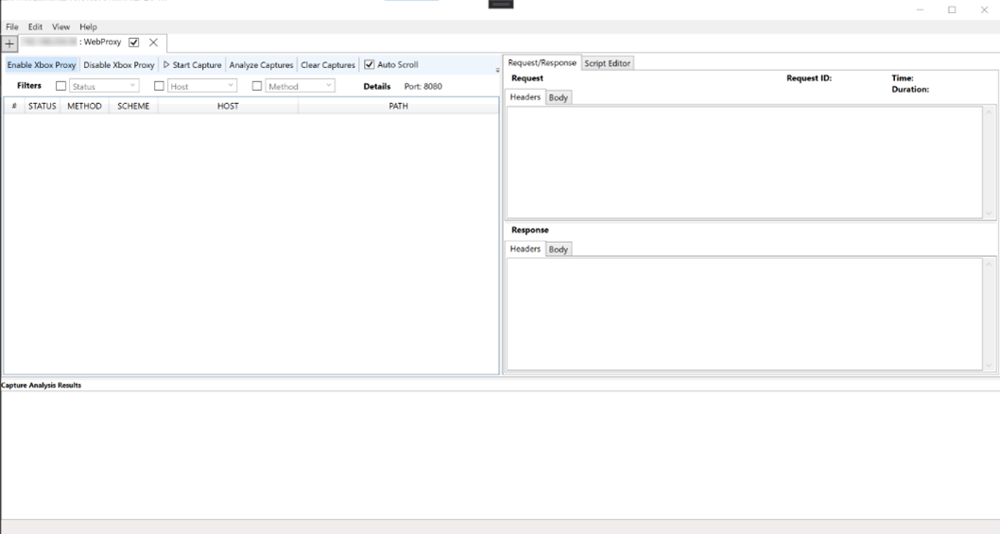

The console's "Fiddler enabled" notification indicates successful proxy setup even
though Fiddler itself is not running.

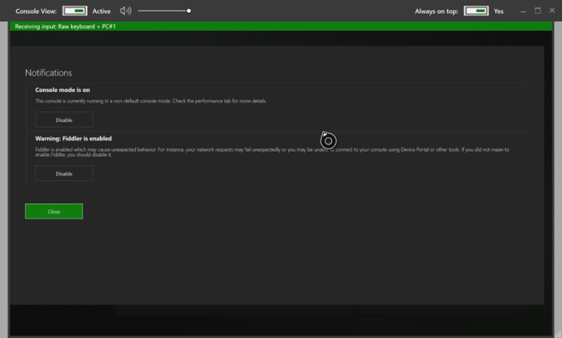

**Expected result:** connections populate the capture's connections list.

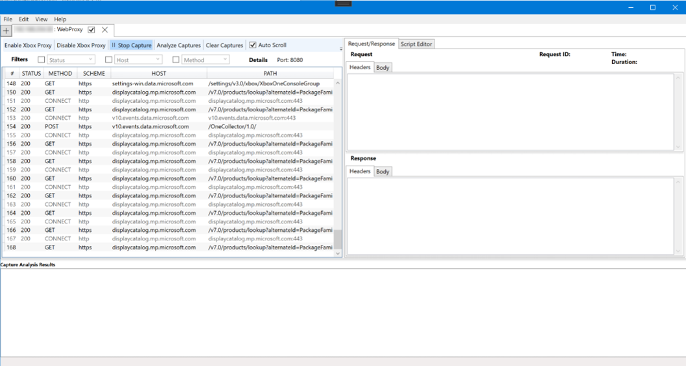

**Stop Capture** stops only the local listener; it does not disable or reboot the
console. **Disable Xbox Proxy** remains available while capture is stopped or after
a failed start, so clearing stale console settings does not require starting a listener.

### Check device settings

**Check Proxy Status** reports the Xbox endpoint instead of treating any nonempty
proxy host as a match. Re-enabling a verified matching endpoint does not rewrite
settings or request another reboot. A different existing endpoint is not overwritten
automatically.

This action is not available for Local PC captures. Generic/manual devices offer
**Proxy Setup Details**, which displays connection instructions rather than querying
device state.

If endpoint verification fails, see [Xbox proxy recovery](troubleshooting.md#xbox-proxy-recovery).

## Change a proxy port

1. Select the device's existing tab and stop capture.
2. Choose **Actions > Change Proxy Port**.
3. Choose an unassigned port from **1 through 65535**. It may be outside the automatic
   range in Preferences.
4. Choose when to apply the change:

| Choice | Behavior |
|---|---|
| **Apply now** | Starts the replacement listener before changing device settings. Xbox proxying is disabled/re-enabled with the required restarts; the console may reboot twice. The popup explains this before consent. Other devices remain stoppable during restarts. |
| **Later** | Saves a pending replacement without changing the device or current assigned port. Both ports stay protected, including after XMAT restarts. Starting/enabling the capture offers the change again; **Discard pending change** keeps the current port. |
| **Cancel** | Closes the popup without accepting a new selection. |

Capture history, filters, and selection are retained. The bottom status bar shows
the selected capture's running/stopped state, assigned port, and pending-change or
device-configuration details. Endpoint confirmation is separate from local capture
activity, so stopping capture does not leave a message claiming it is still running.

**Warning:** canceling an apply prevents later steps, but a console reboot or SDK
operation already requested cannot be undone. An in-flight mutation must settle.

XMAT reports binding, saving, or configuration failures and preserves assignments
needed for recovery rather than silently substituting ports. Once a replacement is
saved and the device may be using it, uncertain activation does not automatically
tear down its listener or revert to the old port. For Xbox, use **Check Proxy Status**
before retrying, stopping, or disabling.

For generic/manual devices, XMAT cannot edit settings remotely. Stop the device/app
using the old endpoint, confirm that in the popup, then update its settings to the
new endpoint shown by XMAT. Different apps can use independently configured generic
listeners, but two global proxy endpoints do not duplicate the same device traffic.

## Inspect requests and responses

1. Launch an app on the kit, such as the ATG NetRumble sample.
2. Select a connection to view its request and response.
3. Use **Headers** and **Body** to inspect formatted data and the connection details
   to see request time and duration.

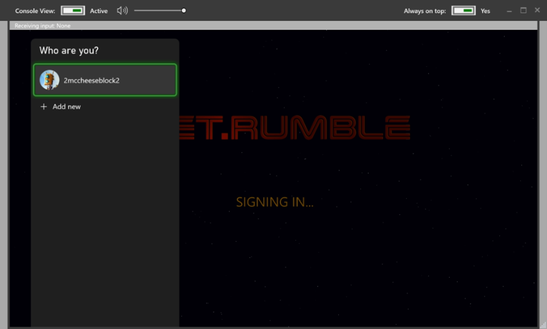

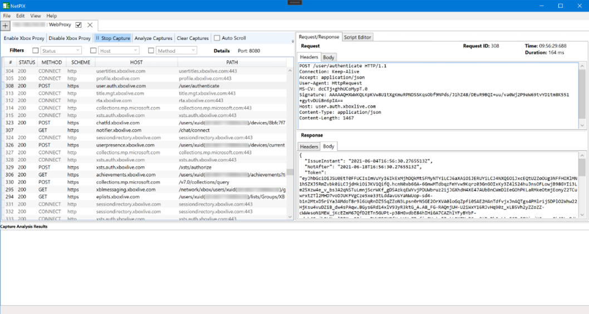

**Auto Scroll** is enabled by default to follow incoming connections. Turn it off
to keep a request in view. Status codes appear when responses arrive.

### Body previews

The **Body** and **JSON** tabs show one preview of the selected request's or
response's body, prepared in the background so that selecting connections stays
responsive; **Preparing the preview...** shows until it is ready, and a preview that is
no longer needed is cancelled. XMAT decodes one `gzip`, `deflate` or Brotli (`br`)
content encoding, reads text in the charset of the `Content-Type` (or a byte order
mark, or else strict UTF-8), and formats JSON when the content type says JSON. Content
that is not text, or that cannot be decoded, is shown as bytes in hexadecimal. A
preview reads at most 16 MiB of the body, decodes at most 4 MiB, and shows at most
256 Ki characters or 4,096 lines, or 4 KiB as bytes. The JSON tree stops at 2,048
nodes or 64 levels, cuts values at 1,024 characters, and expands only the root of a
single document.

A line above the body says what the preview does not show and why, for example that
only its start is shown, that it is shown as bytes, or that the JSON is cut. An empty
body says that it is empty, and a body that XMAT did not keep (see
[Replay requests](#replay-requests)) says so, instead of showing an empty body. Bodies
in the **XMAT Replays** tab, and the composer's response, are shown as the HTTP stack
delivered them: their chunked framing is never removed a second time.

### Filter connections

Use the toolbar lists to filter by status code, host, or method. Lists contain the
values found in the capture; only checked values are shown. Filters combine and
update as traffic arrives. **ALL/NONE** helps include or exclude a small set of values.
Status codes of 400 or higher are colored red.

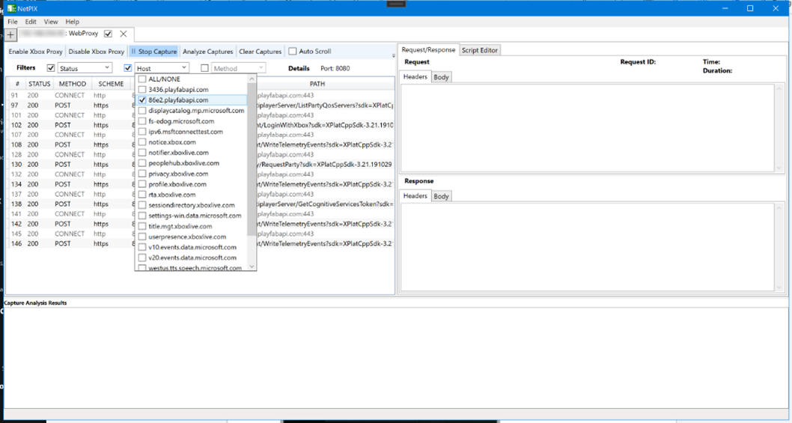

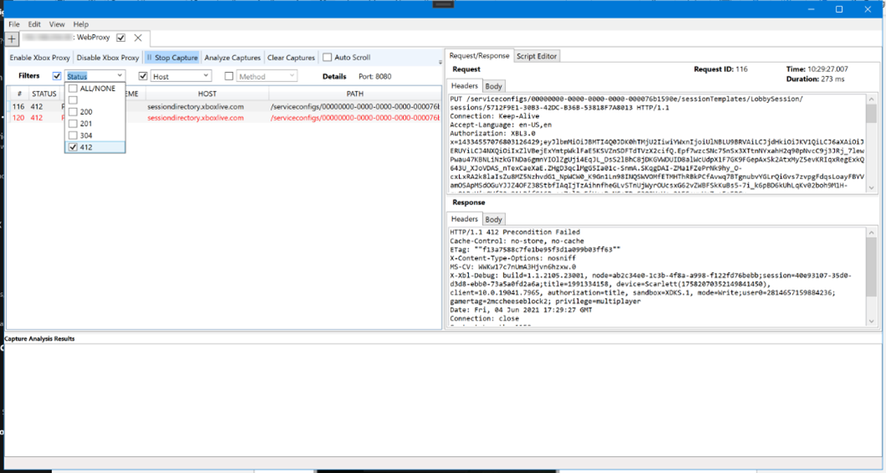

### Filter by process

Through a PC proxy, other programs on the PC, such as browsers, chat apps, updaters
and Windows services, send their traffic through XMAT too. The **PROCESS** column
shows the program that opened each connection on this PC, by image name and process
id, such as `Game.exe (1234)`. It shows **Resolving…** while XMAT looks the program
up, **Remote device** for traffic from a console or another device, and **Unknown**
when the program could not be identified, for example because it had already exited,
or when the capture was recorded before XMAT stored this information. XMAT stores the
image name, never the program's path.

To focus on one program:

- Right-click a request or a timeline bar and choose **Show only "Game.exe"**, or
  **Hide "Name"** to hide that program. **Show all processes** clears the process
  filter.
- Or select **Process** in the filter bar and enter image names or process ids,
  separated by semicolons, under **Show only** and **Hide**. Names ignore case, `*`
  and `?` are wildcards (`game*.exe`), and `.exe` is optional; a number is a process
  id. The filter applies shortly after you stop typing, or when you press Enter or
  **Apply**. **Hide svchost.exe** hides Windows' service host processes.

While a process filter is set, the filter bar shows **Process filter: N/M; H hidden;
U unknown**: the sessions that the process filter shows out of all sessions in the
tab, how many it hides, and how many have no process information. Sessions without
process information appear only while **Show only** is empty. A session whose program
is identified after it appears is shown or hidden at that moment, without reloading
the list. The process filter combines with the status, host and method filters, and
**Show all processes** leaves those filters unchanged.

The process filter only hides sessions: XMAT still forwards and records all traffic
from every program, and saving, exporting and analysis use the full capture unless
you choose to analyze only the filtered sessions (see
[Live trace analysis](live-trace-analysis.md)). Each capture tab has its own process
filter, which [clearing the capture](#clear-a-capture) keeps and which is not saved.
The timeline follows the process filter, but not the status, host and method filters.

### Capture timeline

The Waterfall and By Host views retain complete capture history, including gaps
between capture sessions. Only visible request bars, host labels, and time-axis ticks
are rendered, so scrolling into older history does not rebuild the entire timeline.

Incoming changes are combined into at most ten timeline refreshes per second. This
limits presentation only, not request capture or storage. Scrolling, resizing,
switching modes, and stopping refresh the visible timeline without waiting for the
live-update cadence. Stopping displays final response statuses and durations even
if no further requests arrive.

### Clear a capture

**Clear Capture** in the capture toolbar, or **View > Clear Captures**, removes the
tab's requests and WebSocket messages; a running capture keeps capturing. Connections
that are still open can add new rows afterwards, and the tab keeps its process filter.

Request and connection numbers keep increasing after clearing; they no longer restart
at 1. This is intentional: data that arrives later on a connection opened before the
clear can never be matched to a newer request with the same number. **Stop Capture**
followed by **Start Capture** starts numbering at 1 again.

Clearing never overlaps saving, exporting, importing or analyzing captures: **Clear
Capture** is unavailable while one of them runs, and if one starts at the same moment,
XMAT reports that another capture operation is in progress and clears nothing.

## Edit and resend a request

1. Right-click an HTTP request in the connections list and select **Edit and resend**.
2. Edit the method, URL, headers, or body in the composer window.
3. Click **Send** and inspect the new response. The original capture is not modified.

The composer shows the request as fields, in Parsed mode, from which XMAT builds the
request that it sends, as described below. To send exactly the bytes that you prepare
instead, see [Raw mode (prepared bytes)](#raw-mode-prepared-bytes).

Loaded and imported captures can be resent too. Binary, compressed, and non-UTF-8
request bodies are preserved as editable Base64; text bodies use UTF-8.

The exception is an XMAT capture without the text-format marker (see
[Capture text markers](capture-files.md#capture-text-markers-and-marked-copies)), whose
stored text an older XMAT may have changed. For its requests, **Edit and resend**,
**Replay**, and dragging one into a composer refuse, and nothing opens, is asked, or is
sent. Create a marked copy with `xmat mark-capture-text`, open that copy, and use its
requests instead.

Requests are sent directly from this PC, unless you select **Upstream proxy** (see
below), bypassing system proxies and capture scripts. HTTPS certificates are validated,
redirects are not followed unless you select **Follow same-origin redirects** (see
below), and response cookies are not reused. **Captured headers, including credentials,
are sent to the edited URL.** Host and Content-Length are regenerated, and
connection-only headers are omitted. Methods other than exactly GET, HEAD, and OPTIONS,
in capitals, require confirmation, as does changing the captured origin. The question
names the method, the URL, and any origin that it is about, each shortened when long
and with any character that could hide or reorder text, such as a bidirectional
control, shown as `\uXXXX`; the request is sent with the whole method and URL as you
entered them. CONNECT and WebSocket handshakes cannot be resent.

XMAT sends no request to an IPv6 address with a zone identifier, such as `fe80::1%12` or
`fe80::1%Ethernet`, and exports no cURL command for one. A request keeps such a
destination as data: **Edit and resend**, dragging a request into a composer, **Open
request**, and **Save request as** keep its URL, zone included. **Send**, **Copy as
cURL**, and **Save as cURL script** refuse it before anything is asked, sent, copied, or
saved; the status line says why, and the request in the composer stays as it was. To
send the request, replace its URL with another destination: that changes the captured
origin, which XMAT asks about as always, and the request keeps its captured origin.

A request of the **XMAT Replays** tab keeps, as its captured origin, the origin that its
request was captured or saved for, or first sent to, in Parsed and Raw mode alike; a
request file's is the origin that it was saved for. **Edit and resend**, dragging the
request into a composer, and **Load** keep it, and **Reissue** asks before sending such
a request to another origin. It is kept in memory only: in a saved capture that you open
again, a request's origin is that of its own URL.

HTTPS certificates are checked as Windows checks them, with two limits that every
resent or composed request shares. Revocation is not checked, so a revoked certificate
can pass when the rest of its validation succeeds. And no certificate is downloaded:
validation never fetches an issuer certificate from an address in the server's
certificate, and fetches no revocation data, so a server must send every intermediate
certificate that this PC does not already have in its certificate stores or cache.
Windows' automatic root update may still ask Windows Update about an unknown root.

Use **Cancel request** to stop waiting. Sending has a 30-second timeout and a 16 MiB
response limit for each request. Cancelling or timing out cannot undo changes already
processed by the server. To send the request outside XMAT, use **Copy as cURL** or
**Save as cURL script** (see below).

Before anything is asked or sent, the composer checks the request in the background, as
it was when you clicked **Send**, and the status line says so. **Cancel request** stops
the check: nothing is asked, sent, or recorded, and the status line says "Not sent:
cancelled before sending." Closing the composer also stops the check: nothing is asked,
sent, or recorded, and the closed composer says nothing further.

To send a request that was never captured, select **Actions > Compose a New Request**.
The composer opens with an empty GET request and works the same way.

Each send from the composer is also recorded in the **XMAT Replays** tab, like the
requests that **Replay** sends (see below). A send that you cancel is not recorded, but
it may already have reached the server, and the status line says so. While a replay, an
analysis, or a capture file operation such as an import runs, the composer does not
send and says so; send again when it has finished.

### Composer options

- **Follow same-origin redirects, at most** *N* is off by default; *N* is 1 to 10, and
  10 at first. XMAT follows a redirect only to the scheme, host, and port that the
  request was sent to, and never from HTTPS to HTTP, so captured headers and the body
  never go to another origin. Each redirect followed is another request: after a 303
  it is a GET without the body, but a HEAD stays a HEAD, and after a 301 or 302 that
  answers a POST it is a GET without the body, as browsers send it. XMAT never follows
  a redirect to an IPv6 address with a zone. When XMAT does not follow a redirect, the
  redirect response is the result and the status line says why. Without the option, a
  redirect response is shown as it is.
- **Inspect session** is off by default. When it is selected, XMAT selects the last
  request that the send recorded in the **XMAT Replays** tab once the send has ended,
  also when that request failed or timed out, and also when you cancelled the send
  after some of its requests were recorded. It selects nothing when the send recorded
  nothing (never a request of an earlier send), when the tab or the composer was closed
  meanwhile, or when XMAT stopped the send because it is closing or exiting.
- **HTTP version** is **Automatic** by default, which lets the connection choose the
  version, as before. **HTTP/1.1 only** and **HTTP/2 only** send exactly that version
  and never fall back to another; **HTTP/2 only** needs an HTTPS URL.
- **Connect to another endpoint** is off by default. It sends the request to an IP
  address and port that you enter, such as `192.0.2.10:443` or `[2001:db8::10]:443`,
  instead of the address that the URL's host resolves to, as Fiddler's `Fiddler-Host`
  does; host names and URLs are not accepted. It works with HTTPS URLs only. The URL,
  the `Host` header, and the certificate check stay those of the URL, so the endpoint
  must present a certificate that is valid for the URL's host; XMAT never falls back to
  DNS or a proxy, and redirects followed within the URL's origin go to the same
  endpoint. Sending needs your confirmation, which names the URL's origin and the
  endpoint, together with any other confirmation that the send needs.
- **Upstream proxy** is off by default. It sends every request, and every redirect
  followed, through an HTTP proxy that you enter, as Fiddler's gateway does; see
  [Send through an upstream proxy](#send-through-an-upstream-proxy).
- **Client certificate** is off by default. It offers a certificate from your Personal
  certificate store to a server of the request's origin that asks for one; see
  [Send a client certificate](#send-a-client-certificate).
- **Automatically authenticate with Windows** is off by default. It answers the
  Negotiate and NTLM challenges of the request's origin with the Windows credentials
  that XMAT runs with; see [Authenticate with Windows](#authenticate-with-windows).
- **Edit as raw text...** switches the composer to Raw mode, which sends one HTTP/1.1
  request as the exact bytes that you prepare, and **Edit as parsed (normalized)...**
  switches it back; see [Raw mode (prepared bytes)](#raw-mode-prepared-bytes). In Raw
  mode, **HTTP version** shows **HTTP/1.1 only**, and **Follow same-origin redirects**,
  **Upstream proxy**, **Client certificate**, and **Automatically authenticate with
  Windows** stay off and cannot be selected.

The options are fixed when you confirm or start a send: changing them while it runs, or
while XMAT asks you about it, changes nothing for that send. In the **XMAT Replays**
tab, a request sent with an HTTP version other than **Automatic**, with **Connect to
another endpoint**, with **Upstream proxy**, with **Client certificate**, or with
**Automatically authenticate with Windows** has a note that says so, without the
endpoint, the proxy, or the certificate, with the HTTP version requested and the one
used. The note is kept in memory only.

Fiddler's control headers `Fiddler-Host`, `X-OverrideHost`, `X-IgnoreCertCNMismatch`,
and `X-OverrideGateway` are not applied, and XMAT does not send a request that has one:
in the composer, delete it from the headers. Use **Connect to another endpoint** to send
to another address, and **Upstream proxy** to send through a proxy.

### Send through an upstream proxy

**Upstream proxy** sends every request of a send, and every redirect followed, through
the HTTP proxy that you enter, as Fiddler's gateway does: an `http://` request goes to
the proxy whole, and an `https://` one through a `CONNECT` tunnel, with TLS to the
server inside it. XMAT never sends such a request directly instead, never through the
system's proxy settings, and never with **Connect to another endpoint**: the two cannot
be used together, since the proxy chooses where it connects.

- **The proxy.** Enter `http://HOST` or `http://HOST:PORT`, with port 80 when you leave
  it out, such as `http://proxy.example:8080` or `http://[2001:db8::10]:3128`. `HOST` is
  an ASCII host name or an IP address, an IPv6 address in brackets without a zone. For
  the proxy only, XMAT refuses a user name or password, a path, query, or fragment,
  another scheme, HTTPS and SOCKS proxies included, a host name with non-ASCII
  characters or a trailing dot, a host name whose last label is a number, or an address
  in another form, such as `127.1` or `0x7f.0.0.1`. The status line then says how to
  write a proxy, without repeating what you entered.
- **What the proxy receives.** The proxy is a trusted recipient of the whole request: it
  receives the whole of every `http://` request, its `Authorization`, `Cookie` and other
  headers and its body included. For HTTPS, the unencrypted CONNECT request exposes the
  destination host and port and, when supplied, User-Agent information that may
  identify the application/title, SDK or device. If the proxy intercepts HTTPS with a
  certificate this PC trusts, it also receives the whole request and it—not
  XMAT—decides whether the server is genuine. XMAT's own proxy does not check servers'
  certificates. XMAT checks the server's certificate as it does without a proxy, so a
  proxy that intercepts HTTPS with a certificate that this PC does not trust fails the
  send. Use only a proxy that you trust with the requests' credentials.
- **Your confirmation.** Sending needs your confirmation, which names the proxy and says
  what it receives, together with any other confirmation that the send needs. The send
  goes through the proxy that you confirmed: changing it while XMAT asks, or while the
  send runs, changes nothing for that send.
- **When the send fails.** XMAT never authenticates to a proxy. When an HTTP 407 is
  received, whether it answers the request, the CONNECT of its tunnel, or comes inside
  the tunnel, the send fails without a response, is not retried, and the status line
  says "HTTP 407 (Proxy Authentication Required) was received. XMAT does not
  authenticate to proxies and did not retry the request." A proxy that does not open a
  tunnel to an HTTPS server, or that cannot be reached, fails the send too. The status
  line says what failed in its own words, never with the error message of the proxy or
  of Windows, which can name the proxy.
- **Never kept.** Dragging a request into the composer, **Open request**, and **Load**
  turn **Upstream proxy** off and clear its proxy, so they ask first when you have
  changed it. Request files, the history, and the **XMAT Replays** tab never keep the
  proxy. **Copy as cURL** and **Save as cURL script** are not available with it, since
  curl would send the request directly.

### Send a client certificate

**Client certificate** offers a certificate from your Personal certificate store, for
example to test a service that authenticates its clients by their certificates, as
Fiddler can. Client certificate: it is sent only to a server whose certificate this PC
accepts for the origin, and identifies the user to that server.

- **Choosing the certificate.** Select **Client certificate**, then open its list. XMAT
  reads the list in the background each time that you open it, from your Personal store
  opened read-only, and reads only each certificate's public data, never its private
  key. The list shows only certificates that XMAT could offer: ones that say where their
  private key is on this PC, valid for client authentication and digital signatures, not
  a certificate authority's, and with an RSA or ECDSA key. Being listed does not mean
  that the key can be used: XMAT checks that only when it sends. Each entry shows the
  certificate's subject, its issuer, and when it expires, and its tooltip also its
  thumbprint. An expired certificate, or one that is not valid yet, is marked so and can
  still be offered: the server decides whether to accept it.
- **Your confirmation.** Sending needs your confirmation, which names the origin, as
  `https://HOST:PORT`, and the certificate, by its subject, issuer, validity, and
  thumbprint (a long origin, subject, or issuer is shortened), together with any other
  confirmation that the send needs. The send uses the certificate and the origin that
  you confirmed: changing them while XMAT asks, or while the send runs, changes nothing
  for that send.
- **When the certificate leaves this PC.** Only over HTTPS, to one origin per send: the
  scheme, host, and port of the URL. XMAT offers it only to a server of that origin that
  asks for a certificate while it sets up TLS, and only after the server's own
  certificate passes this PC's validation for the origin's host; a server that does not
  ask receives none. XMAT never resumes an earlier TLS session for such a send, so each
  connection checks the server again. With **Follow same-origin redirects**, redirects
  are followed within that origin only.
- **What is refused.** Before anything is asked or sent: an `http://` URL, a URL that is
  not a supported HTTPS origin, and **Upstream proxy**, since a client certificate is
  never sent through a proxy. Then, when you send, before anything is sent: a
  certificate that is no longer in your Personal store or is there more than once, that
  is a certificate authority's, that is not valid for client authentication or digital
  signatures, whose key is neither an RSA nor an ECDSA key (a key restricted to RSA-PSS
  counts as neither), that does not say where its private key is, or whose private key
  cannot be used, and a store or certificate that cannot be read. The status line says
  why, without naming the certificate; `xmat` gives the same refusals as codes (see
  [Command line](cli.md)).
- **No prompt from XMAT.** XMAT itself never asks for a PIN, a smart card, or your
  consent. Before anything is sent, it opens the private key silently and checks it
  with one signature, and refuses a key that cannot be used that way, such as one that
  would need a PIN, a smart card, or your consent; nothing is sent then. It also
  refuses keys that it cannot use silently: an ECDSA key in a CryptoAPI provider, and a
  key in a CryptoAPI provider that cannot sign SHA-256, such as the older Microsoft
  Enhanced Cryptographic Provider. During the TLS handshake, XMAT asks Windows to use
  the key silently as well, which has not been verified for every key storage provider,
  such as a smart card's: one could still ask, for example after a cached PIN expires.
- **Never kept.** Dragging a request into the composer, **Open request**, and **Load**
  turn **Client certificate** off and clear the certificate chosen, so they ask first
  when you have changed it. Request files and the history never keep it, and the **XMAT
  Replays** tab notes only that a certificate was configured, never which one or
  whether it was sent. After the send, XMAT disposes its copy of the certificate; while
  XMAT runs, the TLS layer of .NET and Windows in its process may still hold a
  credential made for it, until that credential is evicted or XMAT exits; only a later
  send that offers the same certificate, after your confirmation and the same checks,
  can use it. **Copy as cURL** and **Save as cURL script** are not available with it:
  XMAT never exports a certificate.

### Authenticate with Windows

**Automatically authenticate with Windows** answers a server's Negotiate and NTLM
challenges, for example to test a service that uses Windows authentication, as Fiddler
can. Windows authentication: XMAT answers the origin's challenge with the Windows
credentials that it runs with, which may be a service or machine account's; Negotiate
may fall back to NTLM, which a recipient can relay or attack offline; a DNS attacker can
steer the Kerberos service name through CNAMEs, while HTTPS still proves the host.

- **Your confirmation.** Sending needs your confirmation, which says so, names the
  origin, as `https://HOST:PORT` (a long origin is shortened), and says that Windows
  authentication uses HTTP/1.1 only for the send, together with any other confirmation
  that the send needs. The send answers only the origin that you confirmed: changing
  the option while XMAT asks, or while the send runs, changes nothing for that send.
- **When XMAT answers.** Only over HTTPS, to one origin per send: the scheme, host, and
  port of the URL, directly, never through a proxy or another endpoint. XMAT answers
  only that origin's Negotiate and NTLM challenges, never Basic or another scheme's,
  and never before the server asks. With **Follow same-origin redirects**, redirects
  are followed within that origin only. With **Automatic**, the send asks for exactly
  HTTP/1.1, and the **XMAT Replays** tab notes **HTTP/1.1 only** as the version
  requested; the **HTTP version** that you chose stays as it is.
- **What is refused.** Before anything is asked or sent: **Upstream proxy**, **Connect
  to another endpoint**, an `http://` URL, a URL that is not a supported HTTPS origin,
  **HTTP/2 only**, and a request that includes its own `Authorization` header, even an
  empty one. The status line says why; `xmat` gives the same refusals as codes (see
  [Command line](cli.md)).
- **What is recorded.** The **XMAT Replays** tab shows each request as XMAT built it,
  without the `Authorization` header that Windows authentication adds, which XMAT also
  removes from the request after each hop. A send that fails keeps no error details. In
  the responses that XMAT records, each Negotiate, NTLM, and Kerberos challenge of a
  `WWW-Authenticate` or `Proxy-Authenticate` header keeps only its scheme name, without
  its data; other challenges stay as the server sent them, and a header value that is
  not a valid list of challenges is left out.
- **Never kept.** Dragging a request into the composer, **Open request**, and **Load**
  turn **Automatically authenticate with Windows** off, so they ask first when you have
  turned it on. Request files and the history never keep it, and the **XMAT Replays**
  tab notes only that it was configured, never whether a challenge was answered.
  **Copy as cURL** and **Save as cURL script** are not available with it: XMAT never
  exports a command that answers challenges with your Windows credentials.
- **With a client certificate.** **Client certificate** and **Automatically
  authenticate with Windows** can be used together, under the rules of both: HTTPS, one
  origin, no proxy, no other endpoint, HTTP/1.1, and no `Authorization` header of the
  request's own. The confirmation then has both paragraphs, for the one origin.
- **Testing.** XMAT's tests exercise Windows authentication with NTLM only, against a
  server on the loopback address; Kerberos is not exercised.

### Raw mode (prepared bytes)

Raw mode sends one HTTP/1.1 request as the bytes that you prepare in the composer: a
target origin, a head, and a body. It is a constrained mode, not Fiddler's raw wire
format: XMAT checks the request against Raw mode's rules before anything is asked or
sent, sends nothing that breaks one, and adds no field and changes none.

- **Switching.** **Edit as raw text...** turns the request in the editors into Raw
  mode's target origin, head, and body, and **Edit as parsed (normalized)...** turns it
  back into fields. Neither sends anything. The request is prepared in the background:
  **Cancel request**, or closing the composer, stops it and changes nothing. When the
  change loses anything, XMAT lists what and asks first, No by default, and declining
  keeps the request exactly as it was. Going to Raw mode, `Host` is written from the
  URL, `Content-Length` as the body's length, each header line as `Name: value`, and
  the URL's path and query as Parsed mode sends them; header lines that Parsed mode
  leaves out, such as connection-only ones, are left out, and a built form keeps its
  bytes but not its parts. Going back, a chunked body is decoded and sent with
  `Content-Length`, an absolute URL in the request line is not kept, header lines that
  Parsed mode does not send stay in the headers without being sent, and **HTTP
  version** returns to the choice for Parsed mode.
- **When switching is refused.** A request stays in Parsed mode while a part that a
  request file left out is not supplied, with a numbered URL, and with **HTTP/2 only**,
  **Follow same-origin redirects**, **Upstream proxy**, **Client certificate**, or
  **Automatically authenticate with Windows**. Its URL must be an absolute HTTP or
  HTTPS URL of at most 65,536 characters, without a user name or fragment, whose host
  is a DNS name or a whole IP address and whose port is decimal; its method a single
  token; each header line one valid `Name: value`; its body valid as its editor reads
  it; and the request within Raw mode's limits (see below). Preparation also allows at
  most 1,024 distinct candidate field names totaling 256 KiB, before Connection
  nominations are applied. A raw request that is not valid stays in Raw mode, as it is,
  when you edit it as parsed. Each time, the status line says why.
- **Target origin.** Where Raw mode connects, and the name that the server's
  certificate must have: `http://` or `https://`, a host, and a port when needed, such
  as `https://api.example.com:8443`, with no user name, path, query, or fragment. XMAT
  fills it in from the URL, with an international host name in its ASCII (punycode)
  form, and the confirmation shows it in ASCII first, with its Unicode spelling after
  it. `Host` must name this origin, and so must an absolute URL in the request line.
- **Head.** The request line, such as `GET /items HTTP/1.1`, then one `Name: value` line
  per field, in ASCII. Every line break is sent as CRLF, also one typed as LF, and the
  head ends with exactly one empty line. As you type, the composer counts the head's
  bytes and field lines against Raw mode's limits, and the line breaks typed as LF.
- **Body.** The body editor holds the body, which is sent unchanged, line breaks
  included: its text as UTF-8, or its bytes when it is Base64 or uploaded. Its framing
  is the head's own: one `Content-Length` equal to the body's length, or
  `Transfer-Encoding: chunked` with complete chunks, never both. **Fix
  Content-Length** sets the one `Content-Length` field to the body's length in bytes
  and changes nothing else in the head; it needs exactly one `Content-Length` field and
  no `Transfer-Encoding`. **Build form** is not available: write the body and its
  framing yourself, or upload its bytes.
- **Rules.** A head of at most 64 KiB, with a request line of at most 16 KiB and at most
  256 field lines; a method of at most 64 characters; a body of at most 64 MiB; and
  chunk framing of at most 1 MiB in all, with chunk lines of at most 8 KiB. No
  trailers, chunk extensions, or `Trailer` field, and no field more than once. HEAD and
  TRACE requests have no body, and a GET or OPTIONS request with a body counts as
  unsafe, with its own warning. `Host`, and an absolute URL in the request line, must
  name the target origin, which must not be, or resolve only to, an unspecified,
  multicast, or broadcast address. `Connection: close` is the only Connection field
  allowed, with no `Keep-Alive`, `Proxy-Connection`, or `TE` field, and there is no
  `Expect` field, protocol upgrade, or WebSocket handshake. CONNECT, and a standard
  method written in another case, are not sent.
- **The question.** XMAT asks before every raw send, No by default. The question says
  how many prepared bytes XMAT sends and to which target origin, and shows the request
  line, the head's size and field lines, and the body's size and framing, never the
  rest of the head. It adds the risk of a method that can change server data or of
  another origin than the request's captured origin, the warning about a GET or OPTIONS
  request with a body, and **Connect to another endpoint** when it is selected. **HTTP
  version** shows **HTTP/1.1 only**, the only version that Raw mode sends, and the
  version that you chose for Parsed mode comes back when you edit as parsed.
- **What Raw mode never does.** It sends on a new connection of its own, directly or to
  **Connect to another endpoint**, which needs an HTTPS target origin, never through a
  proxy. It offers no client certificate, uses no Windows authentication, follows no
  redirect, retries nothing, and adds no cookies or credentials: fields that you write,
  such as `Authorization` or `Cookie`, are part of the prepared bytes. It sends one
  request, without verification or numbered URLs, with the same 30-second timeout and
  16 MiB response limit.
- **What is recorded.** Each raw send that begins gets a row in the **XMAT Replays**
  tab, which shows a normalized view of the request, not its prepared bytes. The row's
  note begins "Attempted request" unless XMAT handed every byte of the request to the
  connection, and says what XMAT wrote, as the status line does: XMAT wrote nothing of
  the request; XMAT stopped after handing part of the request to the connection; XMAT
  could not confirm that every prepared byte was handed to the connection; or XMAT
  handed every byte to the connection. None of these says that the server received
  anything. The note also says when a response ended because the server closed the
  connection, so that it may be incomplete, and when the response's trailer fields
  were read but not kept. **Cancel request** before the send begins sends and records
  nothing.
- **The recording guarantee.** A raw send that began always gets its row, with what
  XMAT wrote, whether it completes, fails, or is cancelled, also by closing the
  composer, and exiting XMAT waits for it. There are two exceptions. When XMAT exits
  without closing its window, as when Windows ends the session, no row is added; the
  **XMAT Replays** tab, kept in memory only, ends with XMAT anyway. And when the tab
  cannot take a send, the run stops: while the composer is open, its status line shows
  that send's result and what XMAT wrote; once it is closed, only the application log
  notes the failure, naming only the error's type, never the request's data.
- **Certificates.** A raw send checks HTTPS certificates as every resent or composed
  request does, with the same two limits; see
  [Edit and resend a request](#edit-and-resend-a-request).
- **When a send fails.** "Could not be completed" means that XMAT could not resolve the
  target's name, connect to it, or set up TLS with it; or that a write of the request
  failed and no complete response followed; or that the connection ended before a
  complete final status line came, even after interim responses or part of a response.
  When the connection ends while XMAT reads a response's body, the response may be
  incomplete, and the status line says so.
- **Not available in Raw mode.** **Copy as cURL** and **Save as cURL script**, since
  curl would build a request of its own, and **Save request as**, since a request file
  holds a parsed request: edit as parsed first. Dragging a request in, **Open
  request**, and **Load** load it in Parsed mode; in Raw mode, the request in the
  editors always counts as edited, so they ask first, and declining keeps the raw text
  exactly.
- **No guarantee.** Raw mode's checks make a request well formed by its rules, not
  safe. A front end and the server behind it can read the same bytes differently, and
  a raw request can affect other requests on a connection that they share. Send raw
  requests only to servers that you own or may test.

### Copy as cURL and Save as cURL script

**Copy as cURL (PowerShell 7)** copies a command, and **Save as cURL script...** saves a
script, that sends the request in the composer with the `curl.exe` that comes with
Windows; XMAT itself sends nothing. **Both hold the full request, credentials and body
included**, as the warning beside the buttons says: anyone who gets the command or the
script can use them.

- **What they need to run.** Windows, PowerShell 7.2 or later, and the inbox
  `%SystemRoot%\System32\curl.exe`, version 8.21.0 or later, never another `curl` on the
  `PATH`. A header value with non-ASCII characters also needs curl's `Unicode` feature.
  The command and the script check all of this first, and refuse, sending nothing, when
  something is missing or when the command line would be longer than Windows allows. A
  refusal or failure gives a nonzero result: the script's exit code, or `$LASTEXITCODE`
  for the pasted command, which never closes PowerShell. When either fails or is
  interrupted, for example with Ctrl+C, it stops the curl that it started, and an
  interrupted command or script leaves `$LASTEXITCODE` at 1 in the PowerShell session
  that ran it.
- **How curl runs.** Without a proxy or a curl configuration file, and with none of the
  proxy, curl or TLS settings of your environment. It never follows redirects. It
  trusts the certificates that Windows trusts and also checks that the server's
  certificate was not revoked, which **Send** does not: a certificate whose revocation
  Windows cannot check fails in the command or script. Unlike **Send**, it has no
  overall time limit and no limit on the size of a response. It writes the response
  body, and any error, to the console.
- **What is sent.** One request, with the method, URL, headers and body as XMAT sends
  them over HTTP/1.1; `Host` and `Content-Length` come from the URL and the body. A
  header value with non-ASCII characters, which XMAT does not send, is sent as its UTF-8
  bytes, and an empty value as `Name:` rather than `Name: `. **HTTP/1.1 only** is sent
  exactly; with **Automatic**, curl chooses the version itself.
- **When they are not available.** In Raw mode, while a part that a request file left
  out is not supplied, for a numbered URL (see below), and with **Follow same-origin
  redirects**, **HTTP/2 only**, **Connect to another endpoint**, **Upstream proxy**,
  **Client certificate**, or **Automatically authenticate with Windows**: each button
  says why. A request with a Fiddler control header, a HEAD request with a body, a URL
  to an IPv6 address with a zone, or a URL and headers too long for one command line
  are refused when you select either button, before anything is asked, copied, or
  saved, and the status line says why.
- **Another origin.** When the URL goes to another origin than the request was captured
  or loaded for, XMAT asks whether to export the request for that origin, which it
  names: every time, before asking about the content, and No by default. Declining
  copies and saves nothing. Allowing it is no permission to send, and a permission to
  send is none to export.
- **Copy as cURL** copies a command to paste into PowerShell 7 with one click. The body
  can be at most 64 KiB; save a larger one with **Save as cURL script**. XMAT never
  clears the clipboard: when nothing is copied, the clipboard keeps what it had.
- **Save as cURL script...** asks where to save the `.ps1` file, then about another
  origin if needed, then whether to save the full request at all, No by default, for
  every script. The body, up to 64 MiB, is inside the script. The script is saved like a
  request file: privately, only on a local NTFS drive, and never in place of another
  file.
- **In the background.** XMAT prepares the command or script without holding up the
  composer. **Cancel request**, or closing the composer, stops it before anything is
  copied or saved. A script that was already saved by then stays saved.

### Numbered URLs

As in Fiddler's composer, a `#` in the path or query of the URL sends one request per
number. **Send** asks for **Start At** and **End At**, 1 and 1 at first, and every `#`
in the URL is replaced by each number in turn. A leading `0` in **Start At** pads every
number to its width: `http://example.com/#/?a=#` from `08` to `11` sends `/08/?a=08`,
`/09/?a=09`, `/10/?a=10`, and `/11/?a=11`. Only the URL changes; a `#` in a header or
the body is sent as it is. Write `%23` for a literal `#` in the URL. A `#` in the
scheme, host, or port is refused, so numbers never lead to other hosts.

The requests are checked before anything is sent: the request first, then the run with
the numbers that you chose, each in the background, which **Cancel request** stops. A
request whose text comes from an XMAT capture without the text-format marker, or whose
destination is an IPv6 address with a zone, is refused before XMAT asks for the numbers.
The requests go out one at a time, at most 10,000 of them. When they need confirmation,
one question covers them all and says how many there are. **Cancel request** stops before
the next request: the requests already sent stay in the **XMAT Replays** tab. The
composer shows the last response only.

### Upload a body from a file

**Upload File** replaces the whole body with the bytes of a file, up to 64 MiB. The file
is read once, when you choose it: later changes to it are not sent, and the composer
keeps only its bytes and its name. Headers such as `Content-Type` are not changed.
**Clear body** removes the uploaded body. A file that cannot be read leaves the body as
it was, and so does **Cancel request** during the upload. Fiddler's `<@INCLUDE@>` tokens
are not supported: such text is sent as typed, and no file is read. To send a
`multipart/form-data` form, use **Build form** (see below).

### Build a multipart form

**Build form...** builds the body as a `multipart/form-data` form (RFC 7578) from text
and file parts, in the order that you list them, the same way as `xmat` with `--form`.
It opens a dialog that shows the request's method, which a form never changes; for GET
and HEAD, which usually have no body, the dialog says so. Add the parts, then select
**Use form**; **Close** or Esc changes nothing.

- **Parts.** **Add text part** adds the name, type, and value as typed; **Add file
  part...** adds the name and type with the bytes of a file that you pick. **Remove**,
  **Move up**, and **Move down** edit the list. Names can repeat; a form has at most 128
  parts and 64 MiB. A name has 1 to 256 printable ASCII characters, and a type, which
  is optional, is a media type such as `text/plain; charset=utf-8`; each one is
  checked as you type it. A file part without a type is sent as
  `application/octet-stream`, and a text part without one has no `Content-Type`.
- **Text** is sent as UTF-8, without a byte order mark, with its line breaks as typed.
  A type never changes that, so a `charset` in it must be UTF-8. Text that is not valid
  Unicode is refused when you select **Use form**. Text that starts with `@` or holds
  `<@INCLUDE@>` is sent as typed: only **Add file part** reads a file.
- **Files** are read once, when you add them, in the background: later changes to a
  file are not sent, and the composer keeps only its bytes and its name, never its
  folder. A file that does not fit in what is left of 64 MiB is refused before it is
  read. The file name is sent with each non-ASCII byte of its UTF-8, and each `%`,
  percent-encoded, such as `%25` for `%`; a server may or may not decode it.
- **Use form** builds the form in the background and puts it in the composer: the
  body, shown only by its number of parts and size, and its `Content-Type`,
  `multipart/form-data; boundary=` with a random boundary, in the headers in place of
  every `Content-Type` line. The other headers keep their names, values, and order, one
  `Name: value` per line. `Content-Length` is set when the request is sent; a
  `Content-Encoding` header is not changed, so remove it unless the form is encoded
  that way. Nothing is sent.
- **When it fails.** **Use form** changes nothing, and says why, when the form would be
  larger than 64 MiB, a text is not valid, the composer's headers are not valid, or a
  `Connection` header names `Content-Type`, which would drop the form's `Content-Type`
  from the request. **Cancel** stops reading a file or building the form, and changes
  nothing either. After a failure or **Cancel**, the parts stay in the dialog to try
  again, and files are not read again.
- **Closing.** Closing the dialog also stops reading a file or building the form, and
  discards what you changed in the dialog since you last selected **Use form**: the
  composer keeps the form that it last took, if any, and **Build form** opens with that
  form's parts. Closing the composer closes the dialog and releases the form's parts.
- **An edit, not a new request.** The method, the URL, the transport options,
  **Inspect session**, the response, and the parts that a request file left out stay
  as they are: a form does not supply a left-out body or headers, so select **Use this
  body** and **Use these headers** afterward. **Open request** and **Load** ask before
  they replace a request with a form.
- **Editing it again.** While the body is still that form, **Build form** opens with its
  parts, and files are not read again. Editing the method, the URL, or the headers
  keeps them, and does not build the form again. Any other body forgets them: **Upload
  File**, **Clear body**, **Empty body**, **Open request**, **Load**, and a dragged
  request, and so does closing the composer. **Use this body** keeps them.
- **Before it is sent or saved.** While the body is a form, **Send**, **Copy as cURL**,
  **Save as cURL script**, and **Save request as** refuse when a `Connection` header
  names `Content-Type`, and change no header: remove `Content-Type` from it first.
  Otherwise the form is sent, exported, and saved as its exact bytes, like an uploaded
  file.

### Drag a request into the composer

Drag a request from a connections list onto an open composer to edit and send it there.
One request is dragged at a time; CONNECT tunnels, protocol upgrades, and requests
recorded without their body cannot be dragged. The composer loads a copy of the request
as it was when the drag began, clears the previous response, and sends nothing. If you
have edited the request in the composer, it asks before replacing it; in Raw mode, the
request always counts as edited, and the dropped request loads in Parsed mode. A drop
keeps the **HTTP version**, **Connect to another endpoint**, and **Follow same-origin
redirects** as they are, so changing only those asks nothing here; opening a request
file or loading a request from history still asks about them, since both reset them. A
drop turns **Upstream proxy**, **Client certificate**, and **Automatically authenticate
with Windows** off, clearing the proxy and the certificate chosen, as both of those do,
so it asks first when you have changed any of these options. Only requests dragged from
XMAT can be dropped; text, links, and files are refused, and nothing can be dropped
while the composer sends or reads a file.

### Load a request from history

**History** lists the requests that the **XMAT Replays** tab recorded in this session,
newest first: every send from a composer and every request that **Replay** sent,
including those that failed or were recorded without their body. It keeps the latest
200 and is never saved: it is empty when XMAT starts, and opening a saved capture adds
nothing to it. The list is the same in every composer. Each entry shows its tab and
request number, its time, method, URL, and status, shortened when they are long, with
any character that could hide or reorder text shown as `\uXXXX`. The entry of a
request that Raw mode sent then says "Raw mode", or "Raw mode, attempted request"
unless XMAT handed every byte of it to the connection, followed by what XMAT wrote of
it, in its row's words but without a count of bytes. **Load** loads such a request as
the normalized view that its row shows, in Parsed mode, and the status line says so:
that view can differ from the bytes that XMAT prepared.

- **Load** loads the request in place of the request in the editors, as **Edit and
  resend** would, clears the previous response, and sends nothing. It resets the
  transport options: **HTTP version** to **Automatic**, **Connect to another endpoint**
  off, without an endpoint, **Upstream proxy** off, without a proxy, **Client
  certificate** off, without a certificate, **Automatically authenticate with Windows**
  off, and **Follow same-origin redirects** off, with *N* back to 10; **Inspect
  session** stays as it is.
  If you have edited the request or changed these options, XMAT asks first, No by
  default. The request is prepared in the background: **Cancel request**, or closing
  the composer, stops it and loads nothing. A body larger than 64 KiB is kept as its
  exact bytes and shown only by its size: **Copy as cURL** does not copy it, and **Save
  as cURL script** saves it whole. **Load** is not available for CONNECT tunnels,
  protocol upgrades, requests recorded without their body, scoped IPv6 destinations,
  destinations that are malformed or exceed the size limit (see
  [Replay requests](#replay-requests)), or requests whose international host name XMAT
  cannot convert to ASCII (punycode), which it never sends; its tooltip says which.
- **Show in Replays** selects the request in its tab, also when it cannot be loaded.
- **Clear history** empties the history in every composer. The requests stay in the
  **XMAT Replays** tab, and a request that you loaded stays in its composer.

A request leaves the history when it leaves its tab, for example when you close the
tab, and once 200 newer requests have been recorded. XMAT looks for the request again
when you select **Load** or **Show in Replays**, and again just before it loads it, so
neither acts on a request that is gone; the status line says so instead. Loading grants
no permission: sending the request, and exporting it for curl, ask as they always do.

### Open and save request files

**Save request as** saves the request in the composer as a request file, without
sending it, and **Open request** opens one in place of the request in the editors. A
request file is JSON in XMAT's `xmat-request/1` format; XMAT suggests the extension
`.xmat-request.json`. It holds one request and its **HTTP version**, and never **Connect
to another endpoint**, **Upstream proxy**, **Client certificate**, **Automatically
authenticate with Windows**, **Follow same-origin redirects**, a range for a numbered
URL, or any permission. It never holds raw text either: **Save request as** is not
available in Raw mode, so edit the request as parsed to save it.

- **A template by default.** Unless you include the captured content, the file is a
  template: it keeps only safe protocol structure, which is the method when it is a
  standard one (GET, HEAD, OPTIONS, POST, PUT, PATCH, DELETE, or TRACE), the HTTP
  version, and that the request has no headers or no body when it has none. It keeps no
  captured URL, header name or value, or body; the file marks those parts as left out.
- **Captured content, by your choice, every time.** Each save asks whether to
  **Include captured content**, which is off. The question lists the header names and
  query parameter names that XMAT recognizes as sensitive, never their values, and the
  size of the body, which XMAT does not inspect; recognizing nothing does not make a
  request safe to share. Each name is shown on its own line, with any character that
  could hide or reorder text, such as a line break or a bidirectional control, shown as
  `\uXXXX`, and a long name cut short; at most 20 names are listed, then how many more
  there are. XMAT never remembers the answer. A file with the captured content keeps
  the whole request, credentials included: share it only as you would share them.
- **Another origin needs its own permission.** When the URL goes to another origin than
  the request was captured or loaded for, saving it with its content needs a separate
  permission for that origin, since the file's URL becomes the origin that later changes
  are checked against. The question names that origin, shortened when long and with any
  character that could hide or reorder text shown as `\uXXXX`; the file keeps the whole
  URL. Including the content never gives that permission.
- **Where files are saved.** XMAT first checks the request and finds the names it
  recognizes, without holding up the composer, then writes the file privately, for your
  account only, and gives it its name once it is complete: only on a local NTFS drive,
  not on a network share or a drive with another file system, such as FAT, and not
  through a link. It never replaces a file: choose another name when one exists.
  **Cancel request**, or closing the composer, before the file is complete saves
  nothing, and while XMAT still checks the request it also asks nothing. If XMAT cannot
  remove its temporary file, named `.xmat-`, a random name, and `.tmp`, it says so:
  delete that file, which can hold part of the request.
- **Opening a file.** The file is read and checked as untrusted data before anything
  changes: a file that cannot be read, is larger than 96 MiB, or is not a valid request
  file leaves the request as it was. So does **Cancel request**, even if the file was
  read by then, and nothing is asked. Opening sets the **HTTP version** from the file,
  turns off **Connect to another endpoint**, clearing its endpoint, **Upstream proxy**,
  clearing its proxy, **Client certificate**, clearing the certificate chosen,
  **Automatically authenticate with Windows**, and **Follow same-origin redirects**,
  with *N* back to 10, clears the previous response,
  and sends nothing. Before it discards your edits, XMAT asks whether to replace the
  current request: edits to the request since it was loaded, even only supplying a part
  that its file left out, and changes to these transport options from what the composer
  started with, the last opened file, or the last request loaded from history set,
  including changes made before you dragged in a request. In Raw mode, the request
  always counts as edited, and the file opens in Parsed mode. Declining keeps everything
  as it was, and no answer is a permission to send. Text in the file, such as Fiddler's
  `<@INCLUDE@>`, is used as it is, and no other file is read. The composer shows only
  the file's name, never its folder, with any character that could hide or reorder text
  shown as `\uXXXX`, and the **XMAT Replays** tab records each send as coming from that
  file name. A file never grants a permission: sending still asks for every
  confirmation that it needs, and the file's URL is the origin that a changed URL is
  checked against.
- **A large body is not shown.** The editor shows a body of at most 64 KiB from a
  request file. A larger body is kept as its exact bytes, which the composer sends and
  saves as they are, and shown only by the file's name and the body's size, never as
  text or Base64. **Copy as cURL** does not copy it, and **Save as cURL script** saves
  it whole. **Upload File** replaces it and **Clear body** removes it.
- **Parts left out.** A template leaves parts out. The composer lists them above the
  editors, and nothing is sent, exported for curl, or saved with its content until each
  one is supplied. Typing in an editor does not supply a part: enter it, then select its
  button, **Use this method**, **Use this URL**, **Use these headers** or **No
  headers**, and **Use this body** or **Empty body**. **Use this body** reads the body
  in the background, and **Cancel request** stops it without supplying anything.
  **Upload File** and **Clear body** do not supply the body either. A part that is not
  valid is not supplied, and the status says why. Saving the request as a template
  keeps the parts that are still left out.

## Replay requests

Right-click a request, or one of several selected requests, and open **Replay**:

- **Reissue** sends the selected requests again, as captured, one after another.
- **Reissue unconditionally** first removes `If-Match`, `If-None-Match`,
  `If-Modified-Since`, `If-Unmodified-Since` and `If-Range`, so the server sends a full
  response instead of 304 Not Modified.
- **Reissue and verify** then compares each response with the captured one, by status
  code and body (without chunked framing or gzip, deflate or Brotli encoding), and lists
  the requests whose response differs; see
  [View verification differences](#view-verification-differences) for how. Headers are
  not compared. A request for which no response was captured, or whose captured response
  was recorded without its body (see the body limit below), is not verified: XMAT counts
  it as not verified, neither matched nor differed, and warns. The header that marks a
  body that was not kept counts only on an empty body: a captured response that has a
  body is compared, whatever its headers say.
- **Reissue several times** sends the selected requests 2 to 100 times, all of them in
  turn before the next round.
- **Cancel replay** stops a replay that is running.

Replays are sent the way the composer sends requests. Methods other than exactly GET,
HEAD, and OPTIONS, in capitals, need confirmation, which states how many requests the
replay sends, repeats included, and how many of them can change server data. So does a
request of the **XMAT Replays** tab that goes to another origin than the one that its
request was captured or saved for, or first sent to (see
[Edit and resend a request](#edit-and-resend-a-request)), and the question says how many
such requests the replay sends. The requests are copied when you choose the menu item,
so the confirmed requests are exactly the ones sent, even if a running capture updates
their rows meanwhile.

A replay in which any request's destination is malformed or exceeds the size limit is
refused whole, before anything is asked or sent, and XMAT says why; so is a replay in
which any request would go to an IPv6 address with a zone. Requests that a replay
skips, such as CONNECT tunnels, do not count. The size limit applies to the destination
only, never to the rest of the URL: at most 8,192 characters (UTF-16 code units) of a
request's target, from its first character, leading whitespace included, through the
one that ends its host and port, when the target is an absolute URL, and otherwise at
most 8,192 each for the captured scheme, host, and port. A request whose destination is
malformed or exceeds the limit cannot be edited and resent, or dragged into a composer,
either. A selection that also has a request of an XMAT capture without the text-format
marker is refused for that first (see
[Edit and resend a request](#edit-and-resend-a-request)).

Each request that was sent appears in the read-only **XMAT Replays** tab, with its
response, or without one when the request failed or timed out. **Replay of** in the
request details shows where it comes from: the tab and request number of the captured
request, or that the request was composed from scratch. This link is kept in memory
only. You can inspect and analyze replays like captured traffic, and edit and resend
them. Each row's `Host` header, host, and port are the ones that XMAT sent, in ASCII:
an international host name in its IDN (punycode) form, such as `xn--bcher-kva.example`,
an IPv6 address in brackets without its zone, and the port only when it is not the
scheme's default.

When you cancel a replay, the requests already recorded stay in the tab, and XMAT tells
you how many there are. The request that was being sent when you cancelled is not
recorded, but it may already have reached the server, which may have processed it.

The tab belongs to the replay feature. No capture can have its name, so its rows never
mix with a capture's, in analysis or in saved captures; a loaded or imported tab is
never used for replays, and loads and imports never change the replay tab. While
another tab with that name is open, such as one loaded from a saved capture, replays go
to **XMAT Replays (2)**, and so on.

**File > Save** saves the **XMAT Replays** tab with the other tabs, and opening the saved
capture shows it as an ordinary read-only tab, without **Replay of**. **File > Export**
writes only the selected tab to a Fiddler archive, so it writes the tab's requests when
the **XMAT Replays** tab is selected. A request that Raw mode sent, or attempted, is
written as the normalized view that its row holds, not as the bytes that Raw mode
prepared, and without the Raw mark and the write state that the tab shows: only
`--save-saz` of `xmat replay` and `xmat compose` records those (see
[Command line](cli.md)).

Where an export goes depends on the drive that you choose. On a local NTFS drive, the
archive is private to your account and appears whole or not at all, and a file that it
replaces becomes private too, with none of the earlier file's access or streams. While
XMAT replaces a file there, no file has its name between moving the earlier file aside
and renaming the new archive in; if XMAT ends then, the earlier file stays whole in that
folder, named `.xmat-`, a random name, and `.old`, beside the new archive as a private
file named `.xmat-`, a random name, and `.tmp`. On a network share, a mapped drive, or a
FAT or exFAT drive, XMAT prepares the archive privately and then copies it there, so the
copy has that location's access, is not atomic, exists incomplete while it is copied,
and can be left incomplete by a failure; XMAT says so before the copy starts and again
when the export ends. XMAT asks before replacing any file, and replaces only the file
that it asked about. An export goes only into the folder that you chose, as it was
then, even if a link or a drive mapping in its path changes meanwhile. `xmat export-saz`
does not copy: it writes only a new folder on a local NTFS drive (see
[Command line](cli.md)).

The **XMAT Replays** tab keeps at most 256 MiB of request and response bodies, counting
the rows it already has. This limits the bodies it keeps, not XMAT's memory use. A
request whose bodies do not fit still gets its row, with the status, headers, and timing
but without those bodies. A note in the request details says so, and an
`X-XMAT-Request-Body-Not-Kept` or `X-XMAT-Response-Body-Not-Kept` header in the
recorded request or response gives the size of the body that was not kept, so saved
captures and exports never show it as an empty body. A request whose body was not kept
is never sent again, from the GUI or with `xmat replay`. After the replay, XMAT tells
you how many bodies were not kept. Close the tab to make room for new bodies: the next
replay starts a new one.

A send whose response is larger than the response size limit, 16 MiB, also gets its
row, with the status and headers but no body, since the body never came. Its note says
that the response body was not kept, and its `X-XMAT-Response-Body-Not-Kept` header
gives the size that the response declared in `Content-Length`, which XMAT did not
check, or `unknown` when it declared none, as a chunked response does, so the row never
looks like an empty response, also in saved captures and exports. As for a body that
did not fit, the body preview says that the body was not kept, and a replay of the row
with **Reissue and verify** counts it as not verified.

While a replay or a send from the composer is in progress, XMAT does not load, import,
save, or export captures, analyze, start a capture, or close tabs; **Cancel replay**
stops a replay. Exiting XMAT cancels a replay or send in progress and waits for it to
stop before closing. When Windows ends your session, or XMAT restarts itself as
administrator, a replay or send in progress is cancelled without waiting, and nothing
more is recorded.

The command line does the same with `xmat replay` and `xmat compose`; see
[Command line](cli.md).

### View verification differences

**Reissue and verify** keeps how each verified replay compared with the captured
response with its row in the **XMAT Replays** tab, and the note in the request details
says whether it matched. To see how, right-click the row and choose **View verification
differences**, or select it and choose the button of that name in the request details.
The command is available only for rows of verified replays. The window shows what was
compared when that row's replay ran, and only that: opening it sends nothing and
compares nothing again.

- At the top: whether the replay matched, the status code of each response, whether the
  differences shown are complete and, if not, why, and how verify read each body: whether
  it removed the content coding and the chunked framing, whether the decoded content is
  known to be complete, how many bytes it compared, and the charset of the text.
- **Body**: when both bodies read as text, the lines that differ, with up to three
  unchanged lines around them, as in a unified diff. Each line ends with a mark for its
  line break, so lines that differ only in their line breaks show it. Otherwise, the
  offset and length of each run of differing bytes, with up to 16 of its bytes from each
  body in hexadecimal.
- **JSON**: when both bodies are whole, valid, single JSON documents, the values that
  changed, or that only one body has, by path; or, when the values are the same and only
  how they are written differs, how: whitespace, member order, or escapes. Values are
  compared exactly: array order, member names with their case, and numbers as written.
  When a body is not valid JSON, has a member name twice in one object, holds several
  documents, or is not whole, the tab says so instead.

The differences are bounded: at most 64 Ki characters in all, 256 changes, and 128
blocks of lines, and a line, path, or value longer than 1,024 characters is cut and
marked so. When a limit is reached, or a body was not compared in full, the window says
which, rather than showing fewer differences as if they were all. The verdict does not
depend on these limits.

The tab keeps at most 16 MiB of verification differences, including those of earlier
replays, counted by the size of their JSON form, as `xmat replay --verify-diff` writes
it. This limits the differences it keeps, not XMAT's memory use. A replay whose
differences do not fit still gets its row and its verdict; its note and the window say
that its differences were not kept, and after the replay XMAT tells you how many were
not kept. Close the tab to make room.

The differences contain captured content, such as lines of a response body or JSON
values, which can include secrets. XMAT keeps them in memory only, with the rows of the
tab: they are never written to the application log, saved captures or exports, and
closing or clearing the tab discards them. A window open on a row that leaves the tab
then clears what it shows and keeps none of the tab's requests or their differences;
it still names the tab and the request, to say why. You can select and
copy the window's text, as you can a body in the request details: copying puts the
captured content that you copy on the clipboard, where other applications can read it.

## Block or bypass hosts

The **Block List** and **Bypass List** are shared by every capture in the current
session, including imported captures and captures created later. Closing a tab keeps
them; exiting XMAT clears them. Each capture's list tabs edit the same lists, so
changes, including **Clear All**, affect every capture.

1. Right-click a host in the connections list, a timeline bar or By Host label, or
   an analysis Per Endpoint summary row or details header.
2. Add or remove that exact host. **Remove** appears only for an existing exact entry;
   the menu notes any wildcard that still matches.
3. Use **Actions > Manage Host Lists...** to open the editors even without a selected capture.

The menu key acts on the focused row, not the selected row.

| List | Effect |
|---|---|
| **Block** | Captures requests but does not forward them. Applies to new requests immediately and wins if a host is in both lists. An already-open bypassed tunnel continues until closed. |
| **Bypass** | Skips HTTPS decryption for new CONNECT tunnels; open connections retain their mode. Tunnels appear only as CONNECT rows. Scripts and path-based block patterns cannot inspect them. Plain HTTP is never bypassed. This is not the Windows proxy bypass list. |

### Entry rules

- A host entry covers every port, but not subdomains. Use `*.example.com` for subdomains.
- DNS names are case-insensitive, but a final dot matters: `example.com.` and
  `example.com` are different entries.
- IP addresses match by address: `[::1]`, `::1`, and `0:0::1` are one entry. A complete
  IPv6 address such as `2001:db8::1:443` is an address, not a host and port.
- Ports are not allowed: `example.com:443`, `example.com:`, and `[::1]:443` are
  rejected with an explanation.
- Entries containing `*` or `/` are glob patterns, such as `example.com/api/*`.
  A colon in a pattern is literal, not a port filter.
- Write IPv6 patterns without brackets, such as `2001:db8::*` or `::1/api/*`.
  A bracketed IPv6 pattern is accepted but never matches, including one that matched
  HTTP/2 traffic in earlier versions.

Analysis endpoints offer host actions only if every request came from the same
captured host. Synthesized telemetry endpoints (such as `inGameEvents`), endpoints
combining hosts, and older data without host provenance explain why no action is available.

## View WebSocket messages

WebSocket connections through the proxy are captured automatically.

1. Open the capture's **WebSockets** tab to see messages in send/receive order.
2. Filter by **direction** (client to server or server to client) or **message type**
   (text, binary, or close).
3. Select a message and inspect its payload as **text**, formatted **JSON**, or
   **hexadecimal** bytes. One preview, prepared in the background with the limits of
   [body previews](#body-previews), fills the three tabs: a text message is read as
   UTF-8, and the **Hex** tab shows at most the first 64 KiB.

Only the most recent messages are retained: up to **5,000 messages or 32 MB of
payload per capture**, whichever limit is reached first. Individual payloads are
captured up to **1 MB**; the preview of a cut payload says so and shows no JSON tree.
WebSocket messages are **not saved to or loaded from `.XMATCAP` files**.

## Stop proxying safely

1. Use **Stop Capture** to stop the local listener. Active proxy connections are
   canceled and new requests are no longer forwarded; captured data is retained
   when stopping and restarting.
2. To restore normal console routing, use **Disable Xbox Proxy**. This reboots the kit.

If stopping takes more than half a second, a progress dialog shows the shutdown
phase and pending capture callbacks or UI updates while the app remains responsive.

**Warning:** a console with proxying still enabled cannot successfully use Xbox
services while XMAT is not proxying for it. Service status checks may become "unknown."

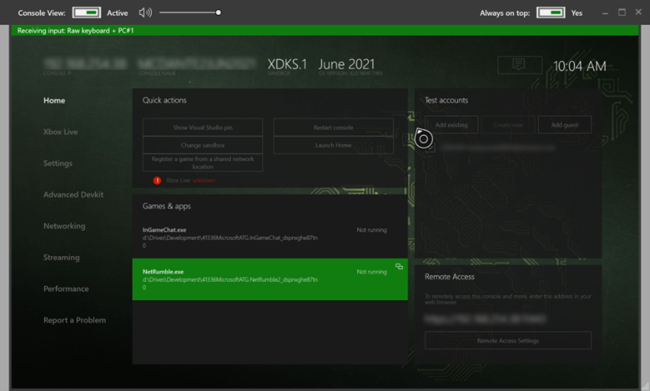

The **Edit > Preferences > Web Proxy > Prompt to disable Xbox proxy on close**
setting applies immediately to existing tabs. When enabled, closing a device tab
or exiting XMAT (including **File > Exit** and the window close button) prompts for
each reachable console whose proxy is enabled. **Yes** disables proxying and reboots
the console; **No** leaves settings unchanged. Imported read-only captures do not prompt.

Tabs left open when XMAT exits are remembered and reopened at the next start. Their
connections lists remain empty until proxying resumes.

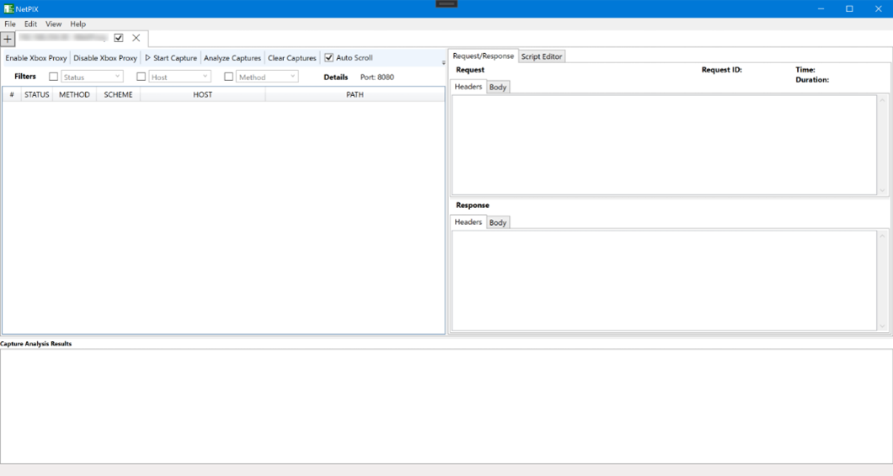

For unexpected exits and Local PC proxy restoration, see
[Troubleshooting](troubleshooting.md#if-xmat-closes-unexpectedly).
