# Web proxy

[Back to README](../README.md) | [Getting started](getting-started.md)

Capture and inspect web requests, responses, and WebSocket messages from a device.
XMAT automates the console proxy setup traditionally described under "Fiddler" in
the GDK documentation.

The toolbar below the selected capture tab spans the traffic and inspector panes.
**Start/Stop Capture**, **Analyze Capture**, and **Clear Capture** apply to that
capture, not to the individual pane or every open capture tab. Pane dividers appear
on hover, while dragging, or when keyboard-focused; their wider grab areas remain
available when the lines are hidden.

## Prerequisites

Check the [device requirements](../README.md#requirements) and start XMAT.
An Xbox kit must be reachable and ready for the reboots required when enabling or
disabling proxying. Generic devices must support a certificate and manual proxy settings.

## Add a device

1. Click the **+** tab and choose a device and the web proxy capture method.
2. Select **Default Xbox console** to use the designated default console without
   entering its IP address, or **Xbox console by address** to enter it.
3. Click **Add capture**. A new device/capture tab opens with an empty connections list.

The kit shown above runs the June 2021 recovery and is set to the Dev Home experience.

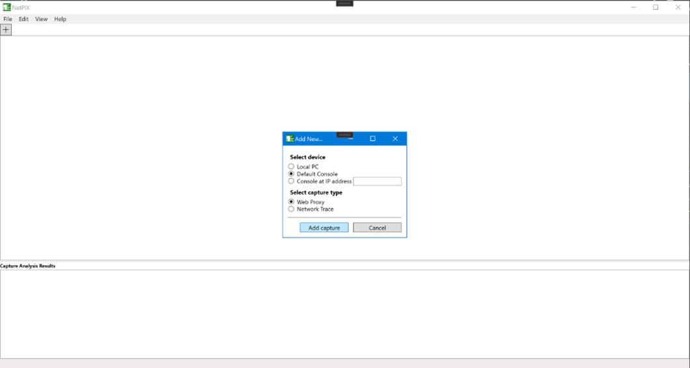

### Automatic proxy ports

Open **Edit > Preferences > Web Proxy** to change the available automatic proxy ports.
The example below uses port 8080.

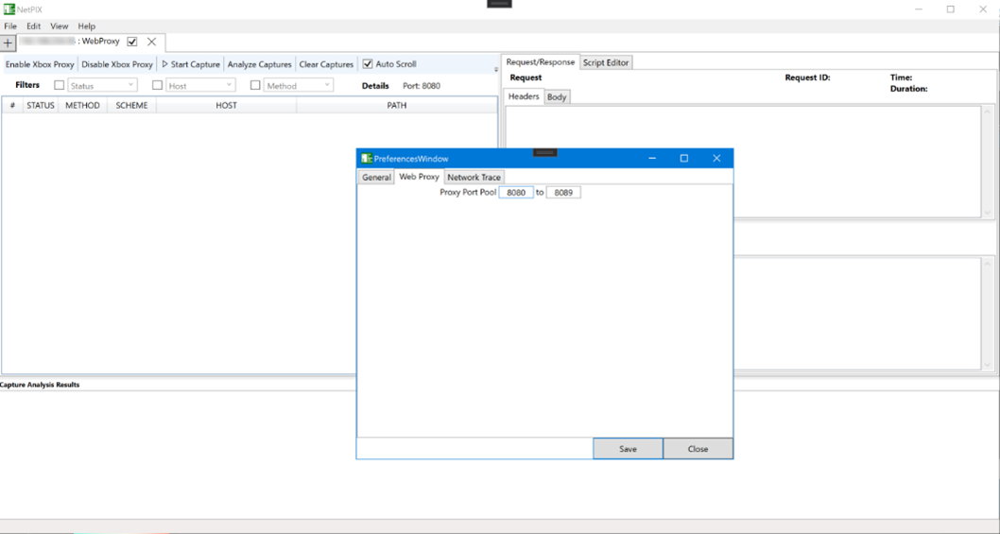

Changing the automatic range does not change an existing device session's assigned
port or free its reservation. Each open capture keeps its port reserved even while
stopped and after remembered devices are restored.

Only one managed proxy endpoint is supported per device. Adding a known device
selects its existing tab rather than creating a second proxy session. A separate
Network Trace capture and read-only imported captures are still supported.

## Enable console proxying

1. Select the console's capture tab.
2. Make sure the kit is ready to reboot, then click **Enable Xbox Proxy**.
3. Wait for the console to restart, then generate web traffic from an app.

**Warning:** enabling proxying reboots the kit and starts the local proxy immediately.
Proxy settings persist across console reboots and XMAT restarts until you explicitly
disable them.

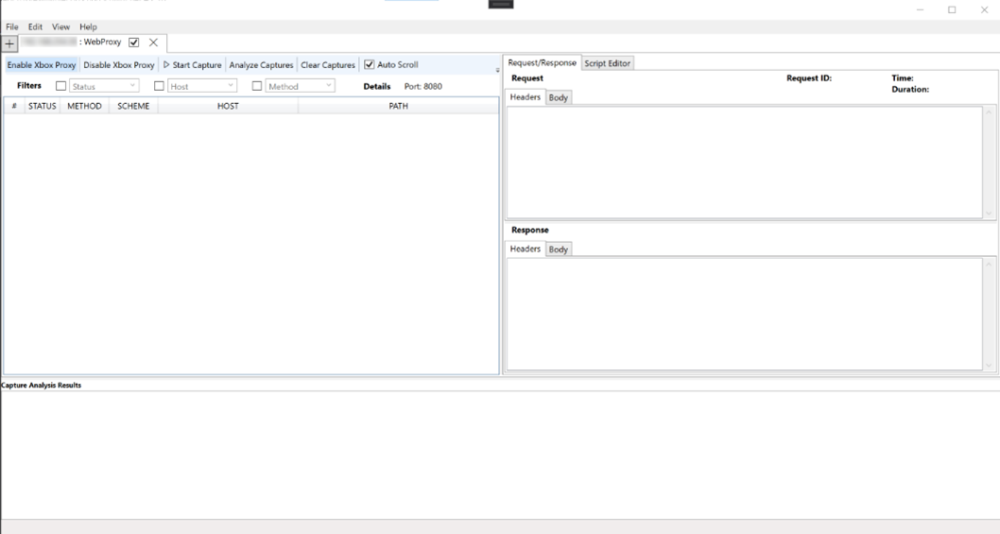

The console's "Fiddler enabled" notification indicates successful proxy setup even
though Fiddler itself is not running.

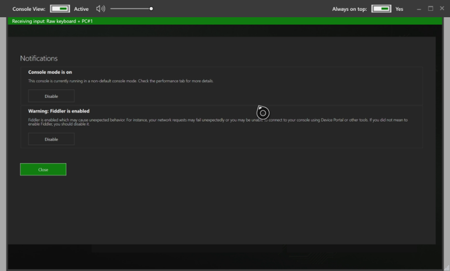

**Expected result:** connections populate the capture's connections list.

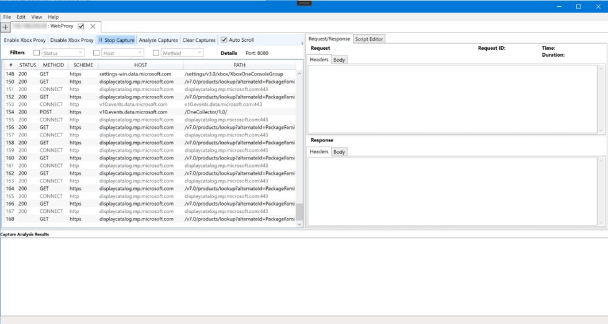

**Stop Capture** stops only the local listener; it does not disable or reboot the
console. **Disable Xbox Proxy** remains available while capture is stopped or after
a failed start, so clearing stale console settings does not require starting a listener.

### Check device settings

**Check Proxy Status** reports the Xbox endpoint instead of treating any nonempty
proxy host as a match. Re-enabling a verified matching endpoint does not rewrite
settings or request another reboot. A different existing endpoint is not overwritten
automatically.

This action is not available for Local PC captures. Generic/manual devices offer
**Proxy Setup Details**, which displays connection instructions rather than querying
device state.

If endpoint verification fails, see [Xbox proxy recovery](troubleshooting.md#xbox-proxy-recovery).

## Change a proxy port

1. Select the device's existing tab and stop capture.
2. Choose **Actions > Change Proxy Port**.
3. Choose an unassigned port from **1 through 65535**. It may be outside the automatic
   range in Preferences.
4. Choose when to apply the change:

| Choice | Behavior |
|---|---|
| **Apply now** | Starts the replacement listener before changing device settings. Xbox proxying is disabled/re-enabled with the required restarts; the console may reboot twice. The popup explains this before consent. Other devices remain stoppable during restarts. |
| **Later** | Saves a pending replacement without changing the device or current assigned port. Both ports stay protected, including after XMAT restarts. Starting/enabling the capture offers the change again; **Discard pending change** keeps the current port. |
| **Cancel** | Closes the popup without accepting a new selection. |

Capture history, filters, and selection are retained. The bottom status bar shows
the selected capture's running/stopped state, assigned port, and pending-change or
device-configuration details. Endpoint confirmation is separate from local capture
activity, so stopping capture does not leave a message claiming it is still running.

**Warning:** canceling an apply prevents later steps, but a console reboot or SDK
operation already requested cannot be undone. An in-flight mutation must settle.

XMAT reports binding, saving, or configuration failures and preserves assignments
needed for recovery rather than silently substituting ports. Once a replacement is
saved and the device may be using it, uncertain activation does not automatically
tear down its listener or revert to the old port. For Xbox, use **Check Proxy Status**
before retrying, stopping, or disabling.

For generic/manual devices, XMAT cannot edit settings remotely. Stop the device/app
using the old endpoint, confirm that in the popup, then update its settings to the
new endpoint shown by XMAT. Different apps can use independently configured generic
listeners, but two global proxy endpoints do not duplicate the same device traffic.

## Inspect requests and responses

1. Launch an app on the kit, such as the ATG NetRumble sample.
2. Select a connection to view its request and response.
3. Use **Headers** and **Body** to inspect formatted data and the connection details
   to see request time and duration.

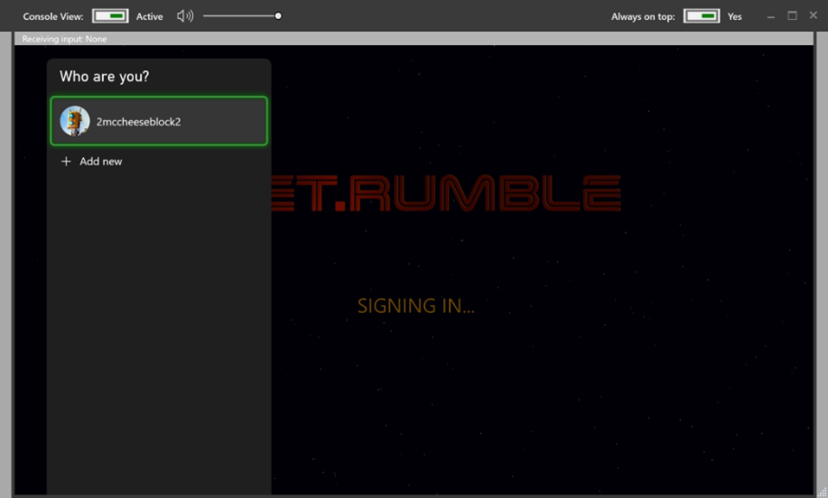

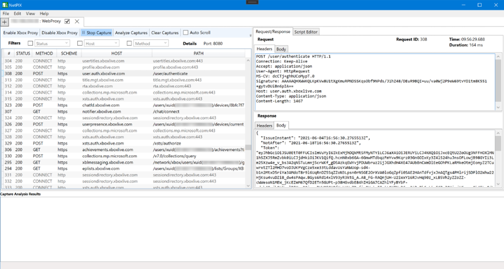

**Auto Scroll**, beside the timeline modes, is enabled by default to follow incoming connections. Turn it off
to keep a request in view. While a capture runs, a red dot and **Capturing** appear beside it. In a narrow traffic
pane, both move to a line of their own under the modes. Status codes appear when responses arrive.

### Filter connections

Use the toolbar lists to filter by status code, host, or method. Lists contain the
values found in the capture; only checked values are shown. Filters combine and
update as traffic arrives. **ALL/NONE** helps include or exclude a small set of values.
Status codes of 400 or higher are colored red.

When the traffic pane is too narrow for the filters, the new look folds them into a
**Filters** button with a funnel icon. The button opens a list of the same filters, and
a dot on it shows that a filter is on. The filters return to their row when it is wide
enough again. A process filter's summary stays in view on its line under the button.

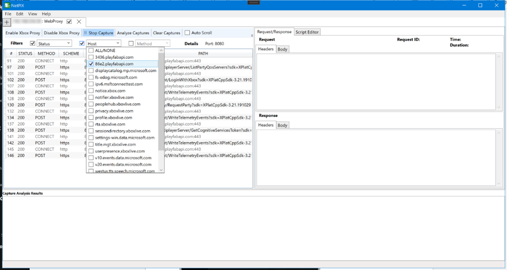

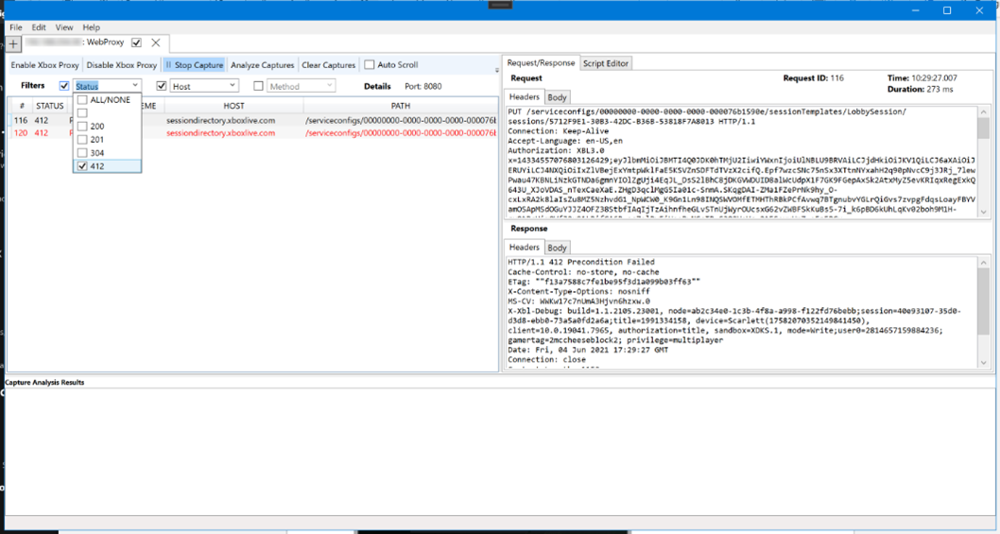

With **New look** on, every column header other than **#** has an info icon at its
right end. Select it to see how that column's values are spread over the connections
the list shows: the six most common values, largest first, with counts and percentages,
then the rest in one row. The selected connection's value is highlighted. Select a
status, host or method to set that filter to the value, or a process to show only that
process; **Scheme** and **Path** have no filter. While capturing, the counts hold still
while the summary is open; open it again to count new connections. Select the icon
again, press Esc or click outside the summary to close it. Selecting the rest of the
header still sorts the list by that column.

From the keyboard, Tab reaches the header icons as one stop, and Left and Right move
between them. Enter, Space or Alt+Down opens the summary with focus on its first value:
Up and Down move through the values, Enter chooses one, and Esc closes the summary and
returns focus to the icon. Tab from the icons moves on to the list.

### Filter by process

Through a PC proxy, other programs on the PC, such as browsers, chat apps, updaters
and Windows services, send their traffic through XMAT too. The **PROCESS** column
shows the program that opened each connection on this PC, by image name and process
id, such as `Game.exe (1234)`. It shows **Resolving…** while XMAT looks the program
up, **Remote device** for traffic from a console or another device, and **Unknown**
when the program could not be identified, for example because it had already exited,
or when the capture was recorded before XMAT stored this information. XMAT stores the
image name, never the program's path.

To focus on one program:

- Right-click a request or a timeline bar and choose **Show only "Game.exe"**, or
  **Hide "Name"** to hide that program. **Show all processes** clears the process
  filter.
- Or select **Process** in the filter bar and enter image names or process ids,
  separated by semicolons, under **Show only** and **Hide**. Names ignore case, `*`
  and `?` are wildcards (`game*.exe`), and `.exe` is optional; a number is a process
  id. The filter applies shortly after you stop typing, or when you press Enter or
  **Apply**. **Hide svchost.exe** hides Windows' service host processes.

While a process filter is set, a line under the filters shows **Process filter: N/M;
H hidden; U unknown** and **Show all processes** (the original look shows them at the
end of the filter bar): the sessions that the process filter shows out of all sessions
in the tab, how many it hides, and how many have no process information. Sessions without
process information appear only while **Show only** is empty. A session whose program
is identified after it appears is shown or hidden at that moment, without reloading
the list. The process filter combines with the status, host and method filters, and
**Show all processes** leaves those filters unchanged.

The process filter only hides sessions: XMAT still forwards and records all traffic
from every program, and saving, the **File** exports and analysis use the full capture
unless you choose otherwise: analyze only the filtered sessions (see
[Live trace analysis](live-trace-analysis.md)), or right-click a request and choose
**Export Visible Sessions...**, which exports what every filter of the list shows, or
**Export Selected Sessions...** (see
[Capture files](capture-files.md#export-selected-or-visible-sessions)). Each capture tab has its own process
filter, which [clearing the capture](#clear-a-capture) keeps and which is not saved.
The timeline follows the process filter, but not the status, host and method filters.

### Traffic overview

With **New look** on, the traffic overview between the filters and the timeline sums up
the connections that every filter shows, the same ones as the list: how many requests
there are, with a line of requests per second over the capture; how many fall in each
status class, in the timeline's colors (2xx, 3xx, 4xx, 5xx, and **No status** for
requests without a status yet); and the three busiest hosts. While a capture runs, it
updates once a second, and the line ends at the last full second, whose rate shows
beside **Requests**. Hover over a status class or a host for its count and share.
Select a status class (in the bar or its legend) or a host to set the **Status** or
**Host** filter to it alone; select it again to clear that filter. From the keyboard,
Tab moves to the status classes and to the hosts, the arrow keys move within them, and
Enter selects. In a narrow pane the busiest hosts go first, then the status becomes a
line of text with successes and errors. The arrow at the overview's top right hides it,
and **Show overview** brings it back in every capture tab; XMAT remembers the choice.

### Capture timeline

Bars are colored by response status: 2xx, 3xx, 4xx, 5xx, or no status yet. With
**New look** on, a bar's label starts with its status code. Hover over a bar for its
URL, status, time and duration. The connections list shows the same requests and
works with the keyboard and screen readers.

The Waterfall and By Host views retain complete capture history, including gaps
between capture sessions. Only visible request bars, host labels, and time-axis ticks
are rendered, so scrolling into older history does not rebuild the entire timeline.

Incoming changes are combined into at most ten timeline refreshes per second. This
limits presentation only, not request capture or storage. Scrolling, resizing,
switching modes, and stopping refresh the visible timeline without waiting for the
live-update cadence. Stopping displays final response statuses and durations even
if no further requests arrive.

With **New look** on, **Volume** shows requests per second as a line instead of
bars. While a capture runs, it shows the last 60 seconds, one point per second, and
moves left once a second; a line along zero means nothing is arriving. After you stop,
or for a saved capture, it fits the whole capture to the width; when there is no room
for every second, each point is the average per second over a step of 2 seconds or
more. The top right shows the last second's rate, or the total and the busiest second.
Hover over the chart for a point's time and request count, and click a point to select
its first request. Like the bars, Volume follows the process filter but not the status,
host and method filters.

### Clear a capture

**Clear Capture** in the capture toolbar, or **View > Clear Captures**, removes the
tab's requests and WebSocket messages; a running capture keeps capturing. Connections
that are still open can add new rows afterwards, and the tab keeps its process filter.

Request and connection numbers keep increasing after clearing; they no longer restart
at 1. This is intentional: data that arrives later on a connection opened before the
clear can never be matched to a newer request with the same number. **Stop Capture**
followed by **Start Capture** starts numbering at 1 again.

Clearing never overlaps saving, exporting, importing or analyzing captures: **Clear
Capture** is unavailable while one of them runs, and if one starts at the same moment,
XMAT reports that another capture operation is in progress and clears nothing.

### Delete sessions

Select sessions in the capture list and press **Delete**, or right-click one and choose
**Delete Selected Sessions**. **Shift+Delete** (**Delete Unselected Sessions**) deletes
the visible sessions that are not selected and keeps the selected ones. Only sessions
that the list shows are deleted: sessions that the Status, Host, Method or process
filters hide stay in the capture. The keys delete only in the capture list, never in
the timeline or the filter boxes.

XMAT asks first, with **Cancel** as the default answer. The confirmation counts the
sessions to delete, the sessions that stay (including hidden ones) and the sessions to
delete that have no complete recorded response. Deleting cannot be undone. Sessions that
arrive while the confirmation is open, and sessions that a filter hides by the time you
confirm, are kept, and XMAT then reports how many it deleted and kept.

You can delete sessions while the capture runs. XMAT keeps forwarding the traffic of a
deleted session that is still in progress, but does not record the rest of it. Deleting
never closes or blocks connections on purpose, but deleting a very large number of
sessions can briefly pause the window and delay the handling of requests.

Opened capture files and imported Fiddler archives are read-only, so their delete
commands are unavailable; [export the sessions to keep](capture-files.md#export-selected-or-visible-sessions)
instead. Like clearing, deleting never overlaps saving, exporting, importing or
analyzing captures.

Deleting changes only the capture in its tab. XMAT does not erase files that you saved
or exported earlier, backups of them, or analysis reports that you generated; they still
contain the deleted sessions. Analyses of the capture become historical; see
[Read the Per Endpoint report](live-trace-analysis.md#read-the-per-endpoint-report).

In the capture, XMAT overwrites the stored data of deleted sessions with zeros (SQLite
`secure_delete`), so a capture that you save afterwards does not contain their payloads.
Database pages that the deletion frees entirely can be reused for new sessions, but
pages that still hold other sessions stay allocated, and new sessions, which XMAT
appends, may not reuse their free space. Neither the capture nor a file saved from it
necessarily gets smaller: XMAT never compacts them (no `VACUUM` or incremental vacuum).
XMAT also releases its references to the deleted sessions, but .NET frees their memory
only at a later garbage collection, which XMAT does not force, and the working set that
Windows reports may not shrink even then. Deleting is not a forensic erasure: other
copies of the data, and data that Windows or the storage device still hold, are beyond
XMAT's reach.

## Block or bypass hosts

The **Block List** and **Bypass List** are shared by every capture in the current
session, including imported captures and captures created later. Closing a tab keeps
them; exiting XMAT clears them. Each capture's list tabs edit the same lists, so
changes, including **Clear All**, affect every capture.

1. Right-click a host in the connections list, a timeline bar or By Host label, or
   an analysis Per Endpoint summary row or details header.
2. Add or remove that exact host. **Remove** appears only for an existing exact entry;
   the menu notes any other entry that still matches.
3. Use **Actions > Manage Host Lists...** to open the editors even without a selected capture.

The menu key acts on the focused row, not the selected row.

| List | Effect |
|---|---|
| **Block** | Captures requests but does not forward them. Applies to new requests immediately and wins if a host is in both lists. An already-open bypassed tunnel continues until closed. |
| **Bypass** | Skips HTTPS decryption for new CONNECT tunnels; open connections retain their mode. Tunnels appear only as CONNECT rows. Scripts and path-based block patterns cannot inspect them. Plain HTTP is never bypassed. This is not the Windows proxy bypass list. |

### Entry rules

- A host entry covers every port, but not subdomains. Use `*.example.com` for subdomains.
- DNS names are case-insensitive, but a final dot matters: `example.com.` and
  `example.com` are different entries.
- IP addresses match by address: `[::1]`, `::1`, and `0:0::1` are one entry. A complete
  IPv6 address such as `2001:db8::1:443` is an address, not a host and port.
- Ports are not allowed: `example.com:443`, `example.com:`, and `[::1]:443` are
  rejected with an explanation.
- Entries containing `*` or `/` are glob patterns, such as `example.com/api/*`.
  A colon in a pattern is literal, not a port filter.
- Path patterns compare the path and query as the proxy forwards them, after its URL
  normalization (`/public/../private/x` becomes `/private/x`).
- A Block entry matches the Host header, or the host the proxy connects to in network
  spelling: the target's host when a request names one (`GET http://host/path`), else
  the Host header, with IDN names in `xn--` form and IPv4 in dotted decimal
  (`Host: 0177.0.0.1` also matches `127.0.0.1`). Bypass entries ignore these spellings.
  Captured requests are still shown and exported as received.
- Write IPv6 patterns without brackets, such as `2001:db8::*` or `::1/api/*`.
  A bracketed IPv6 pattern is accepted but never matches, including one that matched
  HTTP/2 traffic in earlier versions.

Analysis endpoints offer host actions only if every request came from the same
captured host. Synthesized telemetry endpoints (such as `inGameEvents`), endpoints
combining hosts, and older data without host provenance explain why no action is available.

## View WebSocket messages

WebSocket connections through the proxy are captured automatically.

1. Open the capture's **WebSockets** tab to see messages in send/receive order.
2. Filter by **direction** (client to server or server to client) or **message type**
   (text, binary, or close).
3. Select a message and inspect its payload as **text**, formatted **JSON**, or
   **hexadecimal** bytes.

Only the most recent messages are retained: up to **5,000 messages or 32 MB of
payload per capture**, whichever limit is reached first. Individual payloads are
captured up to **1 MB**. WebSocket messages are **not saved to or loaded from
`.XMATCAP` files**.

## Stop proxying safely

1. Use **Stop Capture** to stop the local listener. Active proxy connections are
   canceled and new requests are no longer forwarded; captured data is retained
   when stopping and restarting.
2. To restore normal console routing, use **Disable Xbox Proxy**. This reboots the kit.

If stopping takes more than half a second, a progress dialog shows the shutdown
phase and pending capture callbacks or UI updates while the app remains responsive.

**Warning:** a console with proxying still enabled cannot successfully use Xbox
services while XMAT is not proxying for it. Service status checks may become "unknown."

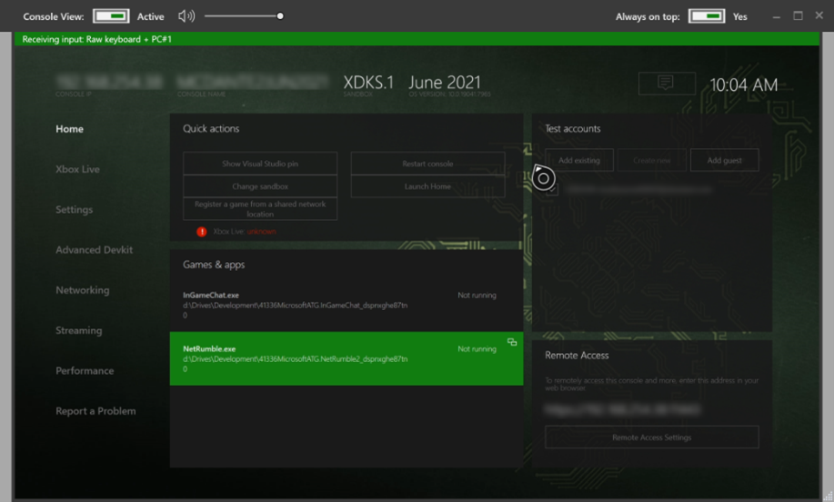

The **Edit > Preferences > Web Proxy > Prompt to disable Xbox proxy on close**
setting applies immediately to existing tabs. When enabled, closing a device tab
or exiting XMAT (including **File > Exit** and the window close button) prompts for
each reachable console whose proxy is enabled. **Yes** disables proxying and reboots
the console; **No** leaves settings unchanged. Imported read-only captures do not prompt.

Tabs left open when XMAT exits are remembered and reopened, in the same order, at the
next start. Their connections lists remain empty until proxying resumes.

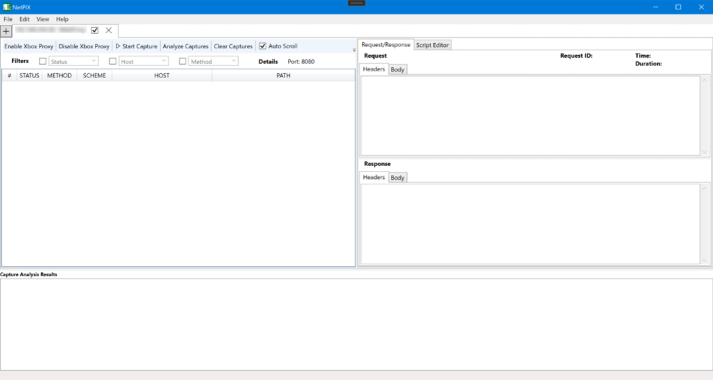

For unexpected exits and Local PC proxy restoration, see
[Troubleshooting](troubleshooting.md#if-xmat-closes-unexpectedly).
